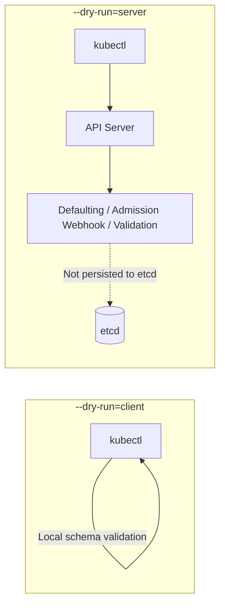

kubectl is a command-line tool for interacting with a Kubernetes cluster.

## Basic Concepts

kubectl manages cluster resources by making **REST calls** to the Kubernetes API server.

### kubectl Command Examples

```bash
kubectl get pods          # GET request - list Pods
kubectl create -f pod.yaml  # POST request - create a Pod
kubectl apply -f deploy.yaml  # PUT/PATCH request - update a resource
kubectl delete pod my-pod  # DELETE request - delete a Pod
```

## How It Works

- **REST API calls:** Sends HTTP REST requests to the Kubernetes API server (kube-apiserver)
- **Authentication/authorization:** Uses the kubeconfig file to authenticate to the cluster and verify permissions
- **Resource management:** Create/read/update/delete Kubernetes resources such as Pod, Deployment, and Service

### REST Call Structure

```
kubectl → HTTPS REST API → kube-apiserver → etcd
```


---

## --dry-run Option: client vs server

`--dry-run` is used to test in advance whether a command or manifest is error-free, without actually creating or modifying resources in the cluster. The biggest difference between `client` and `server` is **where validation is performed, and whether it communicates with the API server**.



### 1. --dry-run=client (Client-side validation)

- **How it works**: Processed only inside the client (kubectl) that sent the request. It does not communicate with the Kubernetes API server.
- **Validation scope**: Based on the schema kubectl has, it validates basic syntax, YAML structure, missing required fields, and so on.
- **Characteristics and limitations**
  - Since it does not go through the API server, it runs quickly even without a cluster connection.
  - It cannot check server-side Defaulting, Admission Webhooks (Mutating/Validating), detailed validation of custom resources (CRDs), etc.
  - It has been the default behavior of `--dry-run` since Kubernetes v1.18.

### 2. --dry-run=server (Server-side validation)

- **How it works**: Sends the request to the Kubernetes API server for processing. The only difference is that the resource is not actually persisted to the etcd database.
- **Validation scope**: Performs every step the API server goes through when actually creating a resource.
- **Characteristics and limitations**
  - Because it communicates with the API server, the real cluster environment (RBAC permissions, API versions, cluster state, etc.) is reflected.
  - You can see how server-side Defaulting is applied.
  - You can test whether Mutating and Validating Admission Webhooks work correctly.
  - It requires a cluster connection and is slightly slower than the client mode.

### 📊 Summary Comparison Table

| Category | `--dry-run=client` | `--dry-run=server` |
|------|--------------------|--------------------|
| Executor | Client (kubectl) | Kubernetes API server |
| Communicates with API server | No | Yes |
| Persisted to etcd | Not persisted | Not persisted |
| Defaults applied | Not applied (client is unaware) | Applied (filled in by the server) |
| Webhook validation | Not possible | Possible (Mutating / Validating) |
| Speed | Very fast | Relatively slow (network communication required) |
| Example use | Quick syntax check of YAML structure | Accurately testing an Admission Controller or the result of default application |

### Usage Examples

```bash
# Client-side: generate a manifest template (no cluster connection needed)
kubectl run web --image=nginx --dry-run=client -o yaml > pod.yaml

# Server-side: validate including Defaulting / Admission / RBAC
kubectl apply -f pod.yaml --dry-run=server

# Also view the defaults filled in by the server
kubectl apply -f pod.yaml --dry-run=server -o yaml
```

> 💡 **Tip**: In practice, when validating a CI/CD pipeline or a complex manifest, it is safer to use `--dry-run=server`, which can accurately simulate webhooks and defaults.


---

## Advanced Command Examples (custom-columns · jsonpath · sorting/filtering)

By combining `-o custom-columns`, `-o jsonpath`, `--sort-by`, and `--field-selector`, you can extract just the information you need without any extra tools. The output examples are based on a 3-node kind cluster (1 control-plane, 2 workers).

> `custom-columns` format: join `Header:JSONPath` pairs with commas. Check the field path first with `kubectl get <resource> -o yaml`.

### 1. Check Taints per Node

```bash
kubectl get no -o custom-columns=NAME:.metadata.name,TAINTS:.spec.taints
```
```
NAME                TAINTS
cka-control-plane   [map[effect:NoSchedule key:node-role.kubernetes.io/control-plane]]
cka-worker          <none>
cka-worker2         <none>
```

If you want to see only the Taint keys cleanly, use jsonpath.
```bash
kubectl get no -o jsonpath='{range .items[*]}{.metadata.name}{"\t"}{.spec.taints[*].key}{"\n"}{end}'
```

### 2. See at a Glance Which Node/IP a Pod Is Running On

```bash
kubectl get po -A -o custom-columns=NS:.metadata.namespace,POD:.metadata.name,NODE:.spec.nodeName,IP:.status.podIP
```
```
NS            POD                       NODE         IP
kube-system   coredns-76f75df574-abcde  cka-worker   10.244.1.2
default       web-6d4cf56db6-xyz12      cka-worker2  10.244.2.3
```

### 3. Allocatable Resources per Node

```bash
kubectl get no -o custom-columns=NAME:.metadata.name,CPU:.status.allocatable.cpu,MEM:.status.allocatable.memory,PODS:.status.allocatable.pods
```
```
NAME                CPU   MEM         PODS
cka-control-plane   4     8038828Ki   110
cka-worker          4     8038828Ki   110
```

### 4. List of All Container Images in Use in the Cluster

```bash
kubectl get po -A -o jsonpath='{range .items[*]}{.metadata.namespace}{"/"}{.metadata.name}{"\t"}{.spec.containers[*].image}{"\n"}{end}'

# Count by image
kubectl get po -A -o jsonpath='{.items[*].spec.containers[*].image}' | tr ' ' '\n' | sort | uniq -c | sort -rn
```

### 5. Find Pods with Many Restarts (Sorting)

```bash
kubectl get po -A --sort-by='.status.containerStatuses[0].restartCount'
```
Sorting is ascending, so the last line is the Pod with the highest restart count.

### 6. List Only Pods That Are Not Running (Field Selector)

```bash
kubectl get po -A --field-selector=status.phase!=Running
kubectl get po -A --field-selector=spec.nodeName=cka-worker    # Pods on a specific node only
```

### 7. View Recent Events in Chronological Order

```bash
kubectl get events -A --sort-by=.lastTimestamp
kubectl get events -A --field-selector type=Warning
```

### 8. Print Node Labels as Columns (`-L`)

```bash
kubectl get no -L kubernetes.io/arch,topology.kubernetes.io/zone
```
```
NAME                STATUS   ROLES           AGE   VERSION   ARCH    ZONE
cka-control-plane   Ready    control-plane   10d   v1.30.0   amd64   <none>
```

### 9. Set-based Label Selectors

```bash
kubectl get po -l 'app in (web,api),tier!=db'
kubectl get po -l '!canary'            # Pods without the canary label
```

### 10. Permission Check: What Can I / Another Account Do (`auth can-i`)

```bash
kubectl auth can-i create deployments -n dev
kubectl auth can-i list secrets -n kube-system --as system:serviceaccount:default:default
kubectl auth can-i --list -n dev                 # Full list of permissions for the current account
```

### 11. Decode a Secret Value

```bash
kubectl get secret db-secret -o jsonpath='{.data.password}' | base64 -d
```

### 12. Top Pods by Resource Usage (requires metrics-server)

```bash
kubectl top po -A --sort-by=memory | head
kubectl top no
```

### 13. Wait Until a Condition Is Met (`wait`) - Useful in Scripts/CI

```bash
kubectl wait --for=condition=Ready pod -l app=web --timeout=60s
kubectl wait --for=condition=Available deploy/web --timeout=120s
kubectl wait --for=delete pod/web-0 --timeout=60s
```

### 14. Preview Changes Before Applying (`diff`)

```bash
kubectl diff -f deploy.yaml
```
While `--dry-run=server` checks "whether there are errors", `diff` shows "what will change".

### 15. Logs from Multiple Pods at Once (label selector + prefix)

```bash
kubectl logs -l app=web --all-containers --prefix --tail=20 -f
```

### 16. Debugging: Ephemeral Container / Node Debug

```bash
# Attach an ephemeral container to a running Pod (debugging images without a shell)
kubectl debug -it web-6d4cf56db6-xyz12 --image=busybox:1.36 --target=nginx

# Launch a debug Pod on a node to inspect the host filesystem (/host)
kubectl debug node/cka-worker -it --image=busybox:1.36
```

### 17. Exploring API Resources

```bash
kubectl api-resources --namespaced=false          # Cluster-scoped resources
kubectl api-resources --api-group=apps -o wide    # Resources by group and supported verbs
kubectl explain pod.spec.containers.livenessProbe --recursive
```

### 18. Check/Change the Namespace of the Current Context

```bash
kubectl config view --minify -o jsonpath='{..namespace}'
kubectl config set-context --current --namespace=dev
```

> 💡 **Tip**: JSONPath filters can be written in the form `[?(@.type=="InternalIP")]`.
> ```bash
> kubectl get no -o jsonpath='{.items[*].status.addresses[?(@.type=="InternalIP")].address}'
> ```
