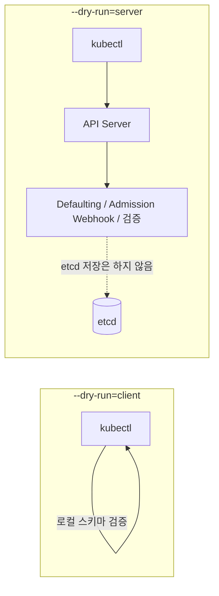

kubectl 은 Kubernetes 클러스터와 상호작용하기 위한 명령줄 도구입니다.

## 기본 개념

kubectl 은 Kubernetes API 서버에 **REST 호출**을 수행하여 클러스터의 리소스를 관리합니다.

### kubectl 명령어 예시

```bash
kubectl get pods          # GET 요청 - 파드 목록 조회
kubectl create -f pod.yaml  # POST 요청 - 파드 생성
kubectl apply -f deploy.yaml  # PUT/PATCH 요청 - 리소스 업데이트
kubectl delete pod my-pod  # DELETE 요청 - 파드 삭제
```

## 동작 방식

- **REST API 호출:** Kubernetes API 서버 (kube-apiserver) 에 HTTP REST 요청을 전송
- **인증/인가:** kubeconfig 파일을 사용하여 클러스터 인증 및 권한 확인
- **리소스 관리:** Pod, Deployment, Service 등 Kubernetes 리소스 생성/조회/수정/삭제

### REST 호출 구조

```
kubectl → HTTPS REST API → kube-apiserver → etcd
```


---

## --dry-run 옵션: client vs server

`--dry-run` 은 실제 리소스를 클러스터에 생성하거나 수정하지 않고, 명령어나 매니페스트에 오류가 없는지 미리 테스트할 때 사용합니다. `client` 와 `server` 방식의 가장 큰 차이는 **검증을 어디서 수행하며, API 서버와 통신하는지 여부**입니다.



### 1. --dry-run=client (클라이언트 측 검증)

- **동작 방식**: 요청을 보낸 클라이언트(kubectl) 내부에서만 처리됩니다. Kubernetes API 서버와 통신하지 않습니다.
- **검증 범위**: kubectl 이 가진 스키마를 바탕으로 기본적인 문법, YAML 구조, 필수 필드 누락 여부 등을 검증합니다.
- **특징 및 한계**
  - API 서버를 거치지 않으므로 클러스터 연결 없이도 빠르게 실행할 수 있습니다.
  - 서버 측 기본값(Defaulting) 적용, Admission Webhook(Mutating/Validating), 커스텀 리소스(CRD)의 세부 유효성 검사 등은 확인할 수 없습니다.
  - Kubernetes v1.18 부터 `--dry-run` 의 기본 동작으로 적용됩니다.

### 2. --dry-run=server (서버 측 검증)

- **동작 방식**: 요청을 Kubernetes API 서버로 전송하여 처리합니다. 단, etcd 데이터베이스에 리소스를 실제로 저장(persist)하지만 않을 뿐입니다.
- **검증 범위**: API 서버가 실제 리소스 생성 시 거치는 모든 단계를 수행합니다.
- **특징 및 한계**
  - API 서버와 통신하므로 실제 클러스터 환경(RBAC 권한, API 버전, 클러스터 상태 등)이 반영됩니다.
  - 서버 측 기본값(Defaulting)이 어떻게 적용되는지 확인할 수 있습니다.
  - Mutating 및 Validating Admission Webhook 이 정상적으로 동작하는지 테스트할 수 있습니다.
  - 클러스터 연결이 필요하며 client 방식에 비해 속도가 약간 더 느립니다.

### 📊 요약 비교표

| 구분 | `--dry-run=client` | `--dry-run=server` |
|------|--------------------|--------------------|
| 실행 주체 | 클라이언트 (kubectl) | Kubernetes API 서버 |
| API 서버 통신 | 안 함 | 함 |
| etcd 저장 여부 | 저장 안 함 | 저장 안 함 |
| 기본값(Default) 적용 | 미적용 (클라이언트가 모름) | 적용됨 (서버가 채워줌) |
| Webhook 검증 | 불가능 | 가능 (Mutating / Validating) |
| 속도 | 매우 빠름 | 상대적으로 느림 (네트워크 통신 필요) |
| 사용 예시 | YAML 구조를 빠르게 문법 검사할 때 | Admission Controller 나 기본값 적용 결과를 정확히 테스트할 때 |

### 사용 예시

```bash
# 클라이언트 측: 매니페스트 템플릿 생성 (클러스터 연결 불필요)
kubectl run web --image=nginx --dry-run=client -o yaml > pod.yaml

# 서버 측: Defaulting / Admission / RBAC 까지 반영하여 검증
kubectl apply -f pod.yaml --dry-run=server

# 서버가 채워준 기본값까지 확인
kubectl apply -f pod.yaml --dry-run=server -o yaml
```

> 💡 **팁**: 실무에서는 CI/CD 파이프라인이나 복잡한 매니페스트를 검증할 때, 웹훅과 기본값까지 정확히 시뮬레이션할 수 있는 `--dry-run=server` 를 사용하는 것이 더 안전합니다.
