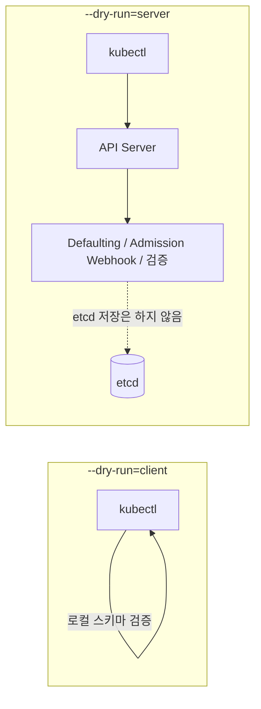

kubectl 은 Kubernetes 클러스터와 상호작용하기 위한 명령줄 도구입니다.

## 기본 개념

kubectl 은 Kubernetes API 서버에 **REST 호출**을 수행하여 클러스터의 리소스를 관리합니다.

### kubectl 명령어 예시

```bash
kubectl get pods          # GET 요청 - 파드 목록 조회
kubectl create -f pod.yaml  # POST 요청 - 파드 생성
kubectl apply -f deploy.yaml  # PUT/PATCH 요청 - 리소스 업데이트
kubectl delete pod my-pod  # DELETE 요청 - 파드 삭제
```

## 동작 방식

- **REST API 호출:** Kubernetes API 서버 (kube-apiserver) 에 HTTP REST 요청을 전송
- **인증/인가:** kubeconfig 파일을 사용하여 클러스터 인증 및 권한 확인
- **리소스 관리:** Pod, Deployment, Service 등 Kubernetes 리소스 생성/조회/수정/삭제

### REST 호출 구조

```
kubectl → HTTPS REST API → kube-apiserver → etcd
```


---

## --dry-run 옵션: client vs server

`--dry-run` 은 실제 리소스를 클러스터에 생성하거나 수정하지 않고, 명령어나 매니페스트에 오류가 없는지 미리 테스트할 때 사용합니다. `client` 와 `server` 방식의 가장 큰 차이는 **검증을 어디서 수행하며, API 서버와 통신하는지 여부**입니다.



### 1. --dry-run=client (클라이언트 측 검증)

- **동작 방식**: 요청을 보낸 클라이언트(kubectl) 내부에서만 처리됩니다. Kubernetes API 서버와 통신하지 않습니다.
- **검증 범위**: kubectl 이 가진 스키마를 바탕으로 기본적인 문법, YAML 구조, 필수 필드 누락 여부 등을 검증합니다.
- **특징 및 한계**
  - API 서버를 거치지 않으므로 클러스터 연결 없이도 빠르게 실행할 수 있습니다.
  - 서버 측 기본값(Defaulting) 적용, Admission Webhook(Mutating/Validating), 커스텀 리소스(CRD)의 세부 유효성 검사 등은 확인할 수 없습니다.
  - Kubernetes v1.18 부터 `--dry-run` 의 기본 동작으로 적용됩니다.

### 2. --dry-run=server (서버 측 검증)

- **동작 방식**: 요청을 Kubernetes API 서버로 전송하여 처리합니다. 단, etcd 데이터베이스에 리소스를 실제로 저장(persist)하지만 않을 뿐입니다.
- **검증 범위**: API 서버가 실제 리소스 생성 시 거치는 모든 단계를 수행합니다.
- **특징 및 한계**
  - API 서버와 통신하므로 실제 클러스터 환경(RBAC 권한, API 버전, 클러스터 상태 등)이 반영됩니다.
  - 서버 측 기본값(Defaulting)이 어떻게 적용되는지 확인할 수 있습니다.
  - Mutating 및 Validating Admission Webhook 이 정상적으로 동작하는지 테스트할 수 있습니다.
  - 클러스터 연결이 필요하며 client 방식에 비해 속도가 약간 더 느립니다.

### 📊 요약 비교표

| 구분 | `--dry-run=client` | `--dry-run=server` |
|------|--------------------|--------------------|
| 실행 주체 | 클라이언트 (kubectl) | Kubernetes API 서버 |
| API 서버 통신 | 안 함 | 함 |
| etcd 저장 여부 | 저장 안 함 | 저장 안 함 |
| 기본값(Default) 적용 | 미적용 (클라이언트가 모름) | 적용됨 (서버가 채워줌) |
| Webhook 검증 | 불가능 | 가능 (Mutating / Validating) |
| 속도 | 매우 빠름 | 상대적으로 느림 (네트워크 통신 필요) |
| 사용 예시 | YAML 구조를 빠르게 문법 검사할 때 | Admission Controller 나 기본값 적용 결과를 정확히 테스트할 때 |

### 사용 예시

```bash
# 클라이언트 측: 매니페스트 템플릿 생성 (클러스터 연결 불필요)
kubectl run web --image=nginx --dry-run=client -o yaml > pod.yaml

# 서버 측: Defaulting / Admission / RBAC 까지 반영하여 검증
kubectl apply -f pod.yaml --dry-run=server

# 서버가 채워준 기본값까지 확인
kubectl apply -f pod.yaml --dry-run=server -o yaml
```

> 💡 **팁**: 실무에서는 CI/CD 파이프라인이나 복잡한 매니페스트를 검증할 때, 웹훅과 기본값까지 정확히 시뮬레이션할 수 있는 `--dry-run=server` 를 사용하는 것이 더 안전합니다.


---

## 고급 명령어 예시 (custom-columns · jsonpath · 정렬/필터)

`-o custom-columns`, `-o jsonpath`, `--sort-by`, `--field-selector` 를 조합하면 별도 도구 없이 필요한 정보만 뽑아볼 수 있습니다. 출력 예시는 3노드(control-plane 1, worker 2) kind 클러스터 기준입니다.

> `custom-columns` 형식: `헤더:JSONPath` 를 쉼표로 연결합니다. 필드 경로는 `kubectl get <리소스> -o yaml` 로 먼저 확인하세요.

### 1. 노드별 Taint 확인

```bash
kubectl get no -o custom-columns=NAME:.metadata.name,TAINTS:.spec.taints
```
```
NAME                TAINTS
cka-control-plane   [map[effect:NoSchedule key:node-role.kubernetes.io/control-plane]]
cka-worker          <none>
cka-worker2         <none>
```

Taint 의 key 만 깔끔하게 보고 싶다면 jsonpath 를 사용합니다.
```bash
kubectl get no -o jsonpath='{range .items[*]}{.metadata.name}{"\t"}{.spec.taints[*].key}{"\n"}{end}'
```

### 2. Pod 가 어느 노드/IP 에서 실행 중인지 한눈에 보기

```bash
kubectl get po -A -o custom-columns=NS:.metadata.namespace,POD:.metadata.name,NODE:.spec.nodeName,IP:.status.podIP
```
```
NS            POD                       NODE         IP
kube-system   coredns-76f75df574-abcde  cka-worker   10.244.1.2
default       web-6d4cf56db6-xyz12      cka-worker2  10.244.2.3
```

### 3. 노드별 할당 가능(Allocatable) 리소스

```bash
kubectl get no -o custom-columns=NAME:.metadata.name,CPU:.status.allocatable.cpu,MEM:.status.allocatable.memory,PODS:.status.allocatable.pods
```
```
NAME                CPU   MEM         PODS
cka-control-plane   4     8038828Ki   110
cka-worker          4     8038828Ki   110
```

### 4. 클러스터에서 사용 중인 모든 컨테이너 이미지 목록

```bash
kubectl get po -A -o jsonpath='{range .items[*]}{.metadata.namespace}{"/"}{.metadata.name}{"\t"}{.spec.containers[*].image}{"\n"}{end}'

# 이미지 종류별 개수
kubectl get po -A -o jsonpath='{.items[*].spec.containers[*].image}' | tr ' ' '\n' | sort | uniq -c | sort -rn
```

### 5. 재시작이 많은 Pod 찾기 (정렬)

```bash
kubectl get po -A --sort-by='.status.containerStatuses[0].restartCount'
```
정렬은 오름차순이므로 가장 마지막 줄이 재시작 횟수가 가장 많은 Pod 입니다.

### 6. 정상(Running)이 아닌 Pod 만 조회 (필드 셀렉터)

```bash
kubectl get po -A --field-selector=status.phase!=Running
kubectl get po -A --field-selector=spec.nodeName=cka-worker    # 특정 노드의 Pod 만
```

### 7. 최근 이벤트를 시간순으로 보기

```bash
kubectl get events -A --sort-by=.lastTimestamp
kubectl get events -A --field-selector type=Warning
```

### 8. 노드 레이블을 컬럼으로 출력 (`-L`)

```bash
kubectl get no -L kubernetes.io/arch,topology.kubernetes.io/zone
```
```
NAME                STATUS   ROLES           AGE   VERSION   ARCH    ZONE
cka-control-plane   Ready    control-plane   10d   v1.30.0   amd64   <none>
```

### 9. 집합 기반 레이블 셀렉터

```bash
kubectl get po -l 'app in (web,api),tier!=db'
kubectl get po -l '!canary'            # canary 레이블이 없는 Pod
```

### 10. 권한 점검: 내가 / 다른 계정이 무엇을 할 수 있나 (`auth can-i`)

```bash
kubectl auth can-i create deployments -n dev
kubectl auth can-i list secrets -n kube-system --as system:serviceaccount:default:default
kubectl auth can-i --list -n dev                 # 현재 계정의 전체 권한 목록
```

### 11. Secret 값 디코딩

```bash
kubectl get secret db-secret -o jsonpath='{.data.password}' | base64 -d
```

### 12. 리소스 사용량 상위 Pod (metrics-server 필요)

```bash
kubectl top po -A --sort-by=memory | head
kubectl top no
```

### 13. 조건 충족까지 대기 (`wait`) - 스크립트/CI 에 유용

```bash
kubectl wait --for=condition=Ready pod -l app=web --timeout=60s
kubectl wait --for=condition=Available deploy/web --timeout=120s
kubectl wait --for=delete pod/web-0 --timeout=60s
```

### 14. 적용 전 변경점 미리 보기 (`diff`)

```bash
kubectl diff -f deploy.yaml
```
`--dry-run=server` 가 "오류가 없는가" 를 본다면, `diff` 는 "무엇이 바뀌는가" 를 보여줍니다.

### 15. 여러 Pod 로그를 한 번에 (레이블 셀렉터 + prefix)

```bash
kubectl logs -l app=web --all-containers --prefix --tail=20 -f
```

### 16. 디버깅: 임시 컨테이너 / 노드 디버그

```bash
# 실행 중인 Pod 에 임시(ephemeral) 컨테이너 붙이기 (shell 없는 이미지 디버깅)
kubectl debug -it web-6d4cf56db6-xyz12 --image=busybox:1.36 --target=nginx

# 노드에 디버그 Pod 를 띄워 호스트 파일시스템(/host) 확인
kubectl debug node/cka-worker -it --image=busybox:1.36
```

### 17. API 리소스 탐색

```bash
kubectl api-resources --namespaced=false          # 클러스터 범위 리소스
kubectl api-resources --api-group=apps -o wide    # 그룹별 리소스와 지원 verb
kubectl explain pod.spec.containers.livenessProbe --recursive
```

### 18. 현재 컨텍스트의 네임스페이스 확인/변경

```bash
kubectl config view --minify -o jsonpath='{..namespace}'
kubectl config set-context --current --namespace=dev
```

> 💡 **팁**: JSONPath 필터는 `[?(@.type=="InternalIP")]` 형태로 쓸 수 있습니다.
> ```bash
> kubectl get no -o jsonpath='{.items[*].status.addresses[?(@.type=="InternalIP")].address}'
> ```
