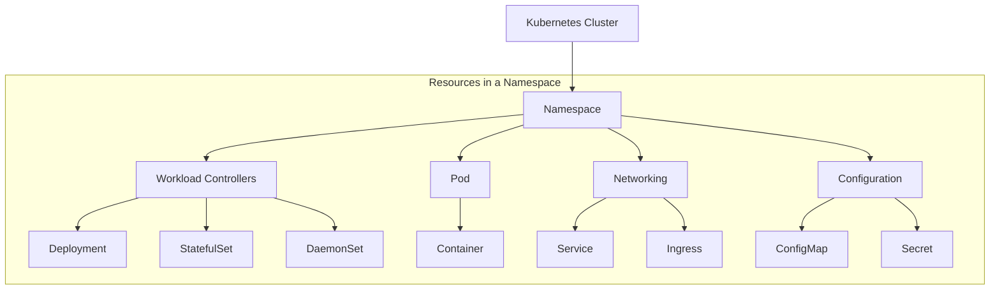

Kubernetes combines a variety of resource objects organically to build a cluster and run applications.

---

## 1. Resource Hierarchy

The resources inside a cluster form the following logical hierarchy.



---

## 2. Resource Relationship Diagram

Resources do not exist in isolation; they reference or contain one another.

| Relationship Type | Structure | Description |
|-----------|------|------|
| **Deployment structure** | `Deployment` → `ReplicaSet` → `Pod` | Declarative updates and replica management |
| **Network connectivity** | `Service` → `Endpoints` → `Pod` | Provides a stable access address and load balancing |
| **Configuration injection** | `ConfigMap/Secret` → `Pod` | Delivers configuration as environment variables or files (Volumes) |
| **Storage binding** | `Pod` → `PVC` → `PV` | Allocates persistent storage to the application |

---

## 3. Core Resource Summary

| Resource | Main Role |
|--------|----------|
| **Pod** | The smallest unit that runs in a cluster (a group of containers) |
| **Deployment** | Defines the desired state of an app and maintains it automatically (recommended for stateless apps) |
| **StatefulSet** | Manages apps where identity and order matter (stateful apps such as databases) |
| **Service** | Gives a fixed IP and name for accessing a set of Pods |
| **Namespace** | Separates a single cluster so that multiple teams or projects can share it |

---

## 4. Tips for Exploring Resources

To see every kind of resource available in the cluster, use the following commands.

```bash
# List all resources and their short names
kubectl api-resources

# Show the detailed spec structure of a specific resource
kubectl explain deployment.spec.template
```

**Understanding how these resources connect and work together is the key to operating Kubernetes.**

---

## 5. Common Resource Short Names

`kubectl` lets you enter resource names as short names. (e.g., `kubectl get po` = `kubectl get pods`)

### 5.1 Core Resources

| Short Name | Resource | Description |
|--------|--------|------|
| `no` | `nodes` | Node |
| `po` | `pods` | Pod |
| `svc` | `services` | Service |
| `ns` | `namespaces` | Namespace |
| `sa` | `serviceaccounts` | Service account |
| `ep` | `endpoints` | Endpoints |

### 5.2 Workloads and Scheduling

| Short Name | Resource | Description |
|--------|--------|------|
| `deploy` | `deployments` | Deployment |
| `rs` | `replicasets` | ReplicaSet |
| `rc` | `replicationcontrollers` | ReplicationController |
| `ds` | `daemonsets` | DaemonSet |
| `sts` | `statefulsets` | StatefulSet |
| `cj` | `cronjobs` | CronJob |
| (`job`) | `jobs` | Job (no separate short name; use `job` as is) |

### 5.3 Configuration and Storage

| Short Name | Resource | Description |
|--------|--------|------|
| `cm` | `configmaps` | ConfigMap |
| `pv` | `persistentvolumes` | PersistentVolume |
| `pvc` | `persistentvolumeclaims` | PersistentVolumeClaim |
| `sc` | `storageclasses` | StorageClass |
| (`secret`) | `secrets` | Secret (no separate short name; use `secret` as is) |

### 5.4 Networking and Security

| Short Name | Resource | Description |
|--------|--------|------|
| `netpol` | `networkpolicies` | NetworkPolicy |
| `ing` | `ingresses` | Ingress |
| (`role`) | `roles` | Role |
| (`rolebinding`) | `rolebindings` | RoleBinding |
| (`clusterrole`) | `clusterroles` | ClusterRole |
| (`clusterrolebinding`) | `clusterrolebindings` | ClusterRoleBinding |

> ⚠️ **Note**: RBAC resources (`roles`, `rolebindings`, `clusterroles`, `clusterrolebindings`) have no official short names. Notations such as `rb`, `crb`, and `crole` are not recognized by kubectl, so use the singular names (`role`, `rolebinding`, etc.) as shown above.

### 5.5 Usage Examples

```bash
kubectl get po,svc,deploy -n kube-system
kubectl get no -o wide
kubectl describe ds <name> -n <ns>
kubectl get sts,pvc
```

> 💡 **Tip**: You can find the exact short names for your cluster in the `SHORTNAMES` column of `kubectl api-resources`. Short names for resources added through CRDs are shown there as well.
