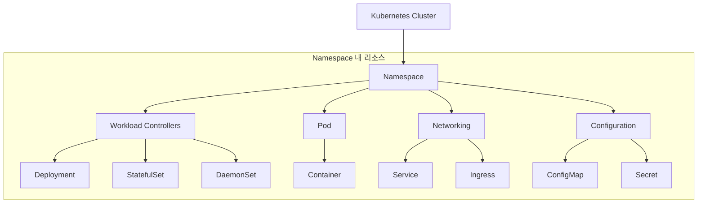

Kubernetes는 다양한 리소스 객체를 유기적으로 결합하여 클러스터를 구성하고 애플리케이션을 실행합니다.

---

## 1. 리소스 계층 구조

클러스터 내부의 리소스들은 논리적으로 다음과 같은 계층을 형성합니다.



---

## 2. 리소스 간 관계도

각 리소스는 독립적으로 존재하지 않고 서로를 참조하거나 포함하는 관계를 가집니다.

| 관계 유형 | 구조 | 설명 |
|-----------|------|------|
| **배포 구조** | `Deployment` → `ReplicaSet` → `Pod` | 선언적 업데이트와 복제본 관리 |
| **네트워크 연결** | `Service` → `Endpoints` → `Pod` | 안정적인 접속 주소 제공 및 로드밸런싱 |
| **설정 주입** | `ConfigMap/Secret` → `Pod` | 환경 변수나 파일(Volume) 형태로 설정 전달 |
| **저장소 연결** | `Pod` → `PVC` → `PV` | 애플리케이션에 영구 저장 공간 할당 |

---

## 3. 핵심 리소스 요약

| 리소스 | 주요 역할 |
|--------|----------|
| **Pod** | 클러스터에서 실행되는 가장 작은 단위 (컨테이너 묶음) |
| **Deployment** | 앱의 원하는 상태를 정의하고 자동으로 유지 (무상태 앱 권장) |
| **StatefulSet** | 정체성과 순서가 중요한 앱 관리 (DB 등 상태 저장 앱) |
| **Service** | Pod 집합에 접근하기 위한 고정된 IP와 이름을 부여 |
| **Namespace** | 하나의 클러스터를 여러 팀이나 프로젝트가 나눠 쓰도록 분리 |

---

## 4. 리소스 탐색 팁

클러스터 내에서 사용할 수 있는 모든 리소스 종류를 확인하려면 다음 명령어를 사용하세요.

```bash
# 전체 리소스 목록 및 약어 확인
kubectl api-resources

# 특정 리소스의 상세 스펙 구조 확인
kubectl explain deployment.spec.template
```

**이러한 리소스들이 어떻게 연결되어 동작하는지 이해하는 것이 Kubernetes 운영의 핵심입니다.**

---

## 5. 주요 리소스 축약어 (Short Names)

`kubectl` 에서는 리소스 이름을 축약어로 입력할 수 있습니다. (예: `kubectl get po` = `kubectl get pods`)

### 5.1 코어 리소스

| 축약어 | 리소스 | 설명 |
|--------|--------|------|
| `no` | `nodes` | 노드 |
| `po` | `pods` | 파드 |
| `svc` | `services` | 서비스 |
| `ns` | `namespaces` | 네임스페이스 |
| `sa` | `serviceaccounts` | 서비스 어카운트 |
| `ep` | `endpoints` | 엔드포인트 |

### 5.2 워크로드 및 스케줄링

| 축약어 | 리소스 | 설명 |
|--------|--------|------|
| `deploy` | `deployments` | 디플로이먼트 |
| `rs` | `replicasets` | 레플리카셋 |
| `rc` | `replicationcontrollers` | 레플리케이션 컨트롤러 |
| `ds` | `daemonsets` | 데몬셋 |
| `sts` | `statefulsets` | 스테이트풀셋 |
| `cj` | `cronjobs` | 크론잡 |
| (`job`) | `jobs` | 잡 (별도 축약어 없이 `job` 그대로 사용) |

### 5.3 설정 및 스토리지

| 축약어 | 리소스 | 설명 |
|--------|--------|------|
| `cm` | `configmaps` | 컨피그맵 |
| `pv` | `persistentvolumes` | 퍼시스턴트 볼륨 |
| `pvc` | `persistentvolumeclaims` | 퍼시스턴트 볼륨 클레임 |
| `sc` | `storageclasses` | 스토리지 클래스 |
| (`secret`) | `secrets` | 시크릿 (별도 축약어 없이 `secret` 그대로 사용) |

### 5.4 네트워크 및 보안

| 축약어 | 리소스 | 설명 |
|--------|--------|------|
| `netpol` | `networkpolicies` | 네트워크 정책 |
| `ing` | `ingresses` | 인그레스 |
| (`role`) | `roles` | 역할 |
| (`rolebinding`) | `rolebindings` | 역할 바인딩 |
| (`clusterrole`) | `clusterroles` | 클러스터 역할 |
| (`clusterrolebinding`) | `clusterrolebindings` | 클러스터 역할 바인딩 |

> ⚠️ **주의**: RBAC 리소스(`roles`, `rolebindings`, `clusterroles`, `clusterrolebindings`)는 공식 축약어가 없습니다. `rb`, `crb`, `crole` 같은 표기는 kubectl 이 인식하지 못하므로 위와 같이 단수형 이름(`role`, `rolebinding` 등)을 사용하세요.

### 5.5 사용 예시

```bash
kubectl get po,svc,deploy -n kube-system
kubectl get no -o wide
kubectl describe ds <name> -n <ns>
kubectl get sts,pvc
```

> 💡 **팁**: 사용 중인 클러스터의 정확한 축약어는 `kubectl api-resources` 의 `SHORTNAMES` 열에서 확인할 수 있습니다. CRD 로 추가된 리소스의 축약어도 여기에 함께 표시됩니다.
