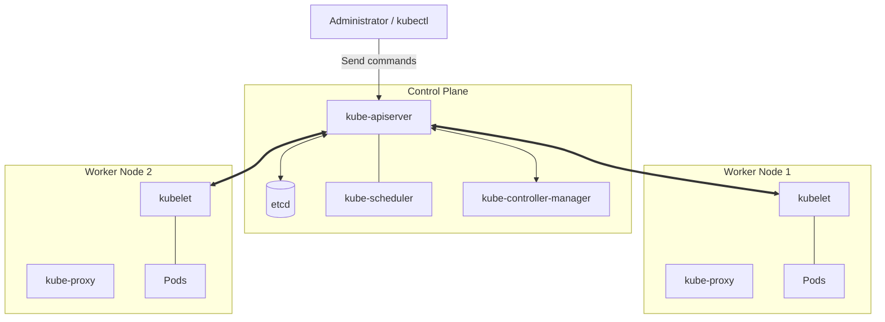

A Kubernetes cluster consists of a **Control Plane** that handles management and **Worker Nodes** where the actual workloads run.

---

## 1. Control Plane (Management Layer)

| Component | Role |
|----------|------|
| **kube-apiserver** | The central gateway of the cluster. Handles all requests and is responsible for authentication and authorization |
| **etcd** | A key-value store that holds all cluster state, acting as the cluster's "brain" |
| **kube-scheduler** | The scheduler that decides which node a newly created Pod should be placed on |
| **kube-controller-manager** | A collection of controllers that manage cluster state such as nodes, replicas, and endpoints |

---

## 2. Worker Node (Workload Layer)

| Component | Role |
|----------|------|
| **kubelet** | The agent that runs on each node. Ensures containers run according to the Pod spec |
| **kube-proxy** | Manages network rules on the node and routes traffic to Services |
| **Container Runtime** | The software that actually runs containers (containerd, CRI-O, etc.) |

---

## 3. Overall Architecture Diagram

This architecture shows the interactions between components at a glance.

**The components are tightly interconnected and work together, centered on the API server, to maintain the cluster's declarative Desired State.**
