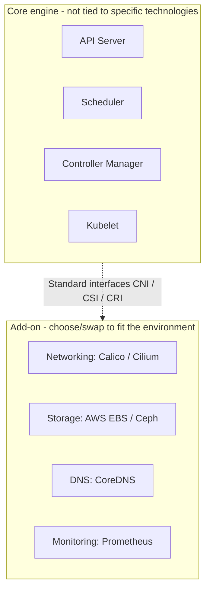

Kubernetes has a philosophy of clearly separating core components from Add-ons.

## What Is an Add-on?

An Add-on is a component that extends the functionality of a Kubernetes cluster but is not built into the core engine; you choose and swap it to fit your environment. (In production it is effectively mandatory; see the 'Perspective' section below.)

## Key Add-on Examples

- **CNI plugins:** Calico, Flannel, Weave, Cilium (networking)
- **CSI drivers:** AWS EBS, GCP PD, Ceph, NFS (storage)
- **Ingress Controller:** Nginx, Traefik, HAProxy
- **Monitoring:** Prometheus, Grafana
- **Log collection:** Fluentd, Filebeat
- **DNS:** CoreDNS, kube-dns

## Why the Add-on Concept Matters

### 1. Flexibility and Extensibility

Users can selectively install the Add-ons that fit their requirements. For example, you can replace the network plugin Calico with Cilium.

### 2. Separation of Core and Auxiliary Features

The Kubernetes core code stays stable while Add-ons can evolve independently. This makes upgrades and maintenance easier.

### 3. Pluggable Architecture

Standard interfaces such as CNI, CSI, and CRI allow third-party vendors to integrate easily.

### 4. Cloud Neutrality

You can use the same Kubernetes across different environments without being tied to a specific cloud provider.

## Perspective: If They Look Mandatory, Why Call Them 'Add-ons'?

In real production, features such as CNI, DNS, and storage are de facto mandatory. The reason they are still called 'add-ons' lies in the philosophy and design principles of the Kubernetes core engine.

### 1. Kubernetes Philosophy: "Minimal Core and Modularity (Extensibility)"

The development philosophy is to provide only the essential skeleton of container orchestration and let users swap or extend the rest in whatever way they prefer.

- **Core engine**: The API server, scheduler, controller manager, and the Kubelet on each node are the minimal pure engine that launches and manages containers.
- From the engine's perspective, it doesn't matter whether networking is Calico or Cilium, or whether storage is AWS EBS or Ceph. It can operate independently without being tied to any particular technology.



### 2. 'Freedom of Choice' by Environment (Vendor Agnostic & Flexibility)

Infrastructure environments vary widely: AWS, GCP, on-premises bare metal, in-house virtualization, and so on. If a specific networking method or storage driver were forced into the core (built-in), the following problems would arise.

| Problem | Description |
|------|------|
| **Loss of flexibility** | Features that don't fit the environment must be included anyway, making the system unnecessarily large and heavy |
| **Cannot be replaced** | Even if you dislike the bundled tools you cannot change them, making the architecture rigid |

Therefore, Kubernetes uses the term 'add-on' to mean "we'll give you only the skeleton; pick and assemble the parts (add-ons) that suit your environment."

### 3. Decoupled Component Lifecycles (Independent Updates and Management)

The Kubernetes core project and the add-on projects are developed and released independently.

- If the networking add-on and even the DNS server were bundled in the core source code, version upgrades during a core upgrade would become very complex and risky.
- Separating features into distinct components (add-ons) lets you upgrade or patch networking and monitoring tools independently of the Kubernetes version, making maintenance easier.

### Summary

> In production, add-ons are **effectively mandatory**. However, calling them 'add-ons' is a technical classification, meant to show that Kubernetes is not tied to a specific technology stack (network, storage, etc.) and is an **extensible structure in which users can choose and combine the tools they want**.

## Example Add-on Installation

```bash
# Install the Calico CNI
kubectl apply -f https://raw.githubusercontent.com/
  projectcalico/calico/v3.31.3/manifests/calico.yaml

# Verify the Add-on
kubectl get pods -n kube-system
```
