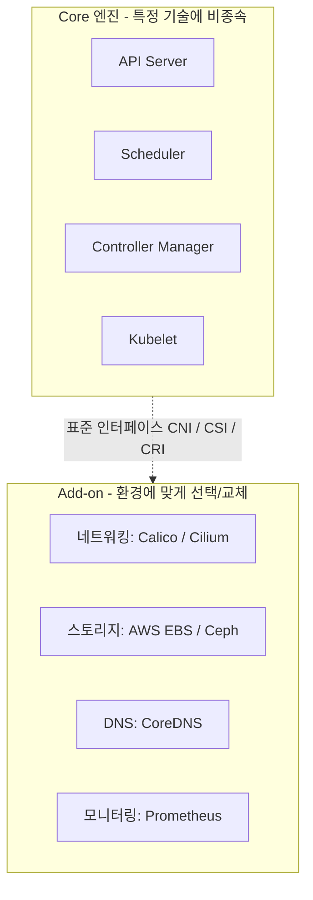

Kubernetes 는 핵심 컴포넌트와 Add-on 을 명확히 분리하는 철학을 가지고 있습니다.

## Add-on 이란?

Add-on 은 Kubernetes 클러스터의 기능을 확장하지만, 코어 엔진에 내장되지 않고 환경에 맞게 선택·교체하는 컴포넌트입니다. (프로덕션에서는 사실상 필수이며, 아래 '관점' 절 참고)

## 주요 Add-on 예시

- **CNI 플러그인:** Calico, Flannel, Weave, Cilium (네트워킹)
- **CSI 드라이버:** AWS EBS, GCP PD, Ceph, NFS (저장소)
- **Ingress Controller:** Nginx, Traefik, HAProxy
- **모니터링:** Prometheus, Grafana
- **로그 수집:** Fluentd, Filebeat
- **DNS:** CoreDNS, kube-dns

## Add-on 개념이 중요한 이유

### 1. 유연성과 확장성

사용자는 자신의 요구사항에 맞는 Add-on 을 선택적으로 설치할 수 있습니다. 예를 들어, 네트워크 플러그인을 Calico 대신 Cilium 으로 교체할 수 있습니다.

### 2. 핵심과 부가기능 분리

Kubernetes 핵심 코드는 안정적으로 유지되면서, Add-on 은 독립적으로 발전할 수 있습니다. 이는 업그레이드와 유지보수를 용이하게 합니다.

### 3. 플러그 가능한 아키텍처

CNI, CSI, CRI 와 같은 표준 인터페이스를 통해 서드파티 벤더가 쉽게 통합할 수 있습니다.

### 4. 클라우드 중립성

특정 클라우드 제공자에 종속되지 않고, 다양한 환경에서 동일한 Kubernetes 를 사용할 수 있습니다.

## 관점: 필수처럼 보이는데 왜 '애드온(Add-on)'이라 부를까?

실제 프로덕션에서 CNI, DNS, 스토리지 같은 기능은 사실상 필수(De facto mandatory)입니다. 그럼에도 '애드온'이라 부르는 이유는 쿠버네티스 코어 엔진의 철학과 설계 사상 때문입니다.

### 1. 쿠버네티스의 철학: "최소한의 코어와 모듈화(Extensibility)"

컨테이너 오케스트레이션의 핵심 뼈대만 제공하고, 나머지는 사용자가 원하는 방식으로 갈아 끼우거나 확장할 수 있게 한다는 것이 개발 철학입니다.

- **코어 엔진**: API 서버, 스케줄러, 컨트롤러 매니저, 각 노드의 Kubelet 등은 컨테이너를 띄우고 관리하는 최소한의 순수 엔진입니다.
- 엔진 입장에서는 네트워킹을 Calico 로 하든 Cilium 으로 하든, 스토리지를 AWS EBS 로 하든 Ceph 로 하든 상관이 없습니다. 특정 기술에 종속되지 않고 독립적으로 동작할 수 있습니다.



### 2. 환경에 따른 '선택의 자유' (Vendor Agnostic & Flexibility)

AWS, GCP, 온프레미스 베어메탈, 사내 가상화 등 인프라 환경은 매우 다양합니다. 특정 네트워킹 방식이나 스토리지 드라이버가 코어에 강제(Built-in)로 박혀 있다면 다음 문제가 생깁니다.

| 문제 | 설명 |
|------|------|
| **유연성 상실** | 환경에 맞지 않는 기능도 무조건 탑재해야 하므로 불필요하게 크고 무거워짐 |
| **교체 불가능** | 기본 포함된 도구가 마음에 들지 않아도 바꿀 수 없어 아키텍처가 경직됨 |

따라서 쿠버네티스는 "뼈대만 줄 테니, 네 환경에 맞는 부품(애드온)을 골라서 조립해 써라"라는 의미로 '애드온'이라는 용어를 사용합니다.

### 3. 컴포넌트의 라이프사이클 분리 (업데이트와 관리의 독립성)

쿠버네티스 코어 프로젝트와 애드온 프로젝트들은 각각 독립적으로 개발되고 배포(Release)됩니다.

- 코어 업그레이드 시 네트워킹 애드온이나 DNS 서버까지 코어 소스코드에 함께 들어 있다면 버전 업그레이드가 매우 복잡하고 위험해집니다.
- 기능을 별도 컴포넌트(애드온)로 분리하면, 쿠버네티스 버전과 무관하게 네트워킹·모니터링 도구를 독립적으로 업그레이드하거나 패치할 수 있어 유지보수가 수월해집니다.

### 요약

> 프로덕션에서 애드온은 **사실상 필수**입니다. 그러나 '애드온'이라 부르는 것은 기술적 분류의 의미로, 쿠버네티스가 특정 기술 스택(네트워크, 스토리지 등)에 종속되지 않고 **사용자가 원하는 도구를 선택·조합할 수 있는 확장 가능한 구조**임을 나타내기 위해서입니다.

## Add-on 예시 설치

```bash
# Calico CNI 설치
kubectl apply -f https://raw.githubusercontent.com/
  projectcalico/calico/v3.31.3/manifests/calico.yaml

# Add-on 확인
kubectl get pods -n kube-system
```
