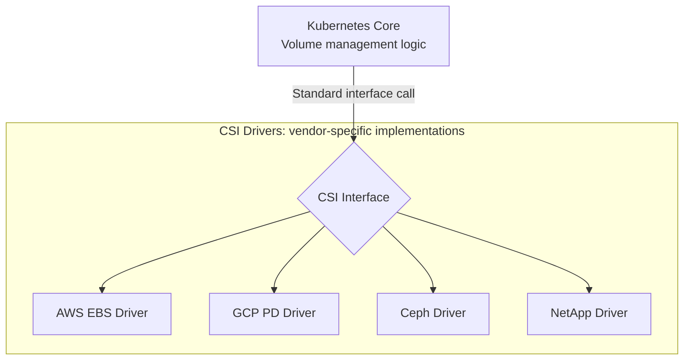

CSI is the standard specification that lets Kubernetes work with a wide range of storage without being locked in to any particular vendor.

---

## 1. What Is CSI?

The **Container Storage Interface (CSI)** is a standard interface for communication between container orchestration tools (such as Kubernetes) and a wide range of storage vendors (AWS, Google, Dell, NetApp, etc.).

---

## 2. The Core Philosophy of CSI

### 1) Vendor Neutrality
Kubernetes does not embed any company's storage control code directly in its source code. Instead, it defines only a standard specification that anyone can build against.

### 2) Separation of Concerns
Cluster management logic is cleanly separated from the logic that controls the actual hardware.

### 3) Pluggability
When a new storage technology appears, there is no need to upgrade Kubernetes itself. Simply install the CSI driver for that storage and it works right away.

---

## 3. Main Stages of CSI Operation

Every CSI driver follows the same common workflow.

| Stage | Function | Role |
|------|--------|------|
| **Volume attach** | `ControllerPublish` | Attach a physical volume (such as EBS) to a specific node |
| **Staging** | `NodeStage` | Format or pre-process the device attached to the node |
| **Mount** | `NodePublish` | Mount the volume at the path the actual Pod will use |
| **Unmount** | `NodeUnpublish` | Unmount when the Pod terminates |

---

## 4. Benefits of Adopting CSI

- **Release independence:** Storage vendors can freely improve their driver features regardless of Kubernetes updates.
- **Safety:** Because driver code runs outside the core Kubernetes processes, a driver error does not bring down the entire cluster.
- **More choices:** Everything from local disks to high-performance enterprise storage can be used with the same YAML syntax.

**CSI is the key extension mechanism that makes Kubernetes a true "cloud operating system."**
