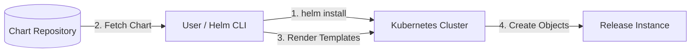

Helm is a **package manager** for defining, installing, and upgrading Kubernetes applications.

---

## 1. What Is Helm?

Helm is a tool that lets you bundle complex Kubernetes resources into a single package (Chart) and manage them together. It plays a role similar to `apt` or `yum` on Linux, or `npm` for Node.js.

### Key Concepts

| Term | Description | Notes |
|------|-------------|-------|
| **Chart** | Helm's packaging unit | A collection of templates and configuration files |
| **Release** | A Chart instance installed in the cluster | The same Chart can be installed multiple times |
| **Repository** | A server where Charts are stored | Artifact Hub, etc. |
| **Values** | Dynamic settings injected by the user | `values.yaml` |

---

## 2. Helm Architecture

This is the flow in which the Helm CLI fetches a chart from a remote repository and deploys it to the cluster.



---

## 3. Chart Directory Structure

A Helm chart has the following standardized directory structure.

```text
my-chart/
├── Chart.yaml          # Chart metadata (name, version, etc.)
├── values.yaml         # Default configuration values
├── charts/             # Sub-charts for dependencies
├── templates/          # K8s manifest templates
│   ├── deployment.yaml
│   ├── service.yaml
│   └── _helpers.tpl    # Common template functions
└── README.md           # Help documentation
```

---

## 4. Key Commands Summary

### Install and Manage
- **Add a repository:** `helm repo add <name> <URL>`
- **Search for charts:** `helm search repo <keyword>`
- **Install a chart:** `helm install <release-name> <chart-name>`
- **List releases:** `helm list`
- **Upgrade a release:** `helm upgrade <release-name> <chart-name>`
- **Roll back a release:** `helm rollback <release-name> <revision>`
- **Delete a release:** `helm uninstall <release-name>`

---

## 5. Benefits of Using Helm

1.  **Templating:** By using variables (`{{ .Values.name }}`) in YAML files, you can easily apply different settings per environment (Dev/Prod).
2.  **Version management:** Versions are tracked per deployment, so an immediate **rollback** is possible when a failure occurs.
3.  **Dependency resolution:** You can easily integrate the open-source components a complex app needs (DB, Redis, etc.) as sub-charts.
4.  **Standardization:** By sharing internal deployment standards in the form of charts, you can keep deployments consistent across teams.

**Helm has become a core tool in the CI/CD pipelines of modern Kubernetes operations.**
