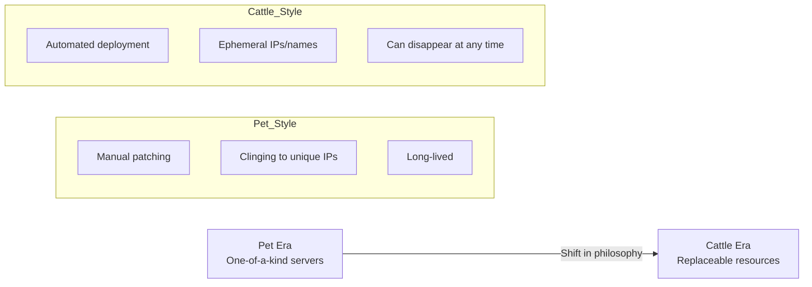

Let's look at the **Pet** and **Cattle** analogy, which helps explain the core design philosophy of cloud-native environments and Kubernetes.

---

## 1. Comparing the Core Concepts

This analogy expresses a philosophical difference in how you treat and manage servers.

| Category | Pet | Cattle |
|------|----------------|---------------|
| **Identity** | Given a unique name (e.g., Zeus, Athena) | Given a number (e.g., node-01, node-02) |
| **Failure response** | When sick, it is repaired and nursed back carefully | When sick, it is replaced immediately with a newly created one |
| **Management style** | Manual configuration, managed individually | Automated provisioning, managed in bulk |
| **Dependency** | If one server dies, the service is at risk of an outage | Even if one dies, another instance takes over immediately |
| **Typical infrastructure** | Traditional physical servers, Mainframe | **Kubernetes, cloud instances** |

---

## 2. The Shift in Management Philosophy

---

## 3. How Kubernetes Implements Cattle

Kubernetes automates 'cattle'-style management through the following resources.

- **Deployment:** When a Pod dies, it creates a new Pod immediately, no questions asked, to maintain the replica count.
- **Service:** Even as Pod IPs keep changing (the cattle being replaced), clients can reach the service through a single fixed name.
- **Auto-scaling:** When traffic grows, it increases the number of cattle; when traffic drops, it reduces them again.

---

## 4. Summary

| Item | Pet | Cattle |
|------|---------------|---------------|
| **Value** | Each individual matters | The service as a whole matters |
| **Recovery** | "We have to bring it back to life" | "We have to spin up a new one" |
| **Scalability** | Vertical scaling (Scale-up) | Horizontal scaling (Scale-out) |

**The goal of modern cloud operations is to treat all infrastructure like 'cattle', building systems that are resilient to failure and free to scale.**
