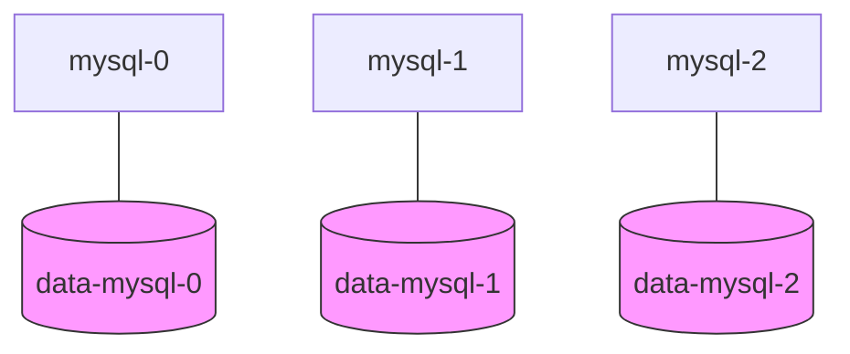
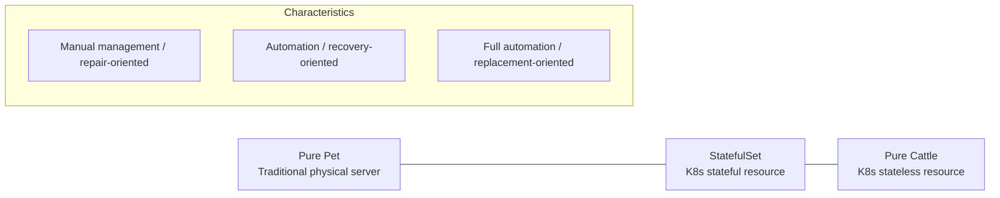

Kubernetes generally follows the **Cattle** philosophy, but **StatefulSet** is an exception, with characteristics closer to a **Pet**.

---

## Why StatefulSet Is a Pet

Unlike a typical Deployment, a StatefulSet is designed so that each Pod keeps its own unique identity.

### 1. Unique and Predictable Identifiers

| Category | Deployment (Cattle) | StatefulSet (Pet) |
|------|--------------------|-------------------|
| **Naming** | `web-abc12` (random hash) | `mysql-0`, `mysql-1` (sequential numbers) |
| **Identity** | All Pods are identical (interchangeable) | Each Pod can have a unique role |
| **Ordering** | Created/deleted all at once in parallel | Created sequentially from 0, deleted in reverse order |

### 2. Stable Network ID (DNS)

When a Pod managed by a Deployment is deleted and recreated, its name changes and so does its network address. A StatefulSet Pod, however, keeps the **same DNS name even after being recreated**.

- **DNS name format:** `<Pod name>.<Headless Service name>.<namespace>.svc.cluster.local`
- **Benefit:** Even if `mysql-1` dies and comes back, other Pods can still find `mysql-1` at the same address.

### 3. 1:1 Matching of Persistent Storage

Each Pod has its own dedicated storage (a PersistentVolumeClaim bound to a PersistentVolume) and keeps its data intact even when the Pod restarts.

---

## The Pet vs Cattle vs StatefulSet Spectrum

The difference in management philosophy can be visualized as follows.

---

## Main Use Cases

1.  **Database clusters:** MySQL, PostgreSQL, etc., where a clear primary/replica (master/slave) structure is required
2.  **Distributed message queues:** Kafka, RabbitMQ, etc., where node IDs matter
3.  **Distributed databases and storage:** MongoDB, Cassandra, etc., which need fixed membership information when forming a cluster

---

## Summary: The Core Value of StatefulSet

- **Uniqueness:** Each Pod has a unique identity, given by its ordinal index (0, 1, 2...)
- **Stability:** Its name and network identity do not change even after a restart
- **Persistence:** Data is preserved through its dedicated volume

**StatefulSet can be called a "managed Pet" or a "Pet in Cattle's clothing," and it is the key tool for running complex stateful applications on Kubernetes.**
