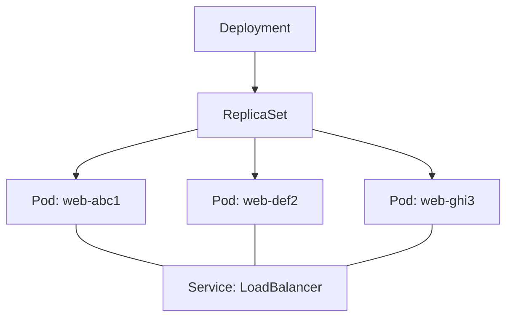
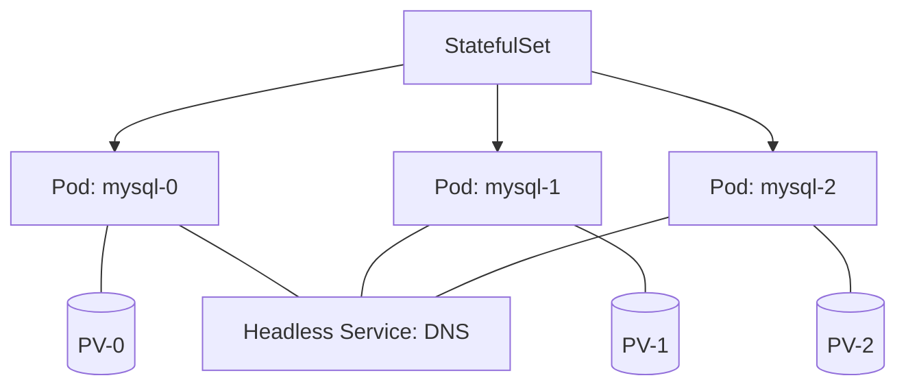
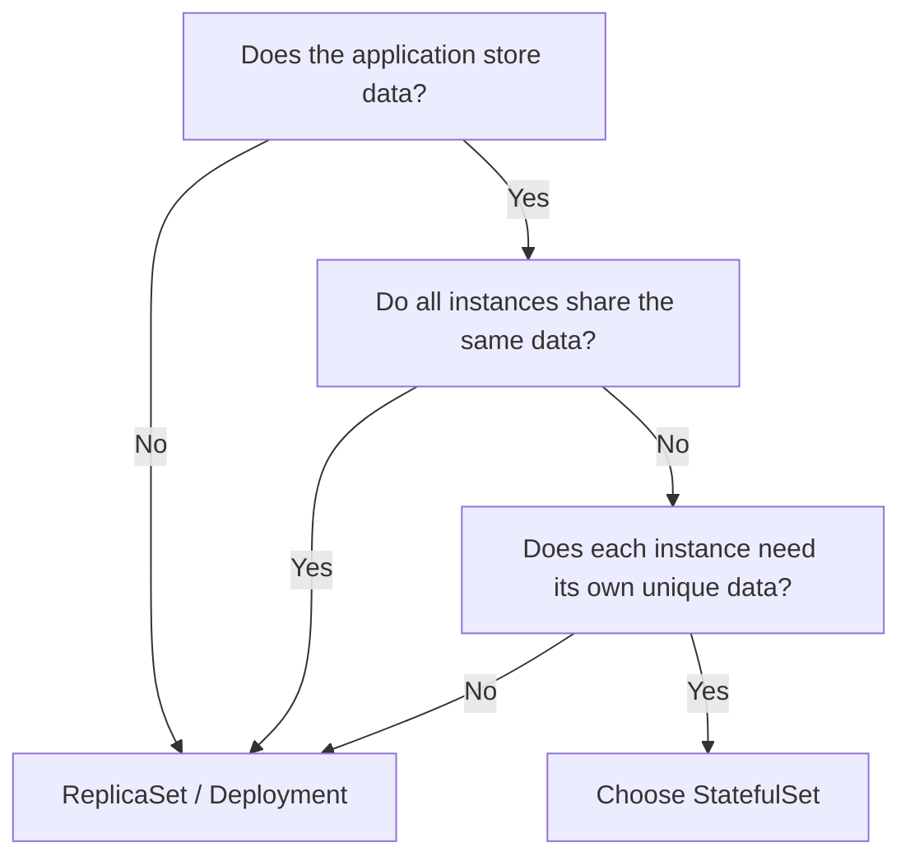

This document analyzes the differences between StatefulSet and ReplicaSet, the two core resources for managing Pods at scale in Kubernetes.

---

## 1. Basic Concept Comparison

| Resource | Core philosophy | Main target | Management tool |
|------|-----------|----------|-----------|
| **ReplicaSet** | **Cattle:** All Pods are identical and replaceable | Stateless apps such as web servers and APIs | Deployment |
| **StatefulSet** | **Pet:** Each Pod has its own unique identity | Stateful apps such as DBs and message queues | Managed directly |

---

## 2. Architecture Comparison

### ReplicaSet (Deployment)
Every Pod has a random name, and the Service groups them together as one unit for load balancing.

### StatefulSet
Each Pod has a sequential name and is mapped 1:1 to dedicated storage (PV). Individual Pods are accessed directly through a Headless Service.

---

## 3. Detailed Feature Comparison

| Characteristic | ReplicaSet (Deployment) | StatefulSet |
|------|------------------------|-------------|
| **Pod name** | Random hash (`web-abc12`) | Sequential number (`mysql-0`, `mysql-1`) |
| **Scaling** | Created/deleted immediately in parallel | Created sequentially from 0, deleted in reverse order |
| **Network ID** | Name/IP changes on re-creation | **Same name (DNS) is kept even after re-creation** |
| **Data retention** | All Pods can share a common volume | **A dedicated volume is allocated and preserved for each Pod** |
| **Update** | Rolling update (fast) | Sequential update (careful) |

---

## 4. Selection Guide (Decision Tree)

Follow the flowchart below depending on your application's characteristics.

---

## 5. Summary

- **ReplicaSet** focuses on "scaling out many replicas that perform the same function."
- **StatefulSet** focuses on "having each replica keep its own unique name and data."

**Whether the application has 'state' is the most important criterion for choosing a resource.**
