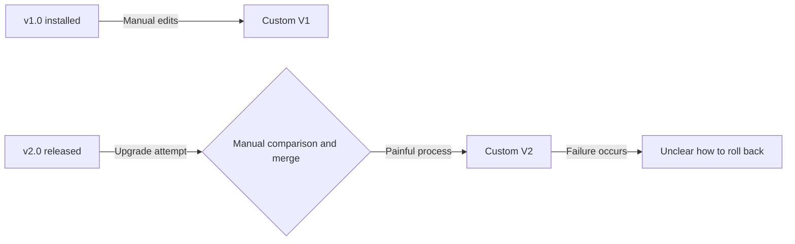
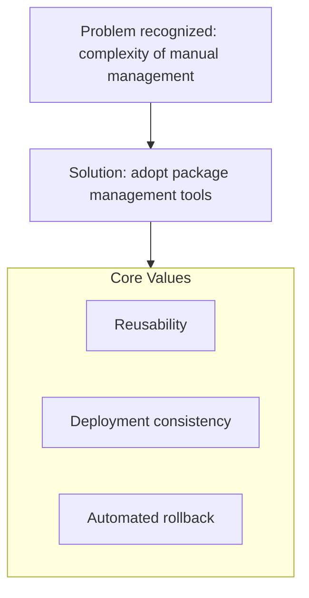

Starting from the problems of configuring Kubernetes add-on components, let's see why package management tools like Helm became necessary.

---

## 1. Traditional Problems with Add-on Configuration

### 1) Limits of Manual YAML Management
Installing a component requires many changes to fit the environment, and editing the manifests by hand every time is very risky.

| Problem Type | Details |
|-----------|-----------|
| **Human error** | High chance of typos or missing settings during manual edits |
| **Lack of consistency** | Subtle configuration differences arise between dev, test, and production environments |
| **No traceability** | There is no record of who changed which setting, and when |

### 2) Version Control and Upgrade History
When updating to a new version, re-applying and comparing earlier customizations is painful.

---

## 2. Why Do We Need Package Managers?

To meet the requirements of complex cluster operations, the following capabilities are essential.

### Requirements and Solutions

| Requirement | Description | How Package Managers Solve It |
|----------|------|------------------------|
| **Templating** | Make configuration reusable | Inject variables through `values.yaml` |
| **Version management** | Track deployment history and roll back | Manage by Release version |
| **Packaging knowledge** | Share experts' best-practice configurations | Provide verified Charts |
| **Dependency resolution** | Automate integration across multiple components | Manage subcharts |

---

## 3. Representative Tools

In the Kubernetes ecosystem today, the following tools are used, each in its own area.

- **Helm:** The most widely used standard package manager (template-based)
- **Kustomize:** A template-free, declarative YAML overlay approach (built into kubectl)
- **ArgoCD / Flux:** Automate package deployment based on the GitOps model

---

## 4. Summary

**Kubernetes package management tools go beyond mere convenience; they are essential for operating large-scale clusters safely and consistently.**
