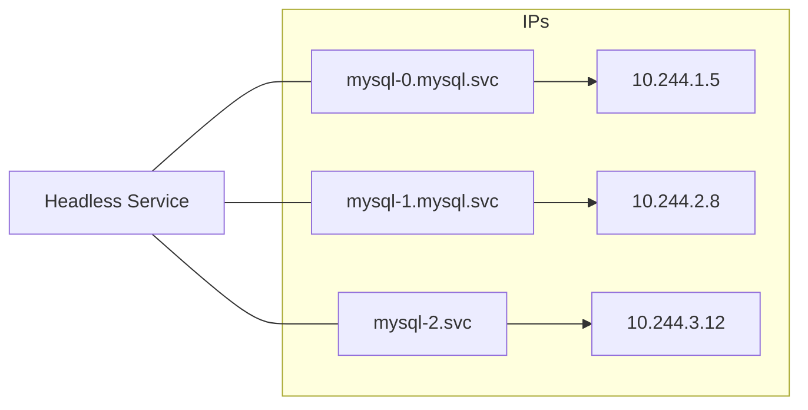
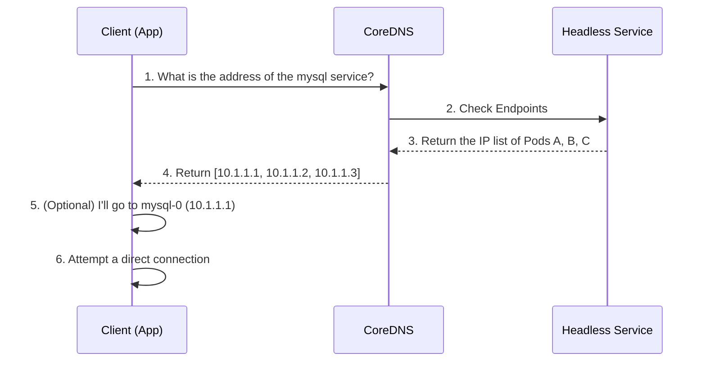

Let's look at the key reasons why a **Headless Service**, rather than a regular Service, is essential when running a StatefulSet.

---

## 1. What Is a Headless Service?

A Headless Service is a Service that, unlike a regular Service, is not assigned a virtual IP because it sets `clusterIP: None`.

| Property | Regular Service (ClusterIP) | Headless Service |
|------|-------------------------|------------------|
| **Virtual IP (VIP)** | Assigned (e.g., 10.96.0.10) | **None** |
| **Load balancing** | kube-proxy distributes across multiple Pods | None (the client chooses directly) |
| **DNS response** | Returns a single ClusterIP | **Returns the list of IPs of all backing Pods** |
| **Main use** | General traffic distribution | Direct access to individual Pods (Stateful) |

---

## 2. Why Is It Essential for a StatefulSet?

### Reason 1: Provides a Unique DNS Address (Stable Network ID)
Each Pod in a StatefulSet has a unique, numbered name. Combined with a Headless Service, each Pod gets a fixed DNS address.

- **Benefit:** Even if `mysql-0` restarts and its IP changes, its DNS name (`mysql-0.mysql`) stays the same, so other Pods can keep communicating without interruption.

### Reason 2: Distinguishing Primary/Replica Roles and Communicating Directly
A regular Service distributes traffic across Pods, so it is impossible to "connect only to the primary (`mysql-0`) for write operations."

- **Headless approach:** The client can look up the primary Pod's address directly through a DNS query and talk only to it.

### Reason 3: Building the Data Replication Topology
Distributed databases (Kafka, MongoDB, MySQL, etc.) require members to identify each other reliably and replicate data between themselves.

- **Replication flow:** It becomes possible to define "I am instance 1, and I replicate from instance 0."

---

## 3. How It Works, in Brief

---

## 4. Key Takeaways

1.  **Predictability:** Makes Pod names and DNS addresses predictable.
2.  **Direct access:** Lets you talk 1:1 with a Pod, with no load balancer in between.
3.  **Stability:** Lets you find a Pod by the same name even after it is terminated and recreated.

**A Headless Service is the core infrastructure that lets a StatefulSet operate as a clustered system with 'identity', rather than a mere bundle of containers.**
