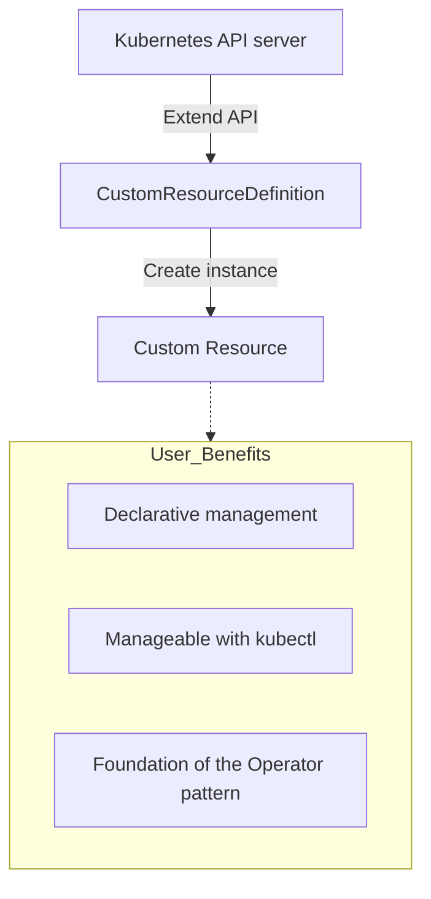

A CRD lets you extend the Kubernetes API with new resource types that you define yourself.

---

## 1. What Is a CRD?

A CRD is a mechanism for adding **custom resources** needed for your own business logic, beyond the built-in Kubernetes resources (Pod, Service, etc.).

### Comparing the Core Concepts

| Category | Kubernetes Built-in Resources | User-Defined Resources (CRD) |
|------|-----------------------|-------------------------|
| **Examples** | Pod, Deployment, ConfigMap | Database, Kafka, RedisCluster |
| **Defined by** | Kubernetes development team (Built-in) | Cluster operators/users |
| **Analogy** | **Off-the-rack clothing:** made in standard sizes | **Tailor-made clothing:** made to fit your body (your business) exactly |
| **Flexibility** | Limited (fields cannot be modified) | Unlimited (you can define the fields you want) |

---

## 2. The Role and Value of CRDs

1.  **Declarative infrastructure:** You can define and manage complex application configuration in a single YAML file.
2.  **Tool integration:** You can check status with the `kubectl get <my-resource>` command, with no extra tooling.
3.  **Operator integration:** True automation is achieved through Operators, which watch the state defined by custom resources and reconcile the cluster toward it.

---

## 3. CRDs vs Built-in Resources in Detail

| Feature | Built-in Resources | CRD (Extension) |
|------|-----------------------|----------------|
| **Availability** | Immediately usable in every K8s cluster | The CRD must be created (installed) first |
| **API group** | Standard groups such as `v1`, `apps/v1` | Custom groups such as `example.com`, `stable.dw.com` |
| **Data storage** | Stored at standard paths in etcd | Stored at user-defined paths in etcd |
| **Versioning** | Updated with the K8s release cycle | Versioned freely by the user (v1alpha1, v1, etc.) |

---

## 4. Summary

With CRDs, you can turn Kubernetes from a mere container orchestrator into a **"user-defined database"** and a **"general-purpose control plane"**.

**CRDs are the essential first step toward implementing the Operator pattern, the heart of modern cloud-native application operations.**
