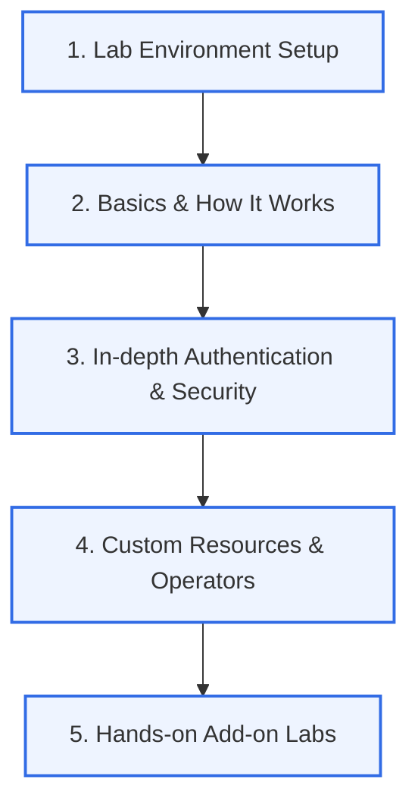

This archive is a dedicated space for studying and managing in-depth knowledge ranging from **advanced Kubernetes (K8s) architecture** and **authentication and security mechanisms** to **Operator development** and **building real-world enterprise environments**.

---

## 💡 Learning Roadmap and Structure

For systematic learning, this archive is organized into **5 specialized areas**. Select a menu at the top, then click the related tab to proceed with your study.

---

## 📂 Core Topics and Details

### 🛠️ 1. Lab Environment Setup (Environment)
Covers the Kubernetes cluster installation environment and essential Core Add-on setup for stable, standardized hands-on labs.

### 📚 2. Basic Theory and Core Architecture (Basics)
*   **How kubectl works**: Analyzing the REST API call flow
*   **Resource map & components**: Interaction between the Control Plane and Worker Nodes
*   **Stateless vs Stateful**: How StatefulSet persistence works and the DNS role of a Headless Service
*   **Package management**: Resource packaging techniques with Helm

### 🔒 3. Authentication and Security (Security & IAM)
The central core part of the advanced Kubernetes course.
*   **Security fundamentals**: Symmetric/asymmetric keys, SSL/TLS handshake, chain of trust, and CA principles
*   **K8s API authentication**: client-cert, mTLS, Webhook Token, OIDC integration
*   **Certificate management in practice**: Checking kubeadm certificate validity, renewing them, and a hands-on lab creating a custom User
*   **Enterprise IAM**: Single Sign-On (SSO) with Keycloak and K8s integration

### 🧩 4. Operator Pattern Development (Operator & CRD)
*   **CRD (Custom Resource Definition)**: Designing custom resource schemas
*   **Controller Pattern**: Maintaining declarative state through the Reconcile loop
*   **Prometheus Operator**: Automating an enterprise monitoring environment

### 🧪 5. Hands-on Add-on Labs (Labs)
Practice the core add-ons essential to cluster operation directly with templates (YAML).
*   Metric Server, Kubernetes Dashboard
*   MetalLB (LoadBalancer), Ingress-NGINX (L7 Gateway)
*   NFS Storage Provisioner
*   kew & kubectl plugin development in practice
