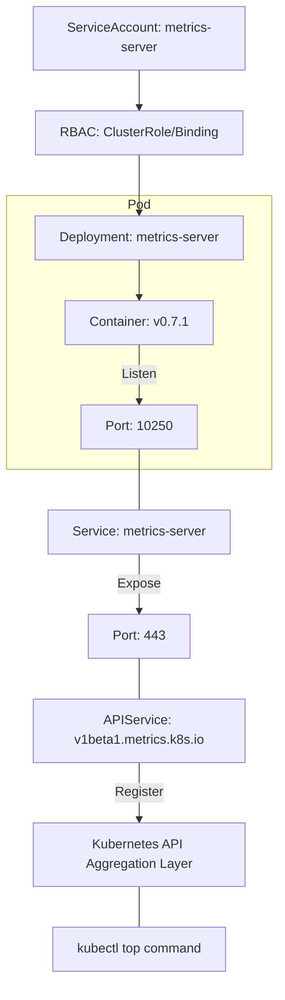

This page analyzes the YAML file used to install Metrics Server.

## Overall Composition

```
Resources that make up Metrics Server:
1. ServiceAccount          - Identity of the Pod
2. ClusterRole (x2)        - Permission definitions
3. RoleBinding             - Permission binding within a namespace
4. ClusterRoleBinding (x2) - Cluster-wide permission binding
5. Service                 - Network endpoint
6. Deployment              - Runs the Metrics Server Pod
7. APIService              - Kubernetes API extension
```

---

## 1. ServiceAccount

```yaml
apiVersion: v1
kind: ServiceAccount
metadata:
  labels:
    k8s-app: metrics-server
  name: metrics-server
  namespace: kube-system
```

### Description

| Field | Value | Description |
|------|-----|------|
| `name` | metrics-server | ServiceAccount name |
| `namespace` | kube-system | Namespace for system components |
| `labels` | k8s-app: metrics-server | Label for identification |

### Role

- The identity the Metrics Server Pod uses when communicating with the Kubernetes API
- The RBAC permissions bound to this ServiceAccount are applied to the Pod

---

## 2. ClusterRole - Aggregated Metrics Reader

```yaml
apiVersion: rbac.authorization.k8s.io/v1
kind: ClusterRole
metadata:
  labels:
    k8s-app: metrics-server
    rbac.authorization.k8s.io/aggregate-to-admin: "true"
    rbac.authorization.k8s.io/aggregate-to-edit: "true"
    rbac.authorization.k8s.io/aggregate-to-view: "true"
  name: system:aggregated-metrics-reader
rules:
- apiGroups:
  - metrics.k8s.io
  resources:
  - pods
  - nodes
  verbs:
  - get
  - list
  - watch
```

### Description

| Field | Value | Description |
|------|-----|------|
| `name` | system:aggregated-metrics-reader | Standard name (reserved by the system) |
| `apiGroups` | metrics.k8s.io | Metrics API group |
| `resources` | pods, nodes | Pod and Node metrics |
| `verbs` | get, list, watch | Read-only permissions |

### Aggregation Labels

```yaml
rbac.authorization.k8s.io/aggregate-to-admin: "true"
rbac.authorization.k8s.io/aggregate-to-edit: "true"
rbac.authorization.k8s.io/aggregate-to-view: "true"
```

- This ClusterRole is automatically aggregated into the admin/edit/view roles
- Users who have admin/edit/view permissions can also query metrics automatically

---

## 3. ClusterRole - Metrics Server

```yaml
apiVersion: rbac.authorization.k8s.io/v1
kind: ClusterRole
metadata:
  labels:
    k8s-app: metrics-server
  name: system:metrics-server
rules:
- apiGroups:
  - ""
  resources:
  - nodes/metrics
  verbs:
  - get
- apiGroups:
  - ""
  resources:
  - pods
  - nodes
  verbs:
  - get
  - list
  - watch
```

### Description

| Resource | Permission | Purpose |
|--------|------|------|
| `nodes/metrics` | get | Collect Node metrics from the kubelet |
| `pods` | get, list, watch | Read Pod information |
| `nodes` | get, list, watch | Read Node information |

### Role

- Permissions that allow Metrics Server to read data from the kubelet and the Kubernetes API

---

## 4. RoleBinding

```yaml
apiVersion: rbac.authorization.k8s.io/v1
kind: RoleBinding
metadata:
  labels:
    k8s-app: metrics-server
  name: metrics-server-auth-reader
  namespace: kube-system
roleRef:
  apiGroup: rbac.authorization.k8s.io
  kind: Role
  name: extension-apiserver-authentication-reader
subjects:
- kind: ServiceAccount
  name: metrics-server
  namespace: kube-system
```

### Description

| Field | Value | Description |
|------|-----|------|
| `roleRef.name` | extension-apiserver-authentication-reader | Default Kubernetes Role |
| `subjects` | metrics-server ServiceAccount | Subject that receives the permissions |

### Role

- Grants permission to read the extension API server authentication configuration
- Required for Metrics Server to run as an extension API server

---

## 5. ClusterRoleBinding - Auth Delegator

```yaml
apiVersion: rbac.authorization.k8s.io/v1
kind: ClusterRoleBinding
metadata:
  labels:
    k8s-app: metrics-server
  name: metrics-server:system:auth-delegator
roleRef:
  apiGroup: rbac.authorization.k8s.io
  kind: ClusterRole
  name: system:auth-delegator
subjects:
- kind: ServiceAccount
  name: metrics-server
  namespace: kube-system
```

### Description

| Field | Value | Description |
|------|-----|------|
| `roleRef.name` | system:auth-delegator | Default Kubernetes ClusterRole |
| `subjects` | metrics-server ServiceAccount | Subject that receives the permissions |

### Role

- Allows Metrics Server to delegate authentication and authorization checks to the API server
- Required so that Metrics Server can validate incoming requests via TokenReview and SubjectAccessReview

---

## 6. ClusterRoleBinding - Metrics Server

```yaml
apiVersion: rbac.authorization.k8s.io/v1
kind: ClusterRoleBinding
metadata:
  labels:
    k8s-app: metrics-server
  name: system:metrics-server
roleRef:
  apiGroup: rbac.authorization.k8s.io
  kind: ClusterRole
  name: system:metrics-server
subjects:
- kind: ServiceAccount
  name: metrics-server
  namespace: kube-system
```

### Description

| Field | Value | Description |
|------|-----|------|
| `roleRef.name` | system:metrics-server | The ClusterRole defined above |
| `subjects` | metrics-server ServiceAccount | Subject that receives the permissions |

### Role

- Binds the ClusterRole defined in section 3 to the ServiceAccount
- Grants the Metrics Server Pod permission to collect metrics

---

## 7. Service

```yaml
apiVersion: v1
kind: Service
metadata:
  labels:
    k8s-app: metrics-server
  name: metrics-server
  namespace: kube-system
spec:
  ports:
  - name: https
    port: 443
    protocol: TCP
    targetPort: https
  selector:
    k8s-app: metrics-server
```

### Description

| Field | Value | Description |
|------|-----|------|
| `port` | 443 | Service port (HTTPS) |
| `targetPort` | https | Container port (referenced by name) |
| `selector` | k8s-app: metrics-server | Selects the target Pods |

### Role

- Provides a network endpoint for Metrics Server
- Used when the API server forwards metrics requests to Metrics Server

---

## 8. Deployment

```yaml
apiVersion: apps/v1
kind: Deployment
metadata:
  labels:
    k8s-app: metrics-server
  name: metrics-server
  namespace: kube-system
spec:
  selector:
    matchLabels:
      k8s-app: metrics-server
  strategy:
    rollingUpdate:
      maxUnavailable: 0
  template:
    metadata:
      labels:
        k8s-app: metrics-server
    spec:
      containers:
      - args:
        - --cert-dir=/tmp
        - --secure-port=10250
        - --kubelet-preferred-address-types=InternalIP,ExternalIP,Hostname
        - --kubelet-use-node-status-port
        - --metric-resolution=15s
        - --kubelet-insecure-tls
        image: registry.k8s.io/metrics-server/metrics-server:v0.7.1
        imagePullPolicy: IfNotPresent
        name: metrics-server
        ports:
        - containerPort: 10250
          name: https
          protocol: TCP
        livenessProbe:
          failureThreshold: 3
          httpGet:
            path: /livez
            port: https
            scheme: HTTPS
          periodSeconds: 10
        readinessProbe:
          failureThreshold: 3
          httpGet:
            path: /readyz
            port: https
            scheme: HTTPS
          initialDelaySeconds: 20
          periodSeconds: 10
        resources:
          requests:
            cpu: 100m
            memory: 200Mi
        securityContext:
          allowPrivilegeEscalation: false
          capabilities:
            drop:
            - ALL
          readOnlyRootFilesystem: true
          runAsNonRoot: true
          runAsUser: 1000
          seccompProfile:
            type: RuntimeDefault
        volumeMounts:
        - mountPath: /tmp
          name: tmp-dir
      nodeSelector:
        kubernetes.io/os: linux
      priorityClassName: system-cluster-critical
      serviceAccountName: metrics-server
      volumes:
      - emptyDir: {}
        name: tmp-dir
```

### Container Arguments (args)

| Argument | Description |
|------|------|
| `--cert-dir=/tmp` | Directory where certificates are stored (self-signed serving certs) |
| `--secure-port=10250` | Secure port |
| `--kubelet-preferred-address-types=InternalIP,ExternalIP,Hostname` | Preferred order of address types used to connect to the kubelet |
| `--kubelet-use-node-status-port` | Use the port reported in the node status |
| `--metric-resolution=15s` | Metrics collection interval (15 seconds) |
| `--kubelet-insecure-tls` | Skip kubelet TLS certificate verification (for testing only) |

### Probes

```yaml
livenessProbe:
  httpGet:
    path: /livez      # Liveness check endpoint
    port: https
    scheme: HTTPS
  periodSeconds: 10   # Check every 10 seconds

readinessProbe:
  httpGet:
    path: /readyz     # Readiness check endpoint
    port: https
    scheme: HTTPS
  initialDelaySeconds: 20  # First check 20 seconds after start
  periodSeconds: 10        # Check every 10 seconds
```

### Security Context

```yaml
securityContext:
  allowPrivilegeEscalation: false  # Disallow privilege escalation
  capabilities:
    drop:
    - ALL                          # Drop all Linux capabilities
  readOnlyRootFilesystem: true     # Read-only root filesystem
  runAsNonRoot: true               # Must not run as root
  runAsUser: 1000                  # Run as UID 1000
  seccompProfile:
    type: RuntimeDefault           # Use the default seccomp profile
```

### Resource Requests

```yaml
resources:
  requests:
    cpu: 100m      # Guarantees 0.1 core
    memory: 200Mi  # Guarantees 200Mi
```

### Other Important Settings

```yaml
priorityClassName: system-cluster-critical  # High priority
nodeSelector:
  kubernetes.io/os: linux                   # Linux nodes only
serviceAccountName: metrics-server          # Use the ServiceAccount
```

---

## 9. APIService

```yaml
apiVersion: apiregistration.k8s.io/v1
kind: APIService
metadata:
  labels:
    k8s-app: metrics-server
  name: v1beta1.metrics.k8s.io
spec:
  group: metrics.k8s.io
  groupPriorityMinimum: 100
  insecureSkipTLSVerify: true
  service:
    name: metrics-server
    namespace: kube-system
  version: v1beta1
  versionPriority: 100
```

### Description

| Field | Value | Description |
|------|-----|------|
| `name` | v1beta1.metrics.k8s.io | API service name |
| `group` | metrics.k8s.io | API group |
| `version` | v1beta1 | API version |
| `service.name` | metrics-server | Service to connect to |
| `service.namespace` | kube-system | Service namespace |

### Role

- Extends the Kubernetes API by adding the `metrics.k8s.io` group
- The `kubectl top` command uses this API

### API Endpoints

```bash
# APIs registered by Metrics Server
/apis/metrics.k8s.io/v1beta1/nodes
/apis/metrics.k8s.io/v1beta1/pods

# kubectl top calls these APIs
kubectl top nodes
# → GET /apis/metrics.k8s.io/v1beta1/nodes

kubectl top pods
# → GET /apis/metrics.k8s.io/v1beta1/pods
```

---

## Resource Relationship Diagram

This shows how the main resources that make up Metrics Server are connected.



| Resource Type | Name | Main Role |
|-----------|------|----------|
| **RBAC** | `system:metrics-server` | Grants permissions for API aggregation and resource queries |
| **Deployment** | `metrics-server` | Runs the process that actually collects and serves metrics |
| **Service** | `metrics-server` | Endpoint through which the API server reaches Metrics Server |
| **APIService** | `v1beta1.metrics.k8s.io` | Registers the metrics feature with the standard API server |

---

## Verifying the Installation

```bash
# Install Metrics Server
kubectl apply -f components.yaml

# Check Pod status
kubectl get pods -n kube-system -l k8s-app=metrics-server
# NAME                            READY   STATUS    RESTARTS   AGE
# metrics-server-xxxxxxxxxx-xxx   1/1     Running   0          1m

# Check API service registration
kubectl get apiservice v1beta1.metrics.k8s.io
# NAME                     SERVICE                      AVAILABLE   AGE
# v1beta1.metrics.k8s.io   kube-system/metrics-server   True        1m

# Test metrics queries
kubectl top nodes
kubectl top pods
```

---

## Summary

| Resource | Count | Purpose |
|--------|------|------|
| ServiceAccount | 1 | Pod identity |
| ClusterRole | 2 | Permission definitions |
| RoleBinding | 1 | Namespace permissions |
| ClusterRoleBinding | 2 | Cluster permissions |
| Service | 1 | Network endpoint |
| Deployment | 1 | Runs the Pods |
| APIService | 1 | API extension |
| **Total** | **9** | |

**Metrics Server is a system component that extends the Kubernetes API to add metric query capabilities.**
