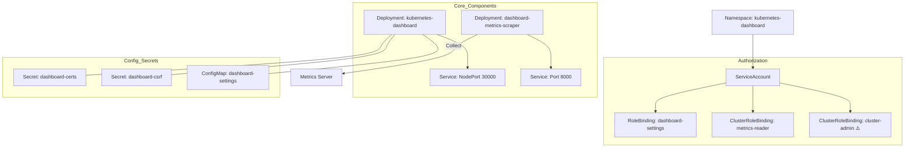

This page walks through the YAML manifest used to install the Kubernetes Dashboard.

## Overall Structure

```
Resources that make up the Dashboard:
1. Namespace                 - Dedicated namespace
2. ServiceAccount            - The Pod's identity
3. Service (x2)              - Network endpoints
4. Secret (x3)               - Certificates and CSRF token
5. ConfigMap                 - Configuration storage
6. Role                      - Namespace permissions
7. ClusterRole               - Cluster permissions
8. RoleBinding               - Namespace permission binding
9. ClusterRoleBinding (x2)   - Cluster permission bindings
10. Deployment (x2)          - Pod deployment
```

---

## 1. Namespace

```yaml
apiVersion: v1
kind: Namespace
metadata:
  name: kubernetes-dashboard
```

### Description

| Field | Value | Description |
|------|-----|------|
| `name` | kubernetes-dashboard | Dedicated namespace for the Dashboard |

### Role

- Isolates Dashboard-related resources
- Separates them from the system namespace (kube-system)

---

## 2. ServiceAccount

```yaml
apiVersion: v1
kind: ServiceAccount
metadata:
  labels:
    k8s-app: kubernetes-dashboard
  name: kubernetes-dashboard
  namespace: kubernetes-dashboard
```

### Description

| Field | Value | Description |
|------|-----|------|
| `name` | kubernetes-dashboard | ServiceAccount name |
| `namespace` | kubernetes-dashboard | Dashboard namespace |

### Role

- The identity the Dashboard Pod uses when communicating with the Kubernetes API

---

## 3. Service - Dashboard

```yaml
kind: Service
apiVersion: v1
metadata:
  labels:
    k8s-app: kubernetes-dashboard
  name: kubernetes-dashboard
  namespace: kubernetes-dashboard
spec:
  ports:
    - port: 443
      targetPort: 8443
      nodePort: 30000
  selector:
    k8s-app: kubernetes-dashboard
  type: NodePort
```

### Description

| Field | Value | Description |
|------|-----|------|
| `port` | 443 | Service port (HTTPS) |
| `targetPort` | 8443 | Container port |
| `nodePort` | 30000 | Port exposed on the node |
| `type` | NodePort | External access through a node port |

### Access URL

```
https://<node IP>:30000
```

---

## 4. Secret (x3)

### 4-1. Certificate Store

```yaml
apiVersion: v1
kind: Secret
metadata:
  labels:
    k8s-app: kubernetes-dashboard
  name: kubernetes-dashboard-certs
  namespace: kubernetes-dashboard
type: Opaque
```

### Role

- Stores the Dashboard HTTPS certificates

### 4-2. CSRF Token

```yaml
apiVersion: v1
kind: Secret
metadata:
  labels:
    k8s-app: kubernetes-dashboard
  name: kubernetes-dashboard-csrf
  namespace: kubernetes-dashboard
type: Opaque
data:
  csrf: ""
```

### Role

- A token that protects against Cross-Site Request Forgery (CSRF) attacks

### 4-3. Key Holder

```yaml
apiVersion: v1
kind: Secret
metadata:
  labels:
    k8s-app: kubernetes-dashboard
  name: kubernetes-dashboard-key-holder
  namespace: kubernetes-dashboard
type: Opaque
```

### Role

- Holds encryption keys

---

## 5. ConfigMap

```yaml
kind: ConfigMap
apiVersion: v1
metadata:
  labels:
    k8s-app: kubernetes-dashboard
  name: kubernetes-dashboard-settings
  namespace: kubernetes-dashboard
```

### Role

- Stores Dashboard settings
- User settings, cluster information, etc.

---

## 6. Role

```yaml
kind: Role
apiVersion: rbac.authorization.k8s.io/v1
metadata:
  labels:
    k8s-app: kubernetes-dashboard
  name: kubernetes-dashboard
  namespace: kubernetes-dashboard
rules:
  # Manage the Dashboard's own Secrets
  - apiGroups: [""]
    resources: ["secrets"]
    resourceNames: ["kubernetes-dashboard-key-holder", 
                    "kubernetes-dashboard-certs", 
                    "kubernetes-dashboard-csrf"]
    verbs: ["get", "update", "delete"]
    
  # Manage the settings ConfigMap
  - apiGroups: [""]
    resources: ["configmaps"]
    resourceNames: ["kubernetes-dashboard-settings"]
    verbs: ["get", "update"]
    
  # Metrics service proxy
  - apiGroups: [""]
    resources: ["services"]
    resourceNames: ["heapster", "dashboard-metrics-scraper"]
    verbs: ["proxy"]
  - apiGroups: [""]
    resources: ["services/proxy"]
    resourceNames: ["heapster", "http:heapster:", 
                    "https:heapster:", 
                    "dashboard-metrics-scraper", 
                    "http:dashboard-metrics-scraper"]
    verbs: ["get"]
```

### Permission Summary

| Resource | Resource Names | Permissions |
|--------|-------------|------|
| Secrets | the three Dashboard Secrets | get, update, delete |
| ConfigMaps | settings | get, update |
| Services | heapster, metrics-scraper | proxy |
| Services/Proxy | heapster, metrics-scraper | get |

---

## 7. ClusterRole

```yaml
kind: ClusterRole
apiVersion: rbac.authorization.k8s.io/v1
metadata:
  labels:
    k8s-app: kubernetes-dashboard
  name: kubernetes-dashboard
rules:
  # Query metrics from the Metrics Server
  - apiGroups: ["metrics.k8s.io"]
    resources: ["pods", "nodes"]
    verbs: ["get", "list", "watch"]
```

### Role

- Permission to query metrics across the entire cluster
- Access to the same metrics data as `kubectl top`

---

## 8. RoleBinding

```yaml
apiVersion: rbac.authorization.k8s.io/v1
kind: RoleBinding
metadata:
  labels:
    k8s-app: kubernetes-dashboard
  name: kubernetes-dashboard
  namespace: kubernetes-dashboard
roleRef:
  apiGroup: rbac.authorization.k8s.io
  kind: Role
  name: kubernetes-dashboard
subjects:
  - kind: ServiceAccount
    name: kubernetes-dashboard
    namespace: kubernetes-dashboard
```

### Role

- Binds the Role's permissions to the ServiceAccount

---

## 9. ClusterRoleBinding (x2)

### 9-1. Metrics Query Permission

```yaml
apiVersion: rbac.authorization.k8s.io/v1
kind: ClusterRoleBinding
metadata:
  name: kubernetes-dashboard
roleRef:
  apiGroup: rbac.authorization.k8s.io
  kind: ClusterRole
  name: kubernetes-dashboard
subjects:
  - kind: ServiceAccount
    name: kubernetes-dashboard
    namespace: kubernetes-dashboard
```

### Role

- Binds the ClusterRole's metrics query permission

### 9-2. Administrator Permissions (Important!)

```yaml
apiVersion: rbac.authorization.k8s.io/v1
kind: ClusterRoleBinding
metadata:
  name: kubernetes-dashboard2
  labels:
    k8s-app: kubernetes-dashboard
roleRef:
  apiGroup: rbac.authorization.k8s.io
  kind: ClusterRole
  name: cluster-admin
subjects:
- kind: ServiceAccount
  name: kubernetes-dashboard
  namespace: kubernetes-dashboard
```

### ⚠️ Cautions

| Item | Description |
|------|------|
| `roleRef.name` | cluster-admin |
| **Permissions** | **Cluster-wide administrator permissions** |
| **Risk level** | **High** |

**This ClusterRoleBinding grants cluster-admin permissions to the Dashboard.**

### Security Considerations

```
⚠️ Risks:
1. The cluster can be fully controlled through the Dashboard
2. If the Dashboard is compromised, the entire cluster is compromised
3. Serious security risk if exposed externally

✅ Recommendations:
1. Use Ingress instead of NodePort
2. Strengthen authentication and authorization
3. Apply NetworkPolicies
4. Apply the principle of least privilege instead of cluster-admin
```

---

## 10. Deployment - Dashboard

```yaml
kind: Deployment
apiVersion: apps/v1
metadata:
  labels:
    k8s-app: kubernetes-dashboard
  name: kubernetes-dashboard
  namespace: kubernetes-dashboard
spec:
  replicas: 1
  revisionHistoryLimit: 10
  selector:
    matchLabels:
      k8s-app: kubernetes-dashboard
  template:
    metadata:
      labels:
        k8s-app: kubernetes-dashboard
    spec:
      securityContext:
        seccompProfile:
          type: RuntimeDefault
      containers:
        - name: kubernetes-dashboard
          image: kubernetesui/dashboard:v2.7.0
          imagePullPolicy: Always
          ports:
            - containerPort: 8443
              protocol: TCP
          args:
            - --auto-generate-certificates
            - --namespace=kubernetes-dashboard
            - --enable-skip-login
          volumeMounts:
            - name: kubernetes-dashboard-certs
              mountPath: /certs
            - mountPath: /tmp
              name: tmp-volume
          livenessProbe:
            httpGet:
              scheme: HTTPS
              path: /
              port: 8443
            initialDelaySeconds: 30
            timeoutSeconds: 30
          securityContext:
            allowPrivilegeEscalation: false
            readOnlyRootFilesystem: true
            runAsUser: 1001
            runAsGroup: 2001
      volumes:
        - name: kubernetes-dashboard-certs
          secret:
            secretName: kubernetes-dashboard-certs
        - name: tmp-volume
          emptyDir: {}
      serviceAccountName: kubernetes-dashboard
      nodeSelector:
        "kubernetes.io/os": linux
      tolerations:
        - key: node-role.kubernetes.io/master
          effect: NoSchedule
```

### Container Arguments (args)

| Argument | Description |
|------|------|
| `--auto-generate-certificates` | Automatically generate certificates |
| `--namespace=kubernetes-dashboard` | Target namespace |
| `--enable-skip-login` | Show the skip-login button |

### Probes

```yaml
livenessProbe:
  httpGet:
    scheme: HTTPS
    path: /         # Root path
    port: 8443
  initialDelaySeconds: 30  # First check after 30 seconds
  timeoutSeconds: 30       # 30-second timeout
```

### Security Context

```yaml
securityContext:
  allowPrivilegeEscalation: false  # Privilege escalation not allowed
  readOnlyRootFilesystem: true     # Root filesystem is read-only
  runAsUser: 1001                  # UID 1001
  runAsGroup: 2001                 # GID 2001
```

### Volumes

```yaml
volumes:
  - name: kubernetes-dashboard-certs
    secret:
      secretName: kubernetes-dashboard-certs  # Certificates
  - name: tmp-volume
    emptyDir: {}                              # Temporary directory
```

---

## 11. Service - Metrics Scraper

```yaml
kind: Service
apiVersion: v1
metadata:
  labels:
    k8s-app: dashboard-metrics-scraper
  name: dashboard-metrics-scraper
  namespace: kubernetes-dashboard
spec:
  ports:
    - port: 8000
      targetPort: 8000
  selector:
    k8s-app: dashboard-metrics-scraper
```

### Role

- Internal Service endpoint for the Metrics Scraper

---

## 12. Deployment - Metrics Scraper

```yaml
kind: Deployment
apiVersion: apps/v1
metadata:
  labels:
    k8s-app: dashboard-metrics-scraper
  name: dashboard-metrics-scraper
  namespace: kubernetes-dashboard
spec:
  replicas: 1
  selector:
    matchLabels:
      k8s-app: dashboard-metrics-scraper
  template:
    metadata:
      labels:
        k8s-app: dashboard-metrics-scraper
    spec:
      containers:
        - name: dashboard-metrics-scraper
          image: kubernetesui/metrics-scraper:v1.0.8
          ports:
            - containerPort: 8000
              protocol: TCP
          livenessProbe:
            httpGet:
              scheme: HTTP
              path: /
              port: 8000
            initialDelaySeconds: 30
            timeoutSeconds: 30
          securityContext:
            allowPrivilegeEscalation: false
            readOnlyRootFilesystem: true
            runAsUser: 1001
            runAsGroup: 2001
      serviceAccountName: kubernetes-dashboard
      volumes:
        - name: tmp-volume
          emptyDir: {}
```

### Role

- Fetches metrics data from the Metrics Server and provides it to the Dashboard
- Caches and processes metrics data

---

## Creating a Dashboard Admin User

```yaml
# dashboard-adminuser.yaml
apiVersion: v1
kind: ServiceAccount
metadata:
  name: admin-user
  namespace: kubernetes-dashboard
---
apiVersion: rbac.authorization.k8s.io/v1
kind: ClusterRoleBinding
metadata:
  name: admin-user
roleRef:
  apiGroup: rbac.authorization.k8s.io
  kind: ClusterRole
  name: cluster-admin
subjects:
- kind: ServiceAccount
  name: admin-user
  namespace: kubernetes-dashboard
```

### Issuing a Token

```bash
# Create a token
kubectl -n kubernetes-dashboard create token admin-user

# Use the printed token to log in to the Dashboard
```

---

## Resource Relationship Diagram

This is the structure of the main resources that make up the Kubernetes Dashboard.



| Component | Main Role |
|-----------|----------|
| **Dashboard UI** | Provides a web-based cluster management interface |
| **Metrics Scraper** | Fetches data from the Metrics Server and processes it into chart data |
| **ServiceAccount** | The identity the Dashboard Pod uses to access the API server |
| **Secrets** | Store certificates for HTTPS communication and the CSRF token |

---

## Verifying the Installation

```bash
# Install the Dashboard
kubectl apply -f kubernetes-dashboard.yaml
kubectl apply -f dashboard-adminuser.yaml

# Check Pod status
kubectl get pods -n kubernetes-dashboard
# NAME                                  READY   STATUS    RESTARTS   AGE
# kubernetes-dashboard-xxxxxxxxx-xxxx   1/1     Running   0          1m
# dashboard-metrics-scraper-xxxx-xxx    1/1     Running   0          1m

# Check Service status
kubectl get svc -n kubernetes-dashboard
# NAME                        TYPE       CLUSTER-IP     EXTERNAL-IP   PORT(S)          AGE
# kubernetes-dashboard        NodePort   10.96.xxx.xxx  <none>        443:30000/TCP    1m
# dashboard-metrics-scraper   ClusterIP  10.96.xxx.xxx  <none>        8000/TCP         1m

# Issue a token
kubectl -n kubernetes-dashboard create token admin-user

# Access
# https://<node IP>:30000
```

---

## Summary

| Resource | Count | Purpose |
|--------|------|------|
| Namespace | 1 | Dedicated namespace |
| ServiceAccount | 1 | Pod identity |
| Service | 2 | Network endpoints |
| Secret | 3 | Certificates, CSRF, keys |
| ConfigMap | 1 | Configuration storage |
| Role | 1 | Namespace permissions |
| ClusterRole | 1 | Cluster permissions |
| RoleBinding | 1 | Namespace binding |
| ClusterRoleBinding | 2 | Cluster bindings |
| Deployment | 2 | Pod deployment |
| **Total** | **15** | |

**The Kubernetes Dashboard provides a web-based UI, and be careful about security when granting it cluster-admin permissions.**
