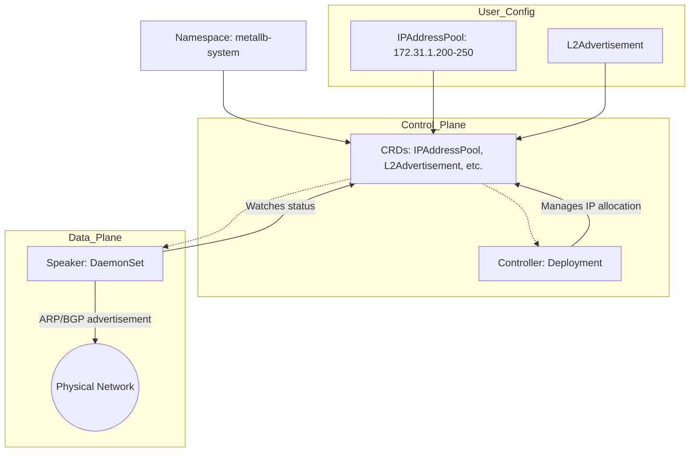

This document analyzes the YAML files used to install and configure MetalLB.

## Overall Structure

```
MetalLB resources:
1. Custom Resources (CRDs)
   - IPAddressPool
   - L2Advertisement
   - BGPPeer, BGPAdvertisement
   - BFDProfile, Community
   - ServiceL2Status

2. RBAC resources
   - ServiceAccount (x2)
   - Role (x2)
   - ClusterRole (x2)
   - RoleBinding (x2)
   - ClusterRoleBinding (x2)

3. Application resources
   - ConfigMap
   - Secret
   - Service
   - Deployment (Controller)
   - DaemonSet (Speaker)

4. Webhook
   - ValidatingWebhookConfiguration
```

---

## 1. Custom Resource Configuration

### 1-1. IPAddressPool

```yaml
apiVersion: metallb.io/v1beta1
kind: IPAddressPool
metadata:
  name: ip-pool
  namespace: metallb-system
spec:
  addresses:
  - 172.31.1.200-172.31.1.250
```

#### Description

| Field | Value | Description |
|------|-----|------|
| `addresses` | 172.31.1.200-172.31.1.250 | IP address range to allocate |

#### Role

- Defines the pool of IP addresses to assign to LoadBalancer Services
- 51 IPs available in total (200~250)

#### Ways to Specify IP Addresses

```yaml
# CIDR notation is also supported
addresses:
- 192.168.1.0/24      # 256 IPs
- 10.0.0.1-10.0.0.10  # Explicit range
```

---

### 1-2. L2Advertisement

```yaml
apiVersion: metallb.io/v1beta1
kind: L2Advertisement
metadata:
  name: l2-advertisement
  namespace: metallb-system
spec:
  ipAddressPools:
  - ip-pool
  interfaces:
  - eth0
```

#### Description

| Field | Value | Description |
|------|-----|------|
| `ipAddressPools` | ip-pool | IP pool to advertise |
| `interfaces` | eth0 | Network interface to advertise on |

#### Role

- Configures IP advertisement through L2 (Layer 2) mode
- Announces IP addresses using the ARP protocol
- Advertises only on a specific interface (eth0)

#### L2 vs BGP

```
L2 mode:
- Uses ARP (simple)
- A single node owns the IP
- Fast failover
- No router configuration needed

BGP mode:
- Uses the BGP protocol (complex)
- ECMP support (load balancing)
- Integrates with network equipment
- BGP peer configuration required
```

---

## 2. Namespace

```yaml
apiVersion: v1
kind: Namespace
metadata:
  labels:
    pod-security.kubernetes.io/audit: privileged
    pod-security.kubernetes.io/enforce: privileged
    pod-security.kubernetes.io/warn: privileged
  name: metallb-system
```

### Pod Security Standards

| Label | Value | Description |
|--------|-----|------|
| `audit` | privileged | Records audit logs only |
| `enforce` | privileged | Allows privileged mode |
| `warn` | privileged | Displays warnings only |

### Role

- Dedicated namespace for MetalLB
- Requires running privileged containers (network manipulation)

---

## 3. CustomResourceDefinitions (CRD)

MetalLB defines 6 CRDs.

### 3-1. BFDProfile

```yaml
apiVersion: apiextensions.k8s.io/v1
kind: CustomResourceDefinition
metadata:
  name: bfdprofiles.metallb.io
spec:
  group: metallb.io
  names:
    kind: BFDProfile
    plural: bfdprofiles
  scope: Namespaced
```

#### Role

- Configures BFD (Bidirectional Forwarding Detection) sessions
- Fast detection of network failures

#### Key Settings

```yaml
spec:
  detectMultiplier: 3        # Failure detection multiplier
  transmitInterval: 300      # Transmit interval (ms)
  receiveInterval: 300       # Receive interval (ms)
  passiveMode: false         # Passive mode
```

---

### 3-2. BGPAdvertisement

```yaml
kind: CustomResourceDefinition
metadata:
  name: bgpadvertisements.metallb.io
```

#### Role

- Configures IP route advertisement through BGP
- Sets BGP communities, local preference, etc.

#### Key Settings

```yaml
spec:
  aggregationLength: 32      # IPv4 aggregation length
  communities:               # BGP communities
  - "65000:100"
  localPref: 100             # Local preference
```

---

### 3-3. BGPPeer

```yaml
kind: CustomResourceDefinition
metadata:
  name: bgppeers.metallb.io
```

#### Role

- Configures BGP peers (routers)
- Supports versions v1beta1 and v1beta2

#### Key Settings (v1beta2)

```yaml
spec:
  myASN: 65000               # Local AS number
  peerASN: 65001             # Peer AS number
  peerAddress: 192.168.1.1   # Peer address
  peerPort: 179              # BGP port
  bfdProfile: bfd-profile    # BFD profile reference
  ebgpMultiHop: false        # Whether multihop is enabled
```

---

### 3-4. Community

```yaml
kind: CustomResourceDefinition
metadata:
  name: communities.metallb.io
```

#### Role

- Defines BGP community aliases
- Maps reusable community names

#### Usage Example

```yaml
spec:
  communities:
  - name: customer-a
    value: "65000:100"
  - name: customer-b
    value: "65000:200"
```

---

### 3-5. IPAddressPool

```yaml
kind: CustomResourceDefinition
metadata:
  name: ipaddresspools.metallb.io
```

#### Role

- Defines IP address pools
- Configures auto-assignment, priority, and namespace selectors

#### Key Settings

```yaml
spec:
  addresses:
  - 192.168.1.0/24
  autoAssign: true           # Auto-assign
  avoidBuggyIPs: true        # Exclude .0 and .255
  serviceAllocation:         # Service allocation rules
    priority: 10
    namespaces:
    - production
```

---

### 3-6. L2Advertisement

```yaml
kind: CustomResourceDefinition
metadata:
  name: l2advertisements.metallb.io
```

#### Role

- Configures IP advertisement in L2 mode
- Specifies interfaces and node selectors

#### Key Settings

```yaml
spec:
  ipAddressPools:
  - pool-1
  interfaces:
  - eth0
  - eth1
  nodeSelectors:             # Specific nodes only
  - matchLabels:
      node-type: lb
```

---

### 3-7. ServiceL2Status

```yaml
kind: CustomResourceDefinition
metadata:
  name: servicel2statuses.metallb.io
```

#### Role

- Monitors Service status in L2 mode
- Shows the node and interface that actually receive traffic

#### Status Information

```yaml
status:
  node: k8s-w1                      # Node receiving traffic
  serviceName: my-service           # Service name
  serviceNamespace: default         # Namespace
  interfaces:                       # List of interfaces
  - name: eth0
```

---

## 4. RBAC Resources

### 4-1. ServiceAccount

```yaml
apiVersion: v1
kind: ServiceAccount
metadata:
  labels:
    app: metallb
  name: controller
  namespace: metallb-system
---
apiVersion: v1
kind: ServiceAccount
metadata:
  labels:
    app: metallb
  name: speaker
  namespace: metallb-system
```

#### Role

- **controller**: Identity of the MetalLB controller Pod
- **speaker**: Identity of the MetalLB speaker Pod (runs on every node)

---

### 4-2. Role (Controller)

```yaml
apiVersion: rbac.authorization.k8s.io/v1
kind: Role
metadata:
  name: controller
  namespace: metallb-system
rules:
- apiGroups: [""]
  resources: ["secrets"]
  verbs: ["create", "delete", "get", "list", "patch", "update", "watch"]
- apiGroups: ["metallb.io"]
  resources: ["bgppeers", "bfdprofiles", "ipaddresspools", 
              "bgpadvertisements", "l2advertisements", "communities"]
  verbs: ["get", "list", "watch"]
```

#### Permissions

- Manage Secrets (for memberlist)
- Read MetalLB CRDs

---

### 4-3. Role (Speaker)

```yaml
kind: Role
metadata:
  name: pod-lister
  namespace: metallb-system
rules:
- apiGroups: [""]
  resources: ["pods", "secrets", "configmaps"]
  verbs: ["list", "get", "watch"]
- apiGroups: ["metallb.io"]
  resources: ["bfdprofiles", "bgppeers", "l2advertisements", 
              "bgpadvertisements", "ipaddresspools", "communities"]
  verbs: ["get", "list", "watch"]
```

#### Permissions

- View Pods, Secrets, and ConfigMaps
- Read MetalLB CRDs

---

### 4-4. ClusterRole (Controller)

```yaml
kind: ClusterRole
metadata:
  name: metallb-system:controller
rules:
- apiGroups: [""]
  resources: ["services", "namespaces", "nodes"]
  verbs: ["get", "list", "watch"]
- apiGroups: [""]
  resources: ["services/status"]
  verbs: ["update"]
- apiGroups: [""]
  resources: ["events"]
  verbs: ["create", "patch"]
- apiGroups: ["admissionregistration.k8s.io"]
  resources: ["validatingwebhookconfigurations", "mutatingwebhookconfigurations"]
  verbs: ["create", "delete", "get", "list", "patch", "update", "watch"]
- apiGroups: ["apiextensions.k8s.io"]
  resources: ["customresourcedefinitions"]
  verbs: ["create", "delete", "get", "list", "patch", "update", "watch"]
```

#### Permissions

- View Services/namespaces/nodes cluster-wide
- Update Service status (LoadBalancer IP assignment)
- Create events
- Manage Webhook configurations
- Manage CRDs

---

### 4-5. ClusterRole (Speaker)

```yaml
kind: ClusterRole
metadata:
  name: metallb-system:speaker
rules:
- apiGroups: ["metallb.io"]
  resources: ["servicel2statuses", "servicel2statuses/status"]
  verbs: ["*"]
- apiGroups: [""]
  resources: ["services", "endpoints", "nodes", "namespaces"]
  verbs: ["get", "list", "watch"]
- apiGroups: ["discovery.k8s.io"]
  resources: ["endpointslices"]
  verbs: ["get", "list", "watch"]
- apiGroups: [""]
  resources: ["events"]
  verbs: ["create", "patch"]
```

#### Permissions

- Full permissions on ServiceL2Status
- View Services, Endpoints, and nodes
- View EndpointSlices
- Create events

---

### 4-6. RoleBinding & ClusterRoleBinding

```yaml
# RoleBinding - Controller
apiVersion: rbac.authorization.k8s.io/v1
kind: RoleBinding
metadata:
  name: controller
  namespace: metallb-system
roleRef:
  kind: Role
  name: controller
subjects:
- kind: ServiceAccount
  name: controller
  namespace: metallb-system

# RoleBinding - Speaker
apiVersion: rbac.authorization.k8s.io/v1
kind: RoleBinding
metadata:
  name: pod-lister
  namespace: metallb-system
roleRef:
  kind: Role
  name: pod-lister
subjects:
- kind: ServiceAccount
  name: speaker
  namespace: metallb-system

# ClusterRoleBinding - Controller
apiVersion: rbac.authorization.k8s.io/v1
kind: ClusterRoleBinding
metadata:
  name: metallb-system:controller
roleRef:
  kind: ClusterRole
  name: metallb-system:controller
subjects:
- kind: ServiceAccount
  name: controller
  namespace: metallb-system

# ClusterRoleBinding - Speaker
apiVersion: rbac.authorization.k8s.io/v1
kind: ClusterRoleBinding
metadata:
  name: metallb-system:speaker
roleRef:
  kind: ClusterRole
  name: metallb-system:speaker
subjects:
- kind: ServiceAccount
  name: speaker
  namespace: metallb-system
```

---

## 5. ConfigMap & Secret

### 5-1. ConfigMap - Excluded Interfaces

```yaml
apiVersion: v1
kind: ConfigMap
metadata:
  name: metallb-excludel2
  namespace: metallb-system
data:
  excludel2.yaml: |
    announcedInterfacesToExclude: 
      ["^docker.*", "^cbr.*", "^dummy.*", "^virbr.*", "^lxcbr.*", 
       "^veth.*", "^lo$", "^cali.*", "^tunl.*", "^flannel.*", 
       "^kube-ipvs.*", "^cni.*", "^nodelocaldns.*"]
```

#### Role

- Defines patterns of network interfaces to exclude from L2 advertisement
- Excludes virtual interfaces and container networks

---

### 5-2. Secret - Webhook Certificate

```yaml
apiVersion: v1
kind: Secret
metadata:
  name: metallb-webhook-cert
  namespace: metallb-system
```

#### Role

- Stores the Webhook server TLS certificate

---

### 5-3. Secret - Memberlist

```yaml
# Secret for communication between controllers (auto-generated)
apiVersion: v1
kind: Secret
metadata:
  name: memberlist
  namespace: metallb-system
```

#### Role

- Encrypts cluster communication between controllers

---

## 6. Service

### 6-1. Webhook Service

```yaml
apiVersion: v1
kind: Service
metadata:
  name: metallb-webhook-service
  namespace: metallb-system
spec:
  ports:
  - port: 443
    targetPort: 9443
  selector:
    component: controller
```

#### Role

- Provides the Webhook validation endpoint

---

## 7. Deployment - Controller

```yaml
apiVersion: apps/v1
kind: Deployment
metadata:
  labels:
    app: metallb
    component: controller
  name: controller
  namespace: metallb-system
spec:
  revisionHistoryLimit: 3
  selector:
    matchLabels:
      app: metallb
      component: controller
  template:
    metadata:
      annotations:
        prometheus.io/port: "7472"
        prometheus.io/scrape: "true"
      labels:
        app: metallb
        component: controller
    spec:
      containers:
      - args:
        - --port=7472
        - --log-level=info
        - --tls-min-version=VersionTLS12
        env:
        - name: METALLB_ML_SECRET_NAME
          value: memberlist
        - name: METALLB_DEPLOYMENT
          value: controller
        image: quay.io/metallb/controller:v0.14.8
        livenessProbe:
          httpGet:
            path: /metrics
            port: monitoring
          initialDelaySeconds: 10
          periodSeconds: 10
        name: controller
        ports:
        - containerPort: 7472
          name: monitoring
        - containerPort: 9443
          name: webhook-server
        readinessProbe:
          httpGet:
            path: /metrics
            port: monitoring
          initialDelaySeconds: 10
          periodSeconds: 10
        securityContext:
          allowPrivilegeEscalation: false
          capabilities:
            drop: ["all"]
          readOnlyRootFilesystem: true
        volumeMounts:
        - mountPath: /tmp/k8s-webhook-server/serving-certs
          name: cert
          readOnly: true
      securityContext:
        fsGroup: 65534
        runAsNonRoot: true
        runAsUser: 65534
      serviceAccountName: controller
      terminationGracePeriodSeconds: 0
      volumes:
      - name: cert
        secret:
          secretName: metallb-webhook-cert
```

### Container Settings

| Setting | Value | Description |
|------|-----|------|
| `image` | quay.io/metallb/controller:v0.14.8 | Controller image |
| `--port` | 7472 | Metrics port |
| `--log-level` | info | Log level |
| `--tls-min-version` | VersionTLS12 | Minimum TLS version |

### Probes

```yaml
livenessProbe:
  httpGet:
    path: /metrics
    port: monitoring
  initialDelaySeconds: 10
  periodSeconds: 10

readinessProbe:
  httpGet:
    path: /metrics
    port: monitoring
  initialDelaySeconds: 10
  periodSeconds: 10
```

### Security Context

```yaml
securityContext:
  allowPrivilegeEscalation: false    # No privilege escalation
  capabilities:
    drop: ["all"]                    # Drop all capabilities
  readOnlyRootFilesystem: true       # Read-only filesystem
  runAsNonRoot: true                 # Must not run as root
  runAsUser: 65534                   # nobody user
```

### Environment Variables

```yaml
env:
- name: METALLB_ML_SECRET_NAME     # Memberlist Secret name
  value: memberlist
- name: METALLB_DEPLOYMENT         # Deployment name
  value: controller
```

### Role

- Monitors LoadBalancer Services
- Assigns IP addresses
- Manages CRDs
- Validates via Webhook

---

## 8. DaemonSet - Speaker

```yaml
apiVersion: apps/v1
kind: DaemonSet
metadata:
  labels:
    app: metallb
    component: speaker
  name: speaker
  namespace: metallb-system
spec:
  selector:
    matchLabels:
      app: metallb
      component: speaker
  template:
    metadata:
      annotations:
        prometheus.io/port: "7472"
        prometheus.io/scrape: "true"
      labels:
        app: metallb
        component: speaker
    spec:
      containers:
      - args:
        - --port=7472
        - --log-level=info
        env:
        - name: METALLB_NODE_NAME
          valueFrom:
            fieldRef:
              fieldPath: spec.nodeName
        - name: METALLB_POD_NAME
          valueFrom:
            fieldRef:
              fieldPath: metadata.name
        - name: METALLB_HOST
          valueFrom:
            fieldRef:
              fieldPath: status.hostIP
        - name: METALLB_ML_BIND_ADDR
          valueFrom:
            fieldRef:
              fieldPath: status.podIP
        - name: METALLB_ML_LABELS
          value: app=metallb,component=speaker
        - name: METALLB_ML_SECRET_KEY_PATH
          value: /etc/ml_secret_key
        image: quay.io/metallb/speaker:v0.14.8
        livenessProbe:
          httpGet:
            path: /metrics
            port: monitoring
          initialDelaySeconds: 10
          periodSeconds: 10
        name: speaker
        ports:
        - containerPort: 7472
          name: monitoring
        - containerPort: 7946
          name: memberlist-tcp
        - containerPort: 7946
          name: memberlist-udp
          protocol: UDP
        securityContext:
          allowPrivilegeEscalation: false
          capabilities:
            add:
            - NET_RAW                    # RAW sockets required (ARP/BGP)
            drop:
            - ALL
          readOnlyRootFilesystem: true
        volumeMounts:
        - mountPath: /etc/ml_secret_key
          name: memberlist
          readOnly: true
        - mountPath: /etc/metallb
          name: metallb-excludel2
          readOnly: true
      hostNetwork: true                  # Use the host network
      serviceAccountName: speaker
      terminationGracePeriodSeconds: 2
      tolerations:
      - effect: NoSchedule
        key: node-role.kubernetes.io/master
        operator: Exists
      - effect: NoSchedule
        key: node-role.kubernetes.io/control-plane
        operator: Exists
      volumes:
      - name: memberlist
        secret:
          secretName: memberlist
      - configMap:
          name: metallb-excludel2
        name: metallb-excludel2
```

### Important Settings

| Setting | Value | Description |
|------|-----|------|
| `hostNetwork` | true | Uses the host network directly |
| `terminationGracePeriodSeconds` | 2 | Fast termination (2 seconds) |
| `capabilities.add` | NET_RAW | RAW socket permission (ARP/BGP) |

### Environment Variables (Pod Information)

```yaml
env:
- METALLB_NODE_NAME        # Node name
- METALLB_POD_NAME         # Pod name
- METALLB_HOST             # Host IP
- METALLB_ML_BIND_ADDR     # Memberlist bind address
- METALLB_ML_LABELS        # Memberlist labels
- METALLB_ML_SECRET_KEY_PATH  # Memberlist key path
```

### Tolerations

```yaml
tolerations:
- key: node-role.kubernetes.io/master        # Tolerate master nodes
  effect: NoSchedule
- key: node-role.kubernetes.io/control-plane # Tolerate control plane nodes
  effect: NoSchedule
```

### Role

- Runs on every node (DaemonSet)
- L2 mode: ARP advertisement
- BGP mode: maintains BGP sessions
- Updates Service status

---

## 9. ValidatingWebhookConfiguration

```yaml
apiVersion: admissionregistration.k8s.io/v1
kind: ValidatingWebhookConfiguration
metadata:
  name: metallb-webhook-configuration
webhooks:
- name: bgppeersvalidationwebhook.metallb.io
  clientConfig:
    service:
      name: metallb-webhook-service
      namespace: metallb-system
      path: /validate-metallb-io-v1beta2-bgppeer
  rules:
  - apiGroups: ["metallb.io"]
    apiVersions: ["v1beta2"]
    operations: ["CREATE", "UPDATE"]
    resources: ["bgppeers"]
  failurePolicy: Fail
  admissionReviewVersions: ["v1"]
  
- name: bfdprofilevalidationwebhook.metallb.io
  rules:
  - operations: ["CREATE", "DELETE"]
    resources: ["bfdprofiles"]
    
- name: bgpadvertisementvalidationwebhook.metallb.io
  rules:
  - operations: ["CREATE", "UPDATE"]
    resources: ["bgpadvertisements"]
    
- name: communityvalidationwebhook.metallb.io
  rules:
  - operations: ["CREATE", "UPDATE"]
    resources: ["communities"]
    
- name: ipaddresspoolvalidationwebhook.metallb.io
  rules:
  - operations: ["CREATE", "UPDATE"]
    resources: ["ipaddresspools"]
    
- name: l2advertisementvalidationwebhook.metallb.io
  rules:
  - operations: ["CREATE", "UPDATE"]
    resources: ["l2advertisements"]
```

### Webhook Validation Targets

| Webhook | Resource | Operations |
|---------|--------|------|
| bgppeersvalidation | BGPPeer | CREATE, UPDATE |
| bfdprofilevalidation | BFDProfile | CREATE, DELETE |
| bgpadvertisementvalidation | BGPAdvertisement | CREATE, UPDATE |
| communityvalidation | Community | CREATE, UPDATE |
| ipaddresspoolvalidation | IPAddressPool | CREATE, UPDATE |
| l2advertisementvalidation | L2Advertisement | CREATE, UPDATE |

### FailurePolicy

```yaml
failurePolicy: Fail
```

- Rejects the request on Webhook errors
- Enforces safe configuration

---

## Resource Relationship Diagram

The relationships between the main components that make up MetalLB and the custom resources (CRDs).



| Component | Main Role | Notes |
|-----------|----------|------|
| **Controller** | Watches Services (LoadBalancer) in the cluster and allocates/reclaims IPs | Runs as a Deployment |
| **Speaker** | Announces allocated IPs to the external network (using the ARP or BGP protocol) | Runs as a DaemonSet on every node |
| **IPAddressPool** | Configuration resource that defines the range of available IPs that can be exposed externally | Custom CRD |
| **L2Advertisement** | Configures which interface to use for L2-mode advertisement | Custom CRD |

---

## Verifying the Installation

```bash
# Install MetalLB
kubectl apply -f metallb-native.yaml

# Configure the IP Pool and advertisement
kubectl apply -f metallb-ippool.yaml
kubectl apply -f metallb-l2advertisement.yaml

# Check Pod status
kubectl get pods -n metallb-system
# NAME                         READY   STATUS    RESTARTS   AGE
# controller-xxxxxxxxxx-xxxx   1/1     Running   0          1m
# speaker-xxxxx                1/1     Running   0          1m

# Check CRDs
kubectl get crd | grep metallb
# bgppeers.metallb.io
# ipaddresspools.metallb.io
# l2advertisements.metallb.io
# ...

# Check the IP Pool
kubectl get ipaddresspool -n metallb-system
# NAME      AUTO ASSIGN   AVOID BUGGY IPS   ADDRESSES
# ip-pool   true          false             172.31.1.200-172.31.1.250

# Check the L2 advertisement
kubectl get l2advertisement -n metallb-system
# NAME              IP ADDRESS POOLS   INTERFACES
# l2-advertisement  ["ip-pool"]        ["eth0"]
```

---

## Summary

| Category | Resources | Count |
|----------|--------|------|
| **CRD** | BFDProfile, BGPPeer, BGPAdvertisement, Community, IPAddressPool, L2Advertisement, ServiceL2Status | 7 |
| **Namespace** | metallb-system | 1 |
| **ServiceAccount** | controller, speaker | 2 |
| **Role** | controller, pod-lister | 2 |
| **ClusterRole** | controller, speaker | 2 |
| **RoleBinding** | controller, pod-lister | 2 |
| **ClusterRoleBinding** | controller, speaker | 2 |
| **ConfigMap** | metallb-excludel2 | 1 |
| **Secret** | webhook-cert, memberlist | 2 |
| **Service** | webhook-service | 1 |
| **Deployment** | controller | 1 |
| **DaemonSet** | speaker | 1 |
| **ValidatingWebhook** | 6 validators | 1 |
| **User resources** | IPAddressPool, L2Advertisement | 2 |
| **Total** | | **27** |

**MetalLB is a networking component that provides LoadBalancer functionality to bare-metal Kubernetes clusters.**
