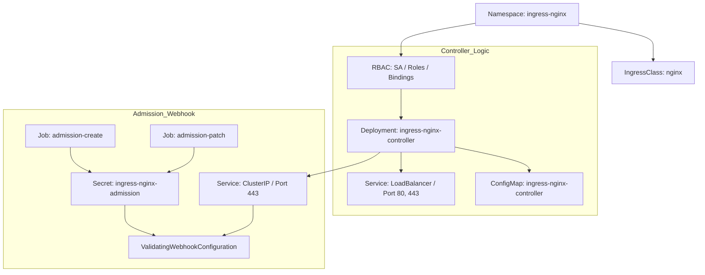

This document analyzes the YAML files used to install the Ingress-NGINX controller.

## Overall Structure

```
Ingress-NGINX resources:
1. Namespace                 - Dedicated namespace
2. ServiceAccount (x2)       - Pod identity
3. Role (x2)                 - Namespace permissions
4. ClusterRole (x2)          - Cluster permissions
5. RoleBinding (x2)          - Namespace permission bindings
6. ClusterRoleBinding (x2)   - Cluster permission bindings
7. ConfigMap                 - Controller configuration
8. Service (x2)              - Network endpoints
9. Deployment                - Controller deployment
10. Job (x2)                 - Webhook certificate creation/patching
11. IngressClass             - Ingress class definition
12. ValidatingWebhook        - Ingress validation
```

---

## 1. Namespace

```yaml
apiVersion: v1
kind: Namespace
metadata:
  labels:
    app.kubernetes.io/instance: ingress-nginx
    app.kubernetes.io/name: ingress-nginx
  name: ingress-nginx
```

### Description

| Field | Value | Description |
|------|-----|------|
| `name` | ingress-nginx | Dedicated namespace for Ingress-NGINX |
| `labels` | app.kubernetes.io/* | Kubernetes recommended label standard |

### Role

- Isolates Ingress-NGINX related resources
- Separates them from system namespaces

---

## 2. ServiceAccount (x2)

### 2-1. For the Controller

```yaml
apiVersion: v1
kind: ServiceAccount
metadata:
  labels:
    app.kubernetes.io/component: controller
    app.kubernetes.io/version: 1.11.3
  name: ingress-nginx
  namespace: ingress-nginx
automountServiceAccountToken: true
```

### 2-2. For Webhook Certificate Creation

```yaml
apiVersion: v1
kind: ServiceAccount
metadata:
  labels:
    app.kubernetes.io/component: admission-webhook
    app.kubernetes.io/version: 1.11.3
  name: ingress-nginx-admission
  namespace: ingress-nginx
automountServiceAccountToken: true
```

### automountServiceAccountToken

```yaml
automountServiceAccountToken: true
```

- Automatically mounts the ServiceAccount token into the Pod
- Required for Kubernetes API access

---

## 3. Role (x2)

### 3-1. Controller Role

```yaml
apiVersion: rbac.authorization.k8s.io/v1
kind: Role
metadata:
  name: ingress-nginx
  namespace: ingress-nginx
rules:
# Get namespaces
- apiGroups: [""]
  resources: ["namespaces"]
  verbs: ["get"]

# Get basic resources
- apiGroups: [""]
  resources: ["configmaps", "pods", "secrets", "endpoints"]
  verbs: ["get", "list", "watch"]

# Get services
- apiGroups: [""]
  resources: ["services"]
  verbs: ["get", "list", "watch"]

# Read Ingress resources
- apiGroups: ["networking.k8s.io"]
  resources: ["ingresses"]
  verbs: ["get", "list", "watch"]

# Update Ingress status
- apiGroups: ["networking.k8s.io"]
  resources: ["ingresses/status"]
  verbs: ["update"]

# Read IngressClass
- apiGroups: ["networking.k8s.io"]
  resources: ["ingressclasses"]
  verbs: ["get", "list", "watch"]

# Leader election
- apiGroups: ["coordination.k8s.io"]
  resourceNames: ["ingress-nginx-leader"]
  resources: ["leases"]
  verbs: ["get", "update"]
- apiGroups: ["coordination.k8s.io"]
  resources: ["leases"]
  verbs: ["create"]

# Create events
- apiGroups: [""]
  resources: ["events"]
  verbs: ["create", "patch"]

# Get EndpointSlices
- apiGroups: ["discovery.k8s.io"]
  resources: ["endpointslices"]
  verbs: ["list", "watch", "get"]
```

### Permission Summary

| Resource | Permissions | Purpose |
|--------|------|------|
| namespaces | get | Read Namespace information |
| configmaps, pods, secrets, endpoints | get, list, watch | Read core resources |
| services | get, list, watch | Read Services |
| ingresses | get, list, watch | Watch Ingress resources |
| ingresses/status | update | Update Ingress status |
| ingressclasses | get, list, watch | Read IngressClasses |
| leases | get, update, create | Leader election (high availability) |
| events | create, patch | Record events |
| endpointslices | list, watch, get | Read EndpointSlices (backend endpoints) |

---

### 3-2. Webhook Role

```yaml
apiVersion: rbac.authorization.k8s.io/v1
kind: Role
metadata:
  name: ingress-nginx-admission
  namespace: ingress-nginx
rules:
- apiGroups: [""]
  resources: ["secrets"]
  verbs: ["get", "create"]
```

### Role

- Create and read the webhook certificate Secret

---

## 4. ClusterRole (x2)

### 4-1. Controller ClusterRole

```yaml
apiVersion: rbac.authorization.k8s.io/v1
kind: ClusterRole
metadata:
  name: ingress-nginx
rules:
# Get cluster-wide resources
- apiGroups: [""]
  resources: ["configmaps", "endpoints", "nodes", "pods", "secrets", "namespaces"]
  verbs: ["list", "watch"]

# Get nodes
- apiGroups: [""]
  resources: ["nodes"]
  verbs: ["get"]

# Get services
- apiGroups: [""]
  resources: ["services"]
  verbs: ["get", "list", "watch"]

# Manage Ingress resources
- apiGroups: ["networking.k8s.io"]
  resources: ["ingresses"]
  verbs: ["get", "list", "watch"]

# Create events
- apiGroups: [""]
  resources: ["events"]
  verbs: ["create", "patch"]

# Update Ingress status
- apiGroups: ["networking.k8s.io"]
  resources: ["ingresses/status"]
  verbs: ["update"]

# Get IngressClass
- apiGroups: ["networking.k8s.io"]
  resources: ["ingressclasses"]
  verbs: ["get", "list", "watch"]

# Get EndpointSlices
- apiGroups: ["discovery.k8s.io"]
  resources: ["endpointslices"]
  verbs: ["list", "watch", "get"]

# Get leases
- apiGroups: ["coordination.k8s.io"]
  resources: ["leases"]
  verbs: ["list", "watch"]
```

### ClusterRole vs Role

| Scope | Role | ClusterRole |
|------|------|-------------|
| **Scope** | Within a namespace | Cluster-wide |
| **Purpose** | Namespaced resources | Cluster-level resources such as nodes and namespaces |

---

### 4-2. Webhook ClusterRole

```yaml
apiVersion: rbac.authorization.k8s.io/v1
kind: ClusterRole
metadata:
  name: ingress-nginx-admission
rules:
- apiGroups: ["admissionregistration.k8s.io"]
  resources: ["validatingwebhookconfigurations"]
  verbs: ["get", "update"]
```

### Role

- Update ValidatingWebhookConfiguration

---

## 5. RoleBinding & ClusterRoleBinding

### 5-1. RoleBinding (x2)

```yaml
# For the controller
apiVersion: rbac.authorization.k8s.io/v1
kind: RoleBinding
metadata:
  name: ingress-nginx
  namespace: ingress-nginx
roleRef:
  kind: Role
  name: ingress-nginx
subjects:
- kind: ServiceAccount
  name: ingress-nginx
  namespace: ingress-nginx

# For the webhook
apiVersion: rbac.authorization.k8s.io/v1
kind: RoleBinding
metadata:
  name: ingress-nginx-admission
  namespace: ingress-nginx
roleRef:
  kind: Role
  name: ingress-nginx-admission
subjects:
- kind: ServiceAccount
  name: ingress-nginx-admission
  namespace: ingress-nginx
```

### 5-2. ClusterRoleBinding (x2)

```yaml
# For the controller
apiVersion: rbac.authorization.k8s.io/v1
kind: ClusterRoleBinding
metadata:
  name: ingress-nginx
roleRef:
  kind: ClusterRole
  name: ingress-nginx
subjects:
- kind: ServiceAccount
  name: ingress-nginx
  namespace: ingress-nginx

# For the webhook
apiVersion: rbac.authorization.k8s.io/v1
kind: ClusterRoleBinding
metadata:
  name: ingress-nginx-admission
roleRef:
  kind: ClusterRole
  name: ingress-nginx-admission
subjects:
- kind: ServiceAccount
  name: ingress-nginx-admission
  namespace: ingress-nginx
```

---

## 6. ConfigMap

```yaml
apiVersion: v1
kind: ConfigMap
metadata:
  name: ingress-nginx-controller
  namespace: ingress-nginx
data:
  allow-snippet-annotations: "false"
```

### Setting Description

| Setting | Value | Description |
|------|-----|------|
| `allow-snippet-annotations` | "false" | Disallow snippet annotations (security) |

### Security Considerations

```yaml
# Mitigation for CVE-2021-25742
# If allow-snippet-annotations: "true",
# malicious nginx configuration can be injected

# Example (malicious annotation):
# nginx.ingress.kubernetes.io/configuration-snippet: |
#   set $secret $http_authorization;
#   proxy_set_header X-Secret $secret;
```

### Other Key Configuration Options

```yaml
data:
  # SSL/TLS settings
  ssl-protocols: "TLSv1.2 TLSv1.3"
  ssl-ciphers: "ECDHE-ECDSA-AES128-GCM-SHA256:..."
  
  # Timeout settings
  proxy-connect-timeout: "10"
  proxy-read-timeout: "60"
  proxy-send-timeout: "60"
  
  # Resource limits
  max-worker-connections: "1024"
  
  # Logging settings
  access-log-path: "/var/log/nginx/access.log"
  error-log-path: "/var/log/nginx/error.log"
  
  # Miscellaneous
  use-forwarded-headers: "true"
  compute-full-forwarded-for: "true"
```

---

## 7. Service (x2)

### 7-1. Controller Service (LoadBalancer)

```yaml
apiVersion: v1
kind: Service
metadata:
  name: ingress-nginx-controller
  namespace: ingress-nginx
spec:
  type: LoadBalancer
  externalTrafficPolicy: Local
  ipFamilies:
  - IPv4
  ipFamilyPolicy: SingleStack
  ports:
  - appProtocol: http
    name: http
    port: 80
    protocol: TCP
    targetPort: http
  - appProtocol: https
    name: https
    port: 443
    protocol: TCP
    targetPort: https
  selector:
    app.kubernetes.io/component: controller
    app.kubernetes.io/name: ingress-nginx
```

### Key Settings

#### externalTrafficPolicy: Local

```yaml
externalTrafficPolicy: Local
```

| Value | Description | Pros and Cons |
|----|------|--------|
| `Cluster` | Distributes traffic to all Pods | Source IP not preserved, even distribution |
| `Local` | Routes traffic only to local Pods | **Source IP preserved**, possible imbalance |

```
Cluster mode:
Client → Node1 → Pod(Node3)  # Source IP changed

Local mode:
Client → Node1 → Pod(Node1)  # Source IP preserved
```

#### ipFamilyPolicy

```yaml
ipFamilies:
- IPv4
ipFamilyPolicy: SingleStack
```

| Policy | Description |
|------|------|
| `SingleStack` | Single IP stack (IPv4 or IPv6) |
| `PreferDualStack` | Prefer dual stack |
| `RequireDualStack` | Require dual stack |

#### appProtocol

```yaml
appProtocol: http   # HTTP protocol
appProtocol: https  # HTTPS protocol
```

- Used in Kubernetes 1.20+
- Compatible with service meshes (Istio, etc.)

---

### 7-2. Webhook Service (ClusterIP)

```yaml
apiVersion: v1
kind: Service
metadata:
  name: ingress-nginx-controller-admission
  namespace: ingress-nginx
spec:
  type: ClusterIP
  ports:
  - appProtocol: https
    name: https-webhook
    port: 443
    targetPort: webhook
  selector:
    app.kubernetes.io/component: controller
```

### Role

- Provides the Validating Webhook endpoint
- For internal cluster communication

---

## 8. Deployment - Controller

```yaml
apiVersion: apps/v1
kind: Deployment
metadata:
  name: ingress-nginx-controller
  namespace: ingress-nginx
spec:
  minReadySeconds: 0
  revisionHistoryLimit: 10
  strategy:
    rollingUpdate:
      maxUnavailable: 1
    type: RollingUpdate
  template:
    spec:
      containers:
      - args:
        - /nginx-ingress-controller
        - --publish-service=$(POD_NAMESPACE)/ingress-nginx-controller
        - --election-id=ingress-nginx-leader
        - --controller-class=k8s.io/ingress-nginx
        - --ingress-class=nginx
        - --configmap=$(POD_NAMESPACE)/ingress-nginx-controller
        - --validating-webhook=:8443
        - --validating-webhook-certificate=/usr/local/certificates/cert
        - --validating-webhook-key=/usr/local/certificates/key
        - --enable-metrics=false
        env:
        - name: POD_NAME
          valueFrom:
            fieldRef:
              fieldPath: metadata.name
        - name: POD_NAMESPACE
          valueFrom:
            fieldRef:
              fieldPath: metadata.namespace
        - name: LD_PRELOAD
          value: /usr/local/lib/libmimalloc.so
        image: registry.k8s.io/ingress-nginx/controller:v1.11.3@sha256:d56f135b6462cfc476447cfe564b83a45e8bb7da2774963b00d12161112270b7
        imagePullPolicy: IfNotPresent
        lifecycle:
          preStop:
            exec:
              command:
              - /wait-shutdown
        livenessProbe:
          failureThreshold: 5
          httpGet:
            path: /healthz
            port: 10254
            scheme: HTTP
          initialDelaySeconds: 10
          periodSeconds: 10
        readinessProbe:
          failureThreshold: 3
          httpGet:
            path: /healthz
            port: 10254
            scheme: HTTP
          initialDelaySeconds: 10
          periodSeconds: 10
        name: controller
        ports:
        - containerPort: 80
          name: http
        - containerPort: 443
          name: https
        - containerPort: 8443
          name: webhook
        resources:
          requests:
            cpu: 100m
            memory: 90Mi
        securityContext:
          allowPrivilegeEscalation: false
          capabilities:
            add:
            - NET_BIND_SERVICE
            drop:
            - ALL
          readOnlyRootFilesystem: false
          runAsNonRoot: true
          runAsUser: 101
        volumeMounts:
        - mountPath: /usr/local/certificates/
          name: webhook-cert
          readOnly: true
      serviceAccountName: ingress-nginx
      terminationGracePeriodSeconds: 300
      volumes:
      - name: webhook-cert
        secret:
          secretName: ingress-nginx-admission
```

### Container Arguments (args)

| Argument | Description |
|------|------|
| `/nginx-ingress-controller` | Executable binary |
| `--publish-service` | References the LoadBalancer Service (advertises the external IP) |
| `--election-id` | ID used for leader election |
| `--controller-class` | Controller class identifier |
| `--ingress-class=nginx` | Default Ingress class |
| `--configmap` | References the configuration ConfigMap |
| `--validating-webhook=:8443` | Webhook port |
| `--validating-webhook-certificate` | Webhook certificate path |
| `--validating-webhook-key` | Webhook key path |
| `--enable-metrics=false` | Disable metrics |

### Environment Variables

```yaml
env:
- POD_NAME         # Pod name (field reference)
- POD_NAMESPACE    # Namespace (field reference)
- LD_PRELOAD       # Memory allocator (performance optimization)
```

### Lifecycle Hook

```yaml
lifecycle:
  preStop:
    exec:
      command:
      - /wait-shutdown
```

- Waits for connections to drain when the Pod terminates
- Graceful shutdown

### Probes

```yaml
livenessProbe:
  httpGet:
    path: /healthz      # Liveness check
    port: 10254
  failureThreshold: 5   # Restart after 5 failures
  periodSeconds: 10

readinessProbe:
  httpGet:
    path: /healthz      # Readiness check
    port: 10254
  failureThreshold: 3   # Remove from traffic after 3 failures
```

### Security Context

```yaml
securityContext:
  allowPrivilegeEscalation: false    # No privilege escalation
  capabilities:
    add:
    - NET_BIND_SERVICE               # Allow binding to ports below 1024
    drop:
    - ALL                            # Drop all other capabilities
  runAsNonRoot: true                 # Must not run as root
  runAsUser: 101                     # nginx user
  seccompProfile:
    type: RuntimeDefault             # Default seccomp profile
```

### Resource Requests

```yaml
resources:
  requests:
    cpu: 100m      # Guarantees 0.1 core
    memory: 90Mi   # Guarantees 90MB
```

### Deployment Strategy

```yaml
strategy:
  rollingUpdate:
    maxUnavailable: 1  # At most 1 Pod unavailable
  type: RollingUpdate
```

### Termination Grace Period

```yaml
terminationGracePeriodSeconds: 300  # 5 minutes
```

- Long grace period: lets in-flight connections finish

---

## 9. Job (x2) - Webhook Certificate Creation

### 9-1. Certificate Creation Job

```yaml
apiVersion: batch/v1
kind: Job
metadata:
  name: ingress-nginx-admission-create
  namespace: ingress-nginx
spec:
  template:
    spec:
      containers:
      - args:
        - create
        - --host=ingress-nginx-controller-admission,ingress-nginx-controller-admission.$(POD_NAMESPACE).svc
        - --namespace=$(POD_NAMESPACE)
        - --secret-name=ingress-nginx-admission
        env:
        - name: POD_NAMESPACE
          valueFrom:
            fieldRef:
              fieldPath: metadata.namespace
        image: registry.k8s.io/ingress-nginx/kube-webhook-certgen:v1.4.4
        name: create
        securityContext:
          allowPrivilegeEscalation: false
          capabilities:
            drop: ["ALL"]
          readOnlyRootFilesystem: true
          runAsNonRoot: true
          runAsUser: 65532
      restartPolicy: OnFailure
      serviceAccountName: ingress-nginx-admission
```

### Role

- Automatically generates the webhook certificate
- Generates a self-signed certificate

### Generated Secret

```yaml
# ingress-nginx-admission Secret
apiVersion: v1
kind: Secret
metadata:
  name: ingress-nginx-admission
data:
  ca.crt: <CA certificate>
  tls.crt: <server certificate>
  tls.key: <server key>
```

---

### 9-2. Webhook Patch Job

```yaml
apiVersion: batch/v1
kind: Job
metadata:
  name: ingress-nginx-admission-patch
  namespace: ingress-nginx
spec:
  template:
    spec:
      containers:
      - args:
        - patch
        - --webhook-name=ingress-nginx-admission
        - --namespace=$(POD_NAMESPACE)
        - --patch-mutating=false
        - --secret-name=ingress-nginx-admission
        - --patch-failure-policy=Fail
        image: registry.k8s.io/ingress-nginx/kube-webhook-certgen:v1.4.4
        name: patch
      restartPolicy: OnFailure
      serviceAccountName: ingress-nginx-admission
```

### Role

- Updates ValidatingWebhookConfiguration
- Patches the CA bundle with the generated CA certificate

### Patch Content

```yaml
# Update the CABundle of the WebhookConfiguration
apiVersion: admissionregistration.k8s.io/v1
kind: ValidatingWebhookConfiguration
metadata:
  name: ingress-nginx-admission
webhooks:
- clientConfig:
    caBundle: <generated CA certificate>
```

---

## 10. IngressClass

```yaml
apiVersion: networking.k8s.io/v1
kind: IngressClass
metadata:
  name: nginx
spec:
  controller: k8s.io/ingress-nginx
```

### Description

| Field | Value | Description |
|------|-----|------|
| `name` | nginx | Ingress class name |
| `controller` | k8s.io/ingress-nginx | Controller identifier |

### Role

- Connects Ingress resources to the controller
- Multiple Ingress controllers can coexist

### Usage Example

```yaml
# Referenced in the Ingress resource
apiVersion: networking.k8s.io/v1
kind: Ingress
metadata:
  name: my-app
spec:
  ingressClassName: nginx  # ← uses this class
  rules:
  - host: myapp.example.com
    http:
      paths:
      - path: /
        pathType: Prefix
        backend:
          service:
            name: my-app
            port:
              number: 80
```

---

## 11. ValidatingWebhookConfiguration

```yaml
apiVersion: admissionregistration.k8s.io/v1
kind: ValidatingWebhookConfiguration
metadata:
  name: ingress-nginx-admission
webhooks:
- admissionReviewVersions:
  - v1
  clientConfig:
    service:
      name: ingress-nginx-controller-admission
      namespace: ingress-nginx
      path: /networking/v1/ingresses
      port: 443
  failurePolicy: Fail
  matchPolicy: Equivalent
  name: validate.nginx.ingress.kubernetes.io
  rules:
  - apiGroups: ["networking.k8s.io"]
    apiVersions: ["v1"]
    operations: ["CREATE", "UPDATE"]
    resources: ["ingresses"]
  sideEffects: None
```

### Description

| Field | Value | Description |
|------|-----|------|
| `admissionReviewVersions` | v1 | AdmissionReview version |
| `failurePolicy` | Fail | Reject the request if validation fails |
| `matchPolicy` | Equivalent | Also match equivalent resources |
| `sideEffects` | None | No side effects |

### Validation Items

- Validates Ingress rule correctness
- Validates annotations
- Checks for path conflicts
- Validates TLS settings

---

## Resource Relationship Diagram

The main resources that make up Ingress-NGINX and their relationships.



| Component | Main Role |
|-----------|----------|
| **Controller** | Watches Ingress resources and automatically generates and updates the NGINX configuration |
| **IngressClass** | An identifier for selecting the nginx controller when multiple Ingress controllers run in the cluster |
| **Admission Webhook** | Validates Ingress resources up front, catching configuration errors when they are created or modified |
| **RBAC** | Grants the controller permission to read cluster resources (Ingress, Secret, etc.) |

---

## Verify the Installation

```bash
# Install Ingress-NGINX
kubectl apply -f ingress-nginx.yaml

# Check Pod status
kubectl get pods -n ingress-nginx
# NAME                                        READY   STATUS    RESTARTS   AGE
# ingress-nginx-controller-xxxxxxxxxx-xxxxx   1/1     Running   0          2m
# ingress-nginx-admission-create-xxxxx        0/1     Completed 0          2m
# ingress-nginx-admission-patch-xxxxx         0/1     Completed 0          2m

# Check Service
kubectl get svc -n ingress-nginx
# NAME                                 TYPE           CLUSTER-IP     EXTERNAL-IP   PORT(S)
# ingress-nginx-controller             LoadBalancer   10.96.xxx.xxx  192.168.x.x   80:3xxxx/TCP,443:3xxxx/TCP
# ingress-nginx-controller-admission   ClusterIP      10.96.xxx.xxx  <none>        443/TCP

# Check IngressClass
kubectl get ingressclass
# NAME    CONTROLLER                       AGE
# nginx   k8s.io/ingress-nginx             2m

# Create a test Ingress
cat <<EOF | kubectl apply -f -
apiVersion: networking.k8s.io/v1
kind: Ingress
metadata:
  name: test-ingress
spec:
  ingressClassName: nginx
  rules:
  - host: test.example.com
    http:
      paths:
      - path: /
        pathType: Prefix
        backend:
          service:
            name: test-service
            port:
              number: 80
EOF

# Check Ingress
kubectl get ingress
# NAME            CLASS   HOSTS             ADDRESS        PORTS   AGE
# test-ingress    nginx   test.example.com  192.168.x.x    80      1m
```

---

## Summary

| Category | Resource | Count |
|----------|--------|------|
| **Namespace** | ingress-nginx | 1 |
| **ServiceAccount** | controller, admission | 2 |
| **Role** | controller, admission | 2 |
| **ClusterRole** | controller, admission | 2 |
| **RoleBinding** | controller, admission | 2 |
| **ClusterRoleBinding** | controller, admission | 2 |
| **ConfigMap** | controller configuration | 1 |
| **Service** | controller, admission | 2 |
| **Deployment** | controller | 1 |
| **Job** | create, patch | 2 |
| **IngressClass** | nginx | 1 |
| **ValidatingWebhook** | admission | 1 |
| **Total** | | **19** |

**Ingress-NGINX is the most widely used controller implementing the Kubernetes Ingress resource.**
