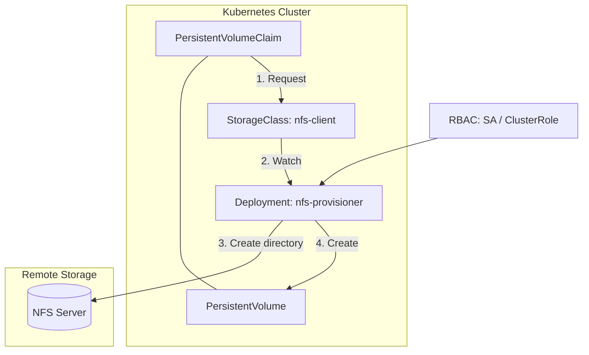
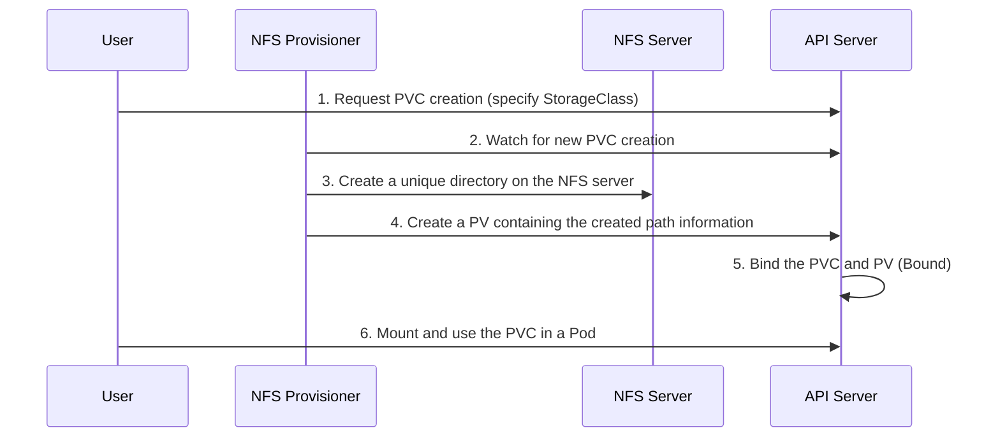

Learn how to implement Dynamic Provisioning of volumes in Kubernetes using an NFS server.

---

## 1. Resource Relationship Diagram

This shows the interactions among the main components that make up the NFS provisioner.

### Roles of the Main Resources

| Component | Role | Notes |
|-----------|------|------|
| **StorageClass** | Defines which provisioner to use | Sets policies such as `archiveOnDelete` |
| **NFS Provisioner** | An agent that watches PVCs and creates the actual directories on the NFS server | Runs as a Deployment |
| **RBAC** | Permissions that let the provisioner control the cluster's PVs/PVCs | SA, ClusterRole, etc. |
| **NFS Server** | The external server where the actual data is stored | Requires IP and mount path |

---

## 2. Dynamic Provisioning Workflow

This is what happens internally when a user creates a PVC.

---

## 3. Installation Verification and Test Summary

1.  **Check the provisioner status:** Use the `kubectl get pods -n nfs` command to verify the container is `Running`.
2.  **Create a PVC:** Apply the test `test-claim.yaml`.
3.  **Verify the binding:** It is successful when the `kubectl get pvc` result shows the `Bound` status.
4.  **Physical verification:** Check that a folder of the form `default-test-claim-pvc-xxx` has been created in the shared directory on the NFS server.

---

## 4. Summary

With the NFS Subdir External Provisioner, users do not need to create PVs manually; **simply creating a PVC automatically allocates a subdirectory on the NFS server**, which greatly improves operational efficiency.
