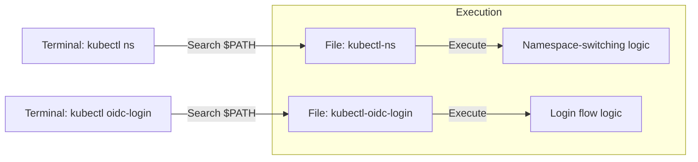

A kubectl plugin is the easiest way to extend kubectl with commands tailored to your own needs.

---

## What Is a kubectl Plugin?

A kubectl plugin is a standalone executable file that works as a subcommand of `kubectl`. With plugins you can simplify complex commands or build custom tools for cluster management.

### Key Characteristics

| Item | Description | Note |
|------|------|------|
| **Naming convention** | Must follow the `kubectl-<plugin-name>` format | Required |
| **File location** | A directory listed in the user's `$PATH` environment variable | Required |
| **How it runs** | Invoked as `kubectl <plugin-name>` | - |
| **Language** | Any language works as long as the file is executable (Bash, Go, Python, etc.) | Flexibility |

---

## Plugin Command Rules

The relationship between the command a user types in the terminal and the actual file name looks like this.



---

## Step 1: Building the Simplest Plugin (Bash)

### 1. Write the script
Create a very simple plugin that prints a greeting.

```bash
# Create the /usr/local/bin/kubectl-hello file
cat <<'EOF' > /usr/local/bin/kubectl-hello
#!/bin/bash
echo "Hello! This is a custom kubectl plugin."
EOF
```

### 2. Make it executable and verify
```bash
# Make the file executable
chmod +x /usr/local/bin/kubectl-hello

# List installed plugins
kubectl plugin list
```

### 3. Usage
```bash
kubectl hello
# Output: Hello! This is a custom kubectl plugin.
```

---

## Step 2: A Practical Plugin Example (Switching Namespaces)

This example implements a commonly used namespace-switching tool in Bash.

```bash
#!/bin/bash
# File name: kubectl-ns
if [ -z "$1" ]; then
  kubectl config view --minify | grep namespace
else
  kubectl config set-context --current --namespace="$1"
  echo "Context switched to namespace '$1'."
fi
```

---

## Key Takeaways

1.  **Rule:** The file name must always start with `kubectl-`.
2.  **Distribution:** Copy the file into a `$PATH` directory and give it execute permission with `chmod +x`, and the plugin is installed.
3.  **Management:** The `kubectl plugin list` command shows all currently available plugins at a glance.
4.  **Recommended tool:** To manage more plugins easily, use the plugin manager **Krew**.

**With plugins, you can turn repetitive, complex kubectl options into your own shortcut commands and greatly improve your productivity.**
