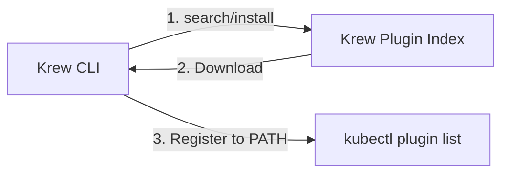

Krew is the official package manager for discovering, installing, and managing `kubectl` plugins.

---

## 1. What Is Krew?

Krew is a **plugin management tool dedicated to kubectl**, playing a role similar to `apt` or `yum` on Linux or `brew` on macOS.

### Key Concepts

- **Standardization:** All plugins can be installed and updated in the same way.
- **Official hub:** Provides hundreds of vetted community plugins.
- **Multi-platform:** Supports Linux, macOS, and Windows.

---

## 2. Benefits of Using Krew

| Category | Manual Installation | Using Krew |
|------|--------------------|-----------|
| **Search** | Search GitHub and similar sites yourself | Instant search with `kubectl krew search` |
| **Install** | Manually copy files and set permissions | Just `kubectl krew install <name>` |
| **Update** | Check for a new version and reinstall | Update everything at once with `kubectl krew upgrade` |
| **Remove** | Find the file location and delete it manually | `kubectl krew uninstall <name>` |

---

## 3. Recommended kubectl Plugins (Top 5)

| Plugin Name | Main Function | Install Command |
|---------------|-----------|------------|
| **ns** | Switch namespaces quickly and easily | `kubectl krew install ns` |
| **ctx** | Quickly switch between multiple cluster contexts | `kubectl krew install ctx` |
| **oidc-login** | Automate OIDC authentication with Keycloak and others | `kubectl krew install oidc-login` |
| **tree** | Visualize the hierarchy between resources | `kubectl krew install tree` |
| **who-can** | Analyze who is allowed to perform a given action | `kubectl krew install who-can` |

---

## 4. Key Command Summary

- **Update index:** `kubectl krew update`
- **Search plugins:** `kubectl krew search <keyword>`
- **Install a plugin:** `kubectl krew install <name>`
- **List installed:** `kubectl krew list`
- **Upgrade plugins:** `kubectl krew upgrade`
- **Remove a plugin:** `kubectl krew uninstall <name>`

---

## 5. Conclusion

With Krew, you can integrate powerful management tools that go beyond the basic features of `kubectl` into your cluster operations workflow with just a few commands. It is an essential tool for any experienced Kubernetes administrator.
