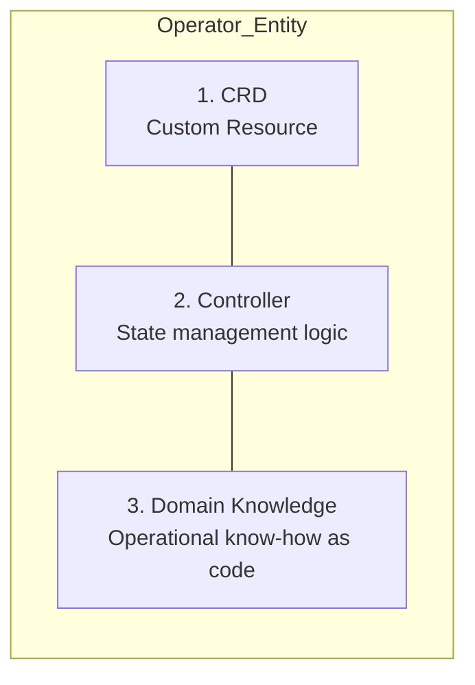

An introduction to how to develop Kubernetes Operators and the various tools that make development more efficient.

---

## What Is an Operator?

An Operator is a software extension that encodes the knowledge of a human operator into code to automatically manage complex applications.

### Key Concept Comparison

| Category | Manual Operation | Operator Automation |
|------|--------------------|-----------------|
| **Monitoring** | A person checks dashboards directly | 24/7 automated monitoring and health checks |
| **Failure recovery** | Manually restart Pods and recover data | Automatic recovery immediately upon detecting a failure |
| **Backup/Upgrade** | Manual work after a maintenance notice | Scheduled automatic backups and zero-downtime upgrades |
| **Analogy** | Emergency rescue crew (dispatched when needed) | Autonomous management robot |

---

## The Three Components of an Operator

An Operator is completed by combining the following three elements.

1.  **CRD (Custom Resource Definition):** A new API object that defines an application's configuration (e.g., `kind: Database`)
2.  **Controller:** A control loop (reconcile loop) that watches resources and acts to drive the cluster toward the desired state
3.  **Domain Knowledge:** Expert knowledge of how to back up, scale, and recover a specific application (MySQL, Kafka, etc.)

---

## Why Do We Need Tools?

Building a Kubernetes controller from scratch is very complex.

| Difficulty | Details |
|-----------|----------|
| **Low-level API** | Requires understanding complex libraries such as `client-go`, Informer, and Lister |
| **State synchronization** | Implementing real-time event handling on top of the `Watch` mechanism |
| **Reconcile loop** | Designing robust control logic that is idempotent |
| **Repetitive code** | A large amount of boilerplate that must be written every time |

**To manage this complexity, we recommend using a framework such as Operator SDK or Kubebuilder.**

---

## Major Development Frameworks

- **Operator SDK:** Supports Helm, Ansible, and Go; widely used (part of the CNCF Operator Framework)
- **Kubebuilder:** The standard Go-based framework for building controllers
- **KUDO:** Builds Operators using a declarative YAML approach

**Operator development goes beyond simple deployment: it automates the entire lifecycle of an application.**
