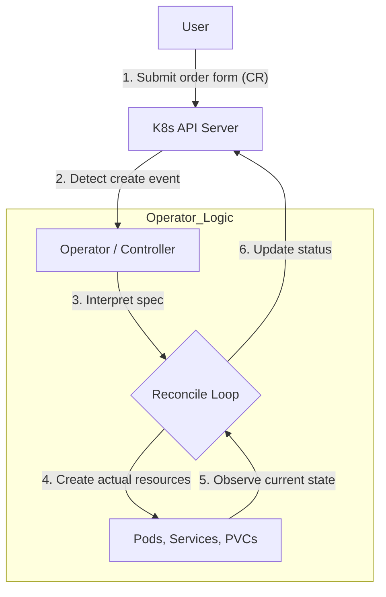

Understand how an Operator and a Custom Resource (CR) work together to manage applications in Kubernetes.

---

## 1. Core Concepts and Analogy

The easiest way to understand the relationship between an Operator and a CR is to think of a **'factory'** and an **'order form'**.

| Item | Concept | Analogy | Main Components |
|------|------|------|---------------|
| **Operator** | Automation software that embeds operational knowledge | **A factory run by management robots** | Controller, CRD, domain knowledge |
| **Custom Resource** | A user-defined resource instance | **A customer's order form (blueprint)** | Defines the desired state (spec) |

---

## 2. Why Must the Operator Be Installed First?

Here are four reasons why the Operator must already be running before you deploy a CR to the cluster.

1.  **CRD registration:** Kubernetes must first be given the CustomResourceDefinition (CRD) so that it can recognize a new resource type (e.g., `kind: MySQL`).
2.  **Controller activation:** When an order form (CR) arrives, the 'brain' (controller) that reads it and creates the actual Pods must already be running.
3.  **RBAC permissions:** The permissions (Role and RoleBinding) the Operator needs to create Pods and Services on your behalf must be set up first.
4.  **Dependency preparation:** The Operator first sets up the basic infrastructure needed to run the app, such as a Secret for storing passwords and the storage configuration.

---

## 3. What a CR Contains (spec vs status)

Through `spec`, the user states the **"desired state"**, and through `status`, the Operator reports the **"current state"**.

| Field | Role | Typical Contents |
|------|------|----------------|
| **spec** | Defined by the user (desired state) | Version, replicas, resources (CPU/memory), backup schedule, ports, etc. |
| **status** | Recorded by the Operator (current state) | Number of running Pods, access endpoint, last backup time, error messages, etc. |

---

## 4. Summary: Recap with Analogies

- **Operator = Apartment complex management office:** The office must be established (installed) first so that staff (controllers) and equipment (permissions) are in place.
- **CR = Move-in application:** Only after the management office opens can you submit an application, be assigned a unit number (name), and receive a key (Service).

**If you submit an application (CR) without a management office (Operator), that application is just a piece of paper no one reads.**
