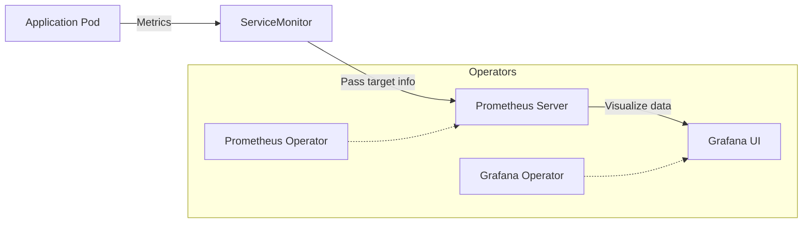
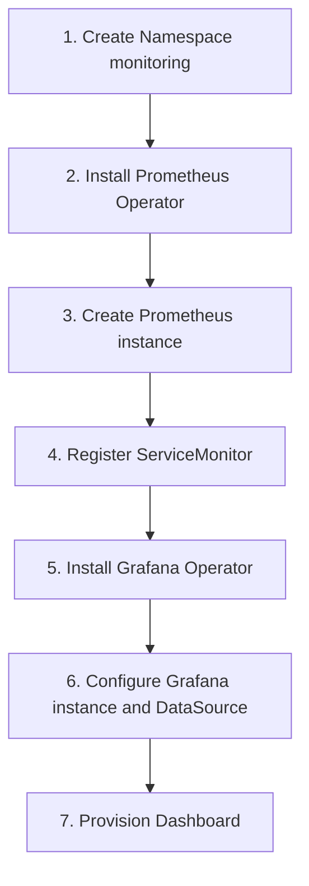

A lab guide for building and automating a monitoring system in a Kubernetes environment using the Operator pattern.

---

## 1. Lab Overview and Architecture

In this lab, instead of deploying Prometheus and Grafana manually, you will manage their lifecycle through Operators.

| Component | Role | Notes |
|-----------|------|------|
| **Prometheus Operator** | Manages the Prometheus server, Alertmanager, and ServiceMonitor | Automatic target discovery |
| **Grafana Operator** | Manages Grafana instances, DataSources, and Dashboards | Configuration automation |
| **ServiceMonitor** | A CRD that defines which Services to scrape metrics from | Core configuration object |

---

## 2. Overall Data Flow



---

## 3. Installation Steps Summary

### [Step 1] Create the Namespace
```bash
kubectl create namespace monitoring
```

### [Step 2] Install Prometheus Operator (Helm)
```bash
helm repo add prometheus-community https://prometheus-community.github.io/helm-charts
helm install prometheus prometheus-community/kube-prometheus-stack --namespace monitoring
```

### [Step 3] Install Grafana Operator (Helm)
```bash
helm repo add grafana-operator https://grafana-operator.github.io/grafana-operator/helm-charts
helm install grafana-operator grafana-operator/grafana-operator --namespace monitoring
```

---

## 4. Core Custom Resources

After installing the Operators, you manage configuration through the following Custom Resources (CRs).

| Resource Kind | Purpose |
|-------------|------|
| **Prometheus** | Defines the actual Prometheus server instance |
| **ServiceMonitor** | Specifies the Services (endpoints) to scrape metrics from |
| **Grafana** | Defines the Grafana server instance |
| **GrafanaDatasource** | Configures the data sources (Prometheus, etc.) that Grafana connects to |
| **GrafanaDashboard** | Deploys dashboards via JSON or a Grafana.com ID |

---

## 5. Installation Order Workflow



---

## 6. Summary

With the Prometheus and Grafana Operators, you can **avoid editing configuration every time a monitoring target is added**: simply adding a `ServiceMonitor` resource automates metric collection. This demonstrates the core value of declarative infrastructure management.
