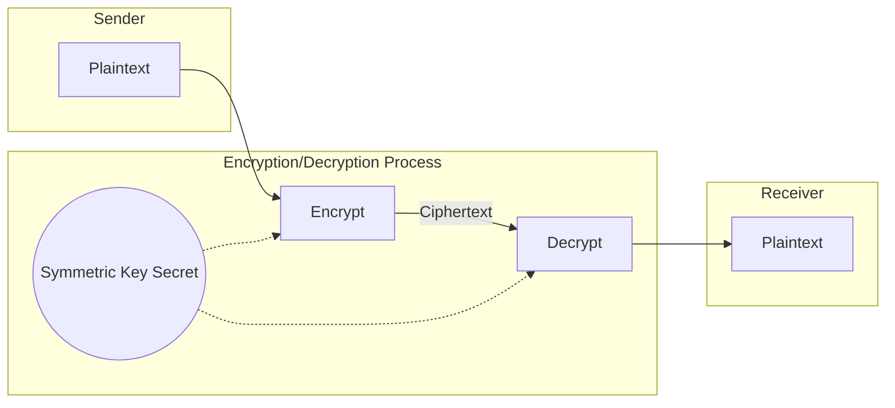
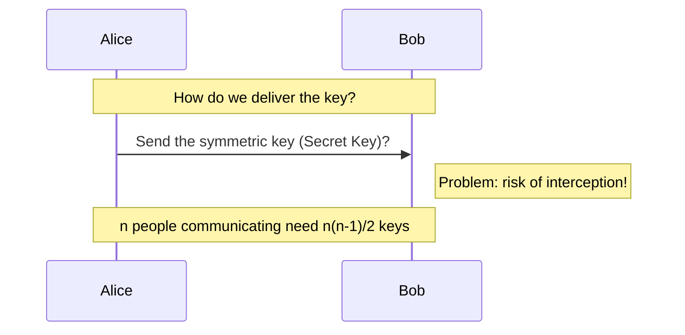
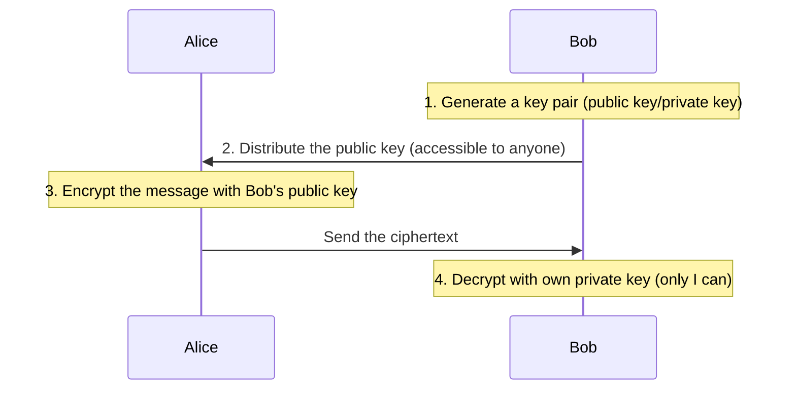
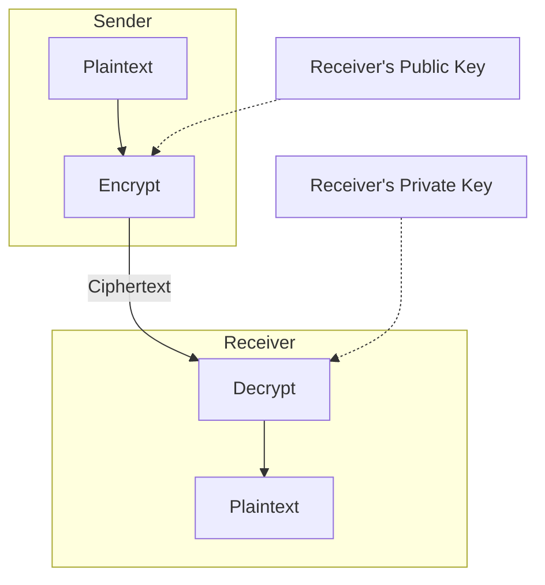

To understand Kubernetes authentication, let's look at the basic cryptographic concepts of symmetric and asymmetric keys.

## Basic Concepts of Encryption

```
Plaintext → [Encrypt] → Ciphertext
Ciphertext → [Decrypt] → Plaintext
```

- **Plaintext**: The original, unencrypted data
- **Ciphertext**: The encrypted data
- **Key**: A secret value used for encryption/decryption

---

## Symmetric Key Encryption

### Concept



**Key point: the same key is used for both encryption and decryption**

### Characteristics

| Characteristic | Description |
|------|------|
| **Number of keys** | 1 (shared by sender and receiver) |
| **Speed** | Fast (easy hardware acceleration) |
| **Key distribution** | Difficult (requires a secure channel) |
| **Typical use** | Encrypting large amounts of data |

### Representative Algorithms

| Algorithm | Key Length | Description |
|----------|---------|------|
| **AES** | 128, 192, 256 bits | Most widely used today (recommended) |
| **DES** | 56 bits | Obsolete (vulnerable, do not use) |
| **3DES** | 168 bits | Improved DES (being phased out) |
| **ChaCha20** | 256 bits | Alternative to AES (software-optimized) |

### Example: AES-256

```python
# Pseudocode example
key = "0123456789abcdef0123456789abcdef"  # 256 bits (32 bytes)
plaintext = "Hello, Kubernetes!"

# Encryption
ciphertext = AES_Encrypt(key, plaintext)
# Result: "a1b2c3d4e5f6..." (ciphertext)

# Decryption
decrypted = AES_Decrypt(key, ciphertext)
# Result: "Hello, Kubernetes!" (original restored)
```

### The Problem with Symmetric Keys: Key Distribution



### The Essence of the Key Distribution Problem

> **"The Key Delivery Paradox"**
> 
> Situation: Alice wants to send a secret message to Bob
> 
> **Problems:**
> 1. A shared key is needed to encrypt the message
> 2. But there is no safe way to deliver the key
> 3. If the key is intercepted by a hacker in transit, all communication is exposed!
> 
> **Paradox:**
> "Secure communication requires secure key delivery, but secure key delivery already requires secure communication."

### Key Distribution Scenarios

| Scenario | Description | Pros | Cons |
|----------|------|------|------|
| **Direct handoff** | Deliver offline, e.g., on a USB drive | Safe | Impractical, does not scale |
| **Encrypted channel** | Encrypt the key and send it | Convenient | Infinite regress: "a key to protect the key" |
| **Reliance on a third party** | Use a trusted courier | Practical | If the third party is hacked, all keys leak |

### Key Management Complexity

Number of keys needed when n people communicate with each other: **n(n-1)/2**

| Number of Users | Keys Required | Notes |
|-----------|----------------|------|
| 2 | 1 | Manageable |
| 10 | 45 | Somewhat complex |
| 100 | 4,950 | Hard to manage |
| 1,000 | 499,500 | Practically impossible |

---

## The Problem Asymmetric Keys Solved: Key Distribution

### The Core Idea of Asymmetric Keys



### Ways to Distribute Public Keys

1.  **Publish on a website:** Post it so anyone can download it, e.g., `https://bob.com/public-key.pem`
2.  **Public key directory:** Register it on a key server (e.g., `keys.openpgp.org`) so it can be searched
3.  **Digital certificate (CA):** A certificate in which a trusted authority (CA) binds the owner's information and public key together and signs it

### Pros/Cons of Asymmetric Keys

| Category | Details |
|------|------|
| **Pros** | Easy key distribution, no prior sharing needed, simple key management (n keys), digital signatures possible |
| **Cons** | 100 to 1000 times slower than symmetric keys, long key lengths, fatal if the private key is lost/leaked |

---

## Asymmetric Key Encryption

### Concept



### Two Usage Modes

#### 1. Confidentiality - Encryption
- **Method:** Encrypt with the receiver's **public key** → decrypt with the receiver's **private key**
- **Result:** Guarantees secure communication that only the receiver can read

#### 2. Authentication - Digital Signature
- **Method:** Sign with the sender's **private key** → verify with the sender's **public key**
- **Result:** Confirms the sender's identity and prevents data tampering (non-repudiation)

---

## Hybrid Approach: TLS/SSL

Modern encrypted communication combines the strengths of symmetric and asymmetric keys.

### TLS Handshake Flow (Simplified)

```mermaid
sequenceDiagram
    participant C as Client
    participant S as Server
    
    C->>S: 1. ClientHello (send supported cipher suites)
    S->>C: 2. ServerHello + certificate (includes server public key)
    Note over C: 3. Verify certificate and generate pre-master secret
    C->>S: 4. Send pre-master secret encrypted with server public key
    Note over S: 5. Decrypt with private key to obtain the secret
    Note over C,S: 6. Both sides generate the same session key (symmetric key)
    C<->>S: 7. Begin high-speed encrypted communication with the generated symmetric key
```

> 💡 **Note:** The flow above is simplified and follows the classic RSA key exchange (TLS 1.2 and earlier). In TLS 1.3 the session key is derived through an ephemeral ECDHE exchange, and the server certificate's key is used only to sign the handshake.

---

## Relevance to Kubernetes

These mechanisms are used in various security areas inside Kubernetes.

1.  **API Server TLS:** Uses server/client certificates (asymmetric keys) to authenticate and establish the connection, then symmetric keys to encrypt the actual traffic
2.  **ServiceAccount:** Signs tokens with a private key and verifies they have not been tampered with using the public key
3.  **Secret encryption:** Encrypts data with AES (symmetric key) before storing it in etcd; the encryption keys can be managed through an external KMS

---

## Summary

| Category | Symmetric Key | Asymmetric Key |
|------|--------|----------|
| **Number of keys** | 1 (shared) | 2 (public key + private key) |
| **Speed** | Very fast | Slow |
| **Key distribution** | Difficult | Easy |
| **Main use** | Encrypting large amounts of data | Key exchange, digital signatures, authentication |
| **Representative algorithms** | AES, ChaCha20 | RSA, ECDSA, Ed25519 |

**Understanding how symmetric and asymmetric keys work together in a hybrid scheme is the starting point of Kubernetes security.**
