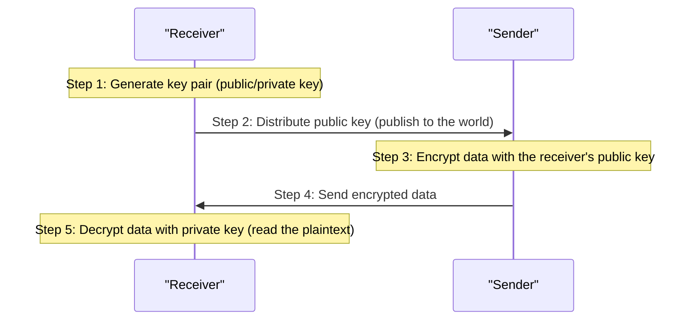
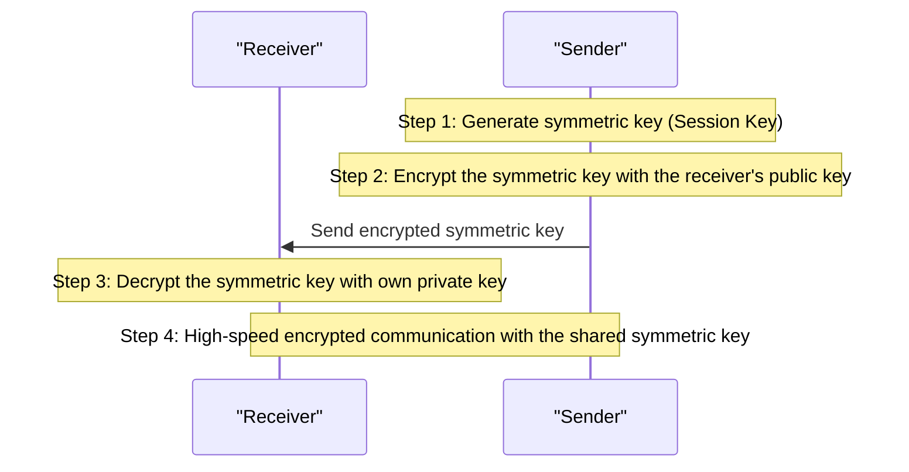
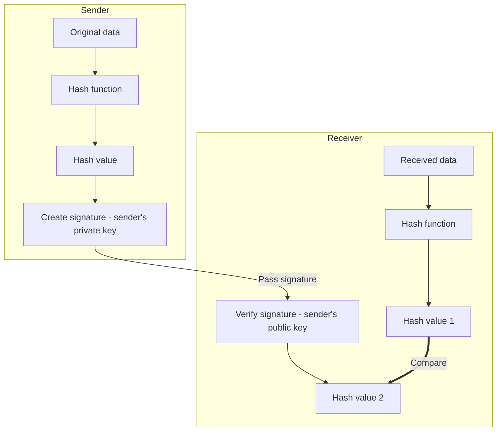
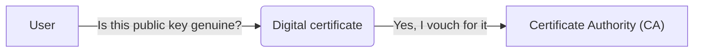
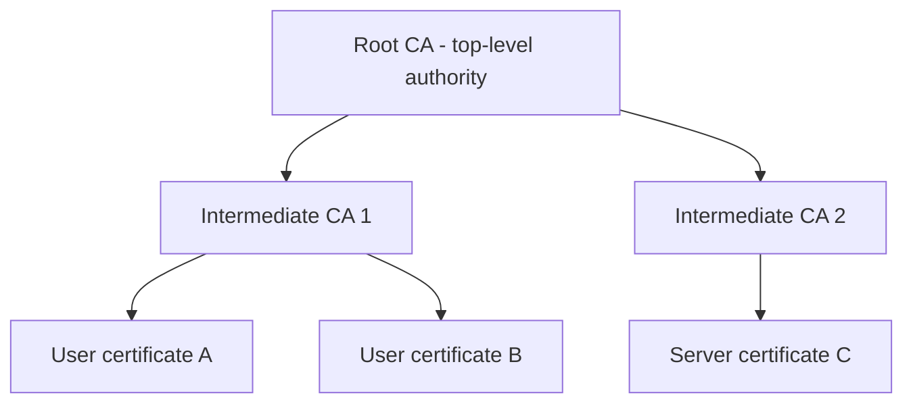

Learn about Certificate Authorities (CAs) to understand the Kubernetes API Server certificate.

---

## Public Key Distribution and the Encryption Process

### 1. Does the receiver publish its public key?

Yes. A public key (Public Key) can, quite literally, be known to anyone.

- **For websites:** A web server (the receiver) distributes a certificate containing its public key to every user who connects, either in advance or immediately on request.
- **For individuals:** They register their public key on a key server or attach it to email signatures, so that others can retrieve and use it at any time.

### 2. Encryption → Decryption Process

### 3. Hybrid Approach: Symmetric Key + Asymmetric Key

The reason asymmetric keys alone are not used is that they are 100-1000 times slower than symmetric keys, making them unsuitable for encrypting large amounts of data.

---

## Digital Signature

### 1. Do you sign with the private key?

Yes. A digital signature is created with your own **Private Key**.

- **Encryption:** When others send to me (uses the receiver's public key)
- **Signing:** When I send to others (uses the sender's private key)

### 2. Signing and Verification Process

### 3. Purpose of Digital Signatures

- **Authentication:** Confirm who the sender is
- **Integrity:** Confirm the data was not forged or tampered with in transit
- **Non-repudiation:** The sender cannot deny having sent it

---

## Digital Certificate

### 1. The Problem of Public Key Trustworthiness

The biggest weakness of the asymmetric key approach is the question: **"Is this public key really Bob's?"** A hacker could impersonate Bob and give Alice their own public key.

### 2. The Role of a Certificate

A certificate is a document in which a **"trusted third party (CA)"** vouches for who owns a public key.

### 3. Components of a Certificate

| Item | Description |
|------|-------------|
| **Subject information** | Name, organization, domain, etc. |
| **Subject public key** | The public key used for encryption/verification |
| **Issuer information** | Information about the CA that issued the certificate |
| **Validity period** | Start and expiration dates |
| **Digital signature** | A signature created with the issuer's (CA's) private key |

---

## CA (Certificate Authority)

### 1. Definition of a CA

A Certificate Authority (CA) is a trusted organization that issues and manages digital certificates.

### 2. Root CA and Subordinate CA (Intermediate CA)

CAs form a hierarchy to build a chain of trust.

- **Root CA:** The top-level certificate authority that vouches for itself (Self-signed)
- **Intermediate CA:** A subordinate certificate authority to which the Root CA has delegated authority

### 3. Chain of Trust

The reason we can trust a website is that the following chain is connected.

1.  The browser has the **Root CA's public key** built in in advance
2.  The browser verifies the **subordinate CA's certificate** with the Root CA's public key
3.  The browser verifies the **website's certificate** with the verified subordinate CA's public key

---

## CAs in Kubernetes

Kubernetes builds and uses its own CA hierarchy to secure communication inside the cluster.

- **kube-ca:** The root of trust for the entire cluster
- **etcd-ca:** A dedicated CA for securing etcd communication
- **front-proxy-ca:** A CA for API Server proxy authentication

**Understanding the structure of certificates and CAs lets you clearly grasp Kubernetes' complex communication security settings.**
