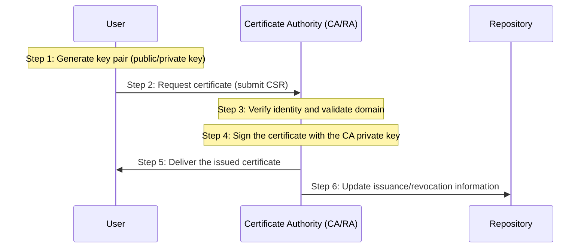

Learn about Public Key Infrastructure (PKI) and X.509 certificates.

---

## What Is PKI (Public Key Infrastructure)?

### Concept

PKI is the infrastructure that makes public key cryptography safe to use. It is a system in which a trusted third party (CA) vouches for the answer to the question: "Does this public key really belong to the owner of this domain?"

### Components of PKI

| Component | Role | Note |
|-----------|------|------|
| **CA (Certificate Authority)** | Issues, signs, and manages certificates | DigiCert, Let's Encrypt, etc. |
| **RA (Registration Authority)** | Verifies the applicant's identity and validates domain ownership | Performs vetting on behalf of the CA |
| **Certificate repository** | Stores and publishes issued certificates | Publicly viewable |
| **CRL (Certificate Revocation List)** | List of certificates revoked due to compromise or before expiry | Published by the CA periodically |
| **OCSP (Online Certificate Status Protocol)** | Real-time certificate validity lookup | Faster response than CRL |
| **End Entity** | Certificate owner (server, individual) | Generates the key pair and keeps the private key |

### PKI Workflow

---

## The X.509 Certificate Standard

### 1. What Is X.509?

X.509 is the standard format for digital certificates used in PKI. It is defined in detail in IETF RFC 5280, and almost all SSL/TLS certificates we use follow this standard.

### 2. Internal Structure of a Certificate (V3)

| Field | Description | Example |
|--------|------|------|
| **Version** | Certificate version (currently V3) | v3 (2) |
| **Serial Number** | Unique number assigned by the CA | 0a:1b:2c... |
| **Signature Algorithm** | Algorithm used for the signature | sha256WithRSAEncryption |
| **Issuer** | Issuer (CA) information | CN=DigiCert Global Root CA |
| **Validity** | Validity period | 2024-01-01 ~ 2025-01-01 |
| **Subject** | Owner information (domain, etc.) | CN=*.google.com |
| **Subject Public Key Info** | Owner's public key and algorithm | RSA (2048 bit), public key value |
| **Extensions (V3)** | Additional extension information (SAN, etc.) | Subject Alternative Name |

### 3. Key Extension Fields (Extensions)

- **Key Usage:** The purpose of the public key (Digital Signature, Key Encipherment, etc.)
- **Subject Alternative Name (SAN):** Lets a single certificate cover multiple domains (important!)
- **Basic Constraints:** Whether this certificate is a CA that can issue other certificates

---

## Certificate Encoding and File Extensions

### 1. Encoding Formats

| Format | Description | Characteristics |
|------|------|------|
| **DER** | Binary encoding | Machine-readable; not viewable in a text editor |
| **PEM** | Base64 text encoding | Human-readable, starts with `-----BEGIN CERTIFICATE-----` |

### 2. Common File Extensions

- **.crt, .cer:** Certificate files (usually PEM or DER)
- **.key:** Private key file (never leak it)
- **.csr:** Certificate signing request file
- **.pfx, .p12:** File that bundles the certificate and private key together (password protected)

---

## Usage in Kubernetes

All Kubernetes components (kube-apiserver, kubelet, etcd, etc.) use X.509 certificates when communicating with each other, both to verify the peer and to encrypt traffic.

- **Client certificate:** Proves the identity of a user or component connecting to the API server
- **Server certificate:** Used by the API server to prove its identity to clients

**Understanding the PKI structure and the X.509 standard lets you fully grasp Kubernetes' certificate-based security model.**
