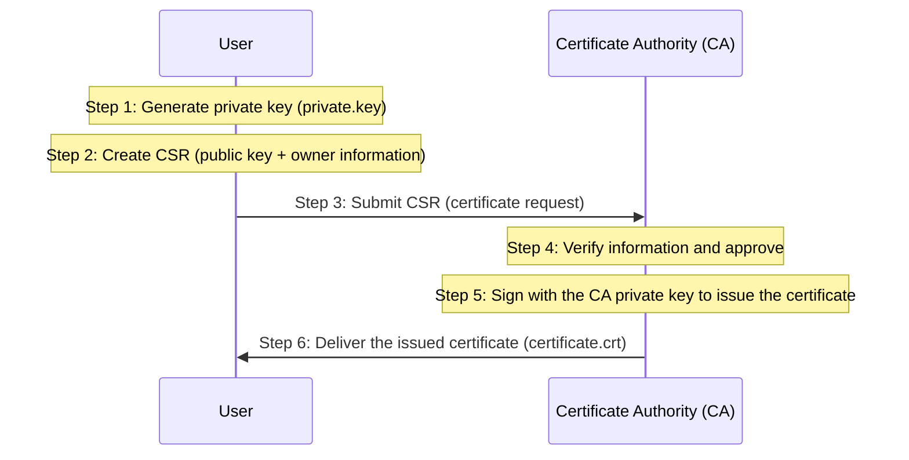

Learn how to create a CSR and how the certificate request process works.

---

## What Is a CSR (Certificate Signing Request)?

### Concept

A CSR (Certificate Signing Request) is a request form submitted to a Certificate Authority (CA) in order to have a certificate issued. It contains the public key and the owner's information, and it is like the application form you submit to the government (CA) to get a passport (certificate).

### Role of a CSR

| Role | Description | Note |
|------|------|------|
| **Delivers the public key** | Safely delivers my public key to the CA | Does not include the private key |
| **Provides owner information** | Provides information such as domain (CN), organization (O), and country (C) | Basis for identity verification |
| **Defines certificate attributes** | Defines key usage (Key Usage), SAN (alternative names), etc. | Determines the detailed capabilities of the certificate |

---

## CSR Creation and Issuance Process

### Step-by-Step Flow

### Detailed Creation Steps (OpenSSL Example)

1.  **Generate the private key:** `openssl genrsa -out private.key 2048`
    - Generates the secret key that the certificate is based on. (Most important!)
2.  **Create the CSR:** `openssl req -new -key private.key -out request.csr -subj "/CN=example.com"`
    - Extracts the public key from the generated private key and combines it with the owner information to create the request.
3.  **Submit to the CA:** Send the generated `request.csr` file to the CA to request issuance.

---

## Key CSR Fields (Subject)

The main owner-information fields entered when applying for a certificate are as follows.

| Abbreviation | Field | Description | Example |
|------|--------|------|------|
| **CN** | Common Name | Domain name or username | *.google.com, admin |
| **O** | Organization | Organization/company name | Google LLC, Kubernetes |
| **OU** | Organizational Unit | Department name | IT, Security |
| **L** | Locality | City | Mountain View, Seoul |
| **ST** | State | State/province | California, Seoul |
| **C** | Country | Country code (2 letters) | US, KR |

---

## The Importance of SAN (Subject Alternative Name)

For security reasons, modern browsers and Kubernetes **validate the SAN field instead of CN (Common Name)**.

- **Limitation of CN:** Only one name can be specified per certificate
- **Advantage of SAN:** Multiple domains or IP addresses can be specified in a single certificate
  - Example: it can include `example.com`, `www.example.com`, `10.96.0.1`, and so on

---

## CSRs in Kubernetes

Certificate issuance also happens frequently inside a Kubernetes cluster.

1.  **kubelet certificates:** When a Node joins the cluster, its kubelet sends a CSR to the API server.
2.  **Adding users:** When creating a new user, you create a CertificateSigningRequest resource and have an administrator approve it.
3.  **cert-manager:** Automatically creates CSRs and renews certificates through CAs such as Let's Encrypt.

**A CSR is the "application form" for secure communication, and understanding this process is essential for managing Kubernetes security settings.**
