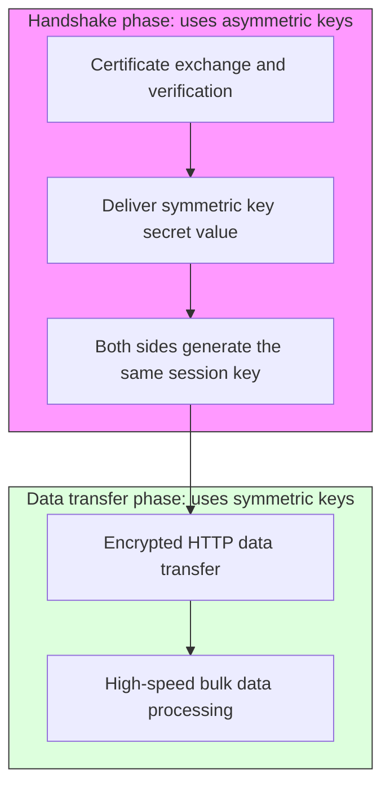

A detailed explanation of how SSL (Secure Sockets Layer) and TLS (Transport Layer Security) work, and of the hybrid encryption scheme.

---

## 1. Core Concept: Hybrid Encryption

SSL/TLS, the foundation of modern internet security, uses a **hybrid scheme** that combines only the strengths of asymmetric and symmetric keys.

### Symmetric vs Asymmetric Key Comparison

| Category | Symmetric Key (AES, etc.) | Asymmetric Key (RSA, etc.) |
|------|-----------------|-------------------|
| **Speed** | **Very fast** (about 1000x) | Relatively slow |
| **Security** | Risk of interception during key delivery | Solves the key delivery problem (public-key based) |
| **Number of keys** | Grows exponentially as users increase | Only 1 key pair per user |
| **Main use** | **Encrypting actual data** | **Key exchange and identity verification** |

---

## 2. How Hybrid Encryption Works

The slow asymmetric key is used only for the initial connection; once a secure encrypted channel is established, it switches to the fast symmetric key.



### Understanding Through an Analogy
- **Asymmetric key:** A **special armored vehicle** that carries the key (symmetric key) to a valuable vault (slow but extremely secure)
- **Symmetric key:** An **ordinary truck** that carries containers that can be opened with that key (fast and efficient)

---

## 3. Why Is a Hybrid Approach Needed?

| Scenario | Problem | Result |
|----------|--------|------|
| **Using only symmetric keys** | The key can be intercepted by a hacker while being delivered | All communication content exposed |
| **Using only asymmetric keys** | Computation is too complex, so transferring large files is very slow | Practical web browsing impossible |
| **Using the hybrid approach** | Exchange keys safely with asymmetric keys, then communicate quickly with symmetric keys | **Both security and speed are achieved** |

---

## 4. History of SSL and TLS

SSL is the name first coined by Netscape, and TLS is its standardized successor. Today the security-hardened **TLS 1.2** and **TLS 1.3** are mainly used.

- **SSL 3.0 (1996):** No longer used due to vulnerabilities
- **TLS 1.2 (2008):** The most widely used standard version today (2 RTT)
- **TLS 1.3 (2018):** The latest version, with stronger security and improved speed (1 RTT)

---

## 5. Detailed TLS Handshake Procedure

### TLS 1.2 Handshake (Traditional)

```mermaid
sequenceDiagram
    autonumber
    participant C as Client
    participant S as Server

    Note over C,S: TCP connection complete (SYN, SYN-ACK, ACK)

    C->>S: ClientHello (TLS 1.2, Random, Cipher Suites)
    S->>C: ServerHello (TLS 1.2, Random, Selected Cipher)
    S->>C: Certificate (server certificate & CA chain)
    S->>C: ServerKeyExchange (DHE/ECDHE parameters)
    S->>C: ServerHelloDone

    C->>S: ClientKeyExchange (encrypted Premaster Secret)
    C->>S: ChangeCipherSpec (encrypting from now on!)
    C->>S: Finished (handshake verification)

    S->>C: ChangeCipherSpec (I'm encrypting too!)
    S->>C: Finished (handshake verification)

    Note over C,S: Handshake complete (2 RTT)
    C<->>S: Application Data (encrypted communication begins)
```

### TLS 1.3 Handshake (Latest, Simplified)

```mermaid
sequenceDiagram
    autonumber
    participant C as Client
    participant S as Server

    Note over C,S: TCP connection complete

    C->>S: ClientHello (TLS 1.3, Random, Key Share)
    S->>C: ServerHello (Selected Cipher, Key Share)
    S->>C: Certificate & CertificateVerify
    S->>C: Finished
    
    C->>S: Finished

    Note over C,S: Handshake complete (1 RTT!)
    C<->>S: Application Data (encrypted communication begins)
```

---

## 6. Summary

SSL/TLS is a clever secure communication method that combines the **safety of asymmetric keys** with the **efficiency of symmetric keys**. Through this process, we can use the internet and the Kubernetes API safely, free from the threat of phishing sites.
