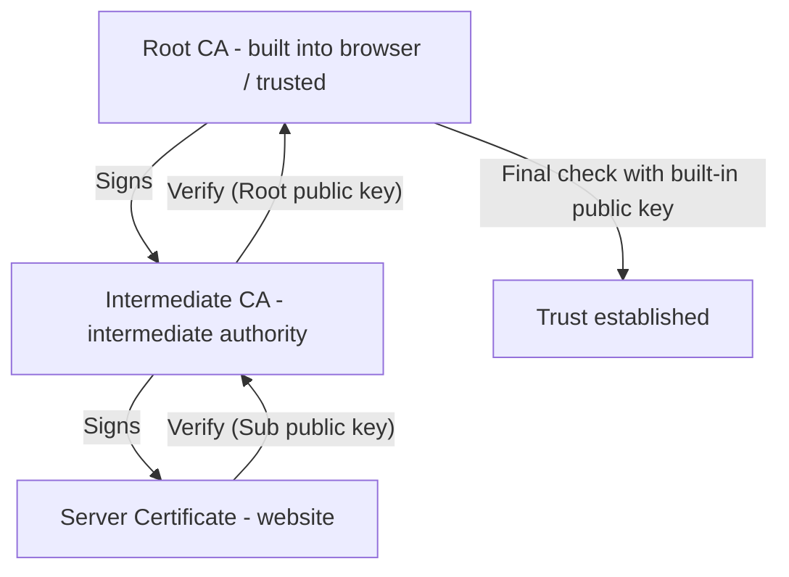

A step-by-step explanation of how certificates guarantee secure communication.

---

## Overall Flow of TLS/SSL Communication

```mermaid
sequenceDiagram
    autonumber
    participant C as Client (browser)
    participant S as Server (website)

    C->>S: 1. ClientHello (version, cipher list, random number)
    S->>C: 2. ServerHello + certificate (server random, certificate chain)
    
    Note over C: 3. Certificate verification (trust check)
    Note right of C: - Verify CA signature, validity period, domain, etc.
    
    C->>S: 4. Key exchange (send Premaster Secret)
    Note right of C: - Sent encrypted with the server's public key
    
    Note over S: 5. Decrypt with private key and generate symmetric key
    Note over C,S: 6. Finished (ready for encrypted communication)
    
    C<->>S: 7. Symmetric-key encrypted communication (high-speed data transfer)
```

---

## Detailed Step-by-Step Procedure

### Step 1: ClientHello
The first message the client sends when attempting to connect to a server.

- **Supported TLS versions:** TLS 1.2, 1.3, etc.
- **Cipher suite list:** The list of supported encryption algorithms
- **Client random:** A 32-byte random number used for key generation
- **Extensions:** SNI (the domain being accessed), ALPN, etc.

### Step 2: ServerHello + Certificate
The server responds to the client's request and proves its identity.

- **ServerHello:** The selected TLS version and cipher suite, and the server random number
- **Certificate:** An X.509 certificate containing the server's public key
- **Certificate Chain:** The intermediate CA certificates that prove the certificate's legitimacy

### Step 3: Certificate Verification (Trust Check)
A core security procedure performed inside the client browser.

| Verification Item | Description | Notes |
|-----------|------|------|
| **CA signature verification** | Check the server certificate's signature with the upper CA's public key | Chain verification |
| **Validity period check** | Check whether the current time is between the start and expiration dates | Expiration |
| **Revocation check** | Look up via CRL or OCSP whether the certificate has been revoked | Key compromise |
| **Domain match check** | Check whether the certificate's CN/SAN matches the domain actually being accessed | Phishing prevention |
| **Key usage check** | Check whether the certificate was issued for 'server authentication' | Usage restriction |

---

### Step 4: Key Exchange (Sharing the Symmetric Key)

1.  **Generate the Premaster Secret:** The client generates a new random value (the seed of the symmetric key).
2.  **Encrypt with the server's public key:** It encrypts this value with the **public key** included in the server's certificate.
3.  **Send:** It sends the encrypted value to the server. Even if a hacker intercepts it along the way, the content cannot be read without the server's **private key**.
4.  **Derive the symmetric key:** Both sides combine the shared Premaster Secret with the random numbers exchanged earlier to generate the **session key (symmetric key)** used for actual communication.

---

### Step 5: Finished and Start of Encrypted Communication

- **Finished:** Both sides confirm that the handshake so far was correct and signal that, from now on, they will communicate encrypted with the generated symmetric key.
- **Application Data:** Once everything is ready, actual data such as HTTP requests/responses is exchanged, encrypted with a high-speed symmetric key (AES, etc.).

---

## Trust Chain Verification in Detail

The reason we can trust a server certificate is the **'Chain of Trust'**.



---

## Security Properties Summary

| Security Property | Description | Implementation |
|-----------|------|-----------|
| **Confidentiality** | A man-in-the-middle cannot read the data | Symmetric-key encryption (AES) |
| **Integrity** | Tampering with data is detected immediately | Hash-based message authentication (HMAC) |
| **Authentication** | The server's identity is reliably confirmed | Digital certificates and signatures |
| **Non-repudiation** | The fact of communication cannot be denied later | Private-key-based digital signatures |

**Through this multi-step security procedure, the websites we use every day and Kubernetes API communication are kept secure.**
