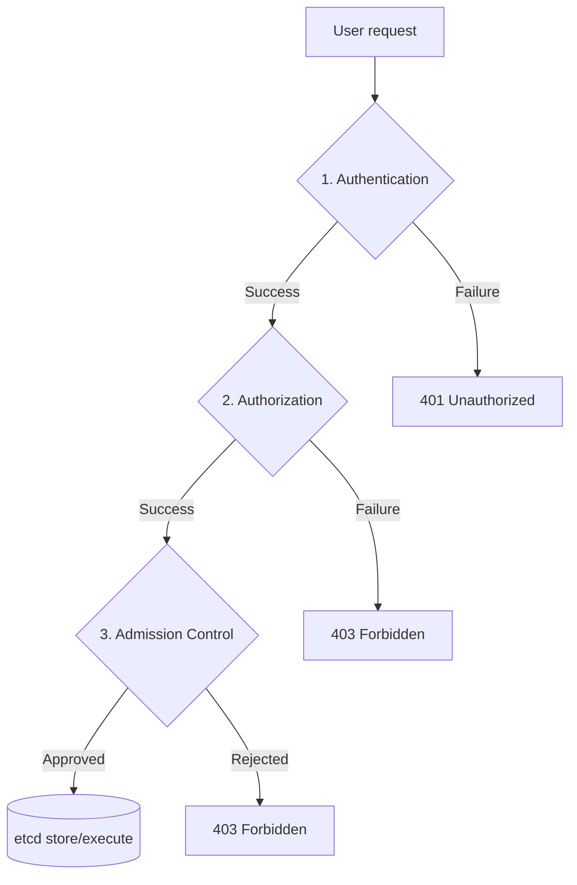

Learn about authentication and authorization, the core concepts of Kubernetes security.

---

## Core Concept Comparison

| Category | Authentication | Authorization |
|------|-----------------------|----------------------|
| **Key question** | "Who are you?" | "What can you do?" |
| **Purpose** | Identity verification | Granting permissions and controlling resource access |
| **Analogy** | Passport check, company access badge | Visa issuance, access rights to a specific floor |
| **K8s methods** | Certificates, tokens, OIDC, etc. | RBAC, ABAC, Node, etc. |

---

## Security Processing Flow

Every request that reaches the Kubernetes API server goes through the following three stages.

---

## 1. Authentication

This is the process of verifying who is making the request. Kubernetes has no built-in 'user' object; it verifies identity through certificates or external authentication systems.

### Main Authentication Methods
- **X.509 client certificates:** Authentication via client certificates (kubeadm default)
- **Static token file:** Token authentication via a static file
- **Bootstrap tokens:** Tokens used when joining nodes to a cluster
- **ServiceAccount tokens:** Tokens automatically issued to Pods for in-cluster authentication
- **OIDC (OpenID Connect):** Authentication integrated with an external IDP (Google, Okta, etc.)

---

## 2. Authorization

This checks whether an authenticated user is allowed to perform a specific action (verb) on a specific resource.

### Main Authorization Modes
- **RBAC (Role-Based Access Control):** Role-based access control (the most widely recommended)
- **ABAC (Attribute-Based Access Control):** Attribute-based access control
- **Node Authorization:** Special-purpose authorization that restricts what kubelets can access
- **Webhook:** Delegates the permission check to an external service

---

## 3. Admission Control

For requests that have passed authentication and authorization, this performs a final check that they comply with the cluster's policies, modifying the request (mutating) or rejecting it (validating) as needed.

- **Mutating Admission Webhook:** Modifies the request (e.g., sidecar injection)
- **Validating Admission Webhook:** Validates the request (e.g., resource limit checks)

---

## Summary

| Stage | Role | Result |
|------|------|------|
| **Authentication (AuthN)** | Identity verification | Identifies the user and groups |
| **Authorization (AuthZ)** | Permission check | Allow/Deny decision |
| **Admission** | Policy review | Accepts, modifies, or rejects the request |

**These three layers together keep a Kubernetes cluster secure.**
