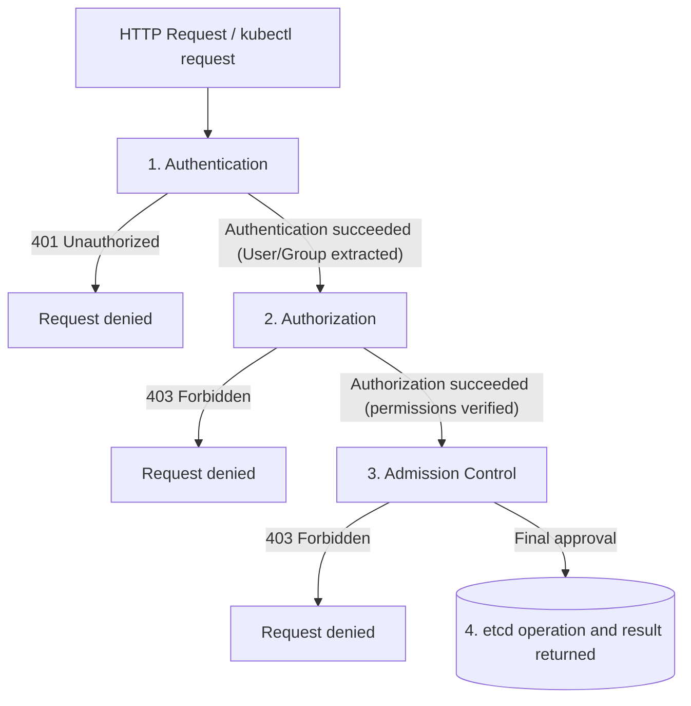

Learn about the three-stage plugins (Authentication, Authorization, Admission Control) through which the Kubernetes API Server processes requests.

---

## API Server Request Processing Pipeline

Every HTTP request that reaches the Kubernetes API server passes sequentially through the following strict security stages.

---

## Detailed Flow by Stage

### Stage 1: Authentication
This stage verifies "Who is the requester?" The API server runs the configured authentication plugins in order, and the user is identified as soon as any one of them succeeds.

| Plugin Type | Description | Main Use |
|---------------|------|------------|
| **X.509 Client Certs** | Checks the CN/O fields of the client certificate | Administrators, kubelet communication |
| **Static Token File** | Checks tokens stored in a static file on the server | Testing, legacy environments |
| **ServiceAccount** | Checks the JWT token mounted in the Pod | Application (Pod) authentication |
| **OIDC** | Checks tokens from an external IDP (Google, Okta, etc.) | Enterprise integrated authentication |
| **Webhook** | Delegates authentication requests to an external service | Integration with custom authentication systems |
| **Anonymous** | Treated as an anonymous user if all previous authentications fail | Health checks (Healthz), etc. |

---

### Stage 2: Authorization
This stage checks "Does the authenticated user have permission to perform a specific action on that resource?"

| Authorization Mode | Description | Notes |
|-----------|------|------|
| **Node** | Restricts the kubelet to accessing only the resources assigned to it | Special-purpose authorization |
| **RBAC** | Permission management through Roles and Bindings | **The most recommended approach** |
| **Webhook** | Asks an external service to check permissions (Allow/Deny) | Custom permission systems |
| **ABAC** | File-based attribute access control | Not recommended due to management difficulty |
| **AlwaysAllow** | Unconditionally allows every request | Security risk (for testing only) |

---

### Stage 3: Admission Control
This is the final check of whether a request that has passed authentication and authorization "satisfies the cluster's policies and requirements."

1.  **Mutating Admission:** Modifies the request data or fills in default values. (e.g., Sidecar injection)
2.  **Validating Admission:** Validates that the request data is correct and decides whether to reject it. (e.g., Resource Quota check)

---

## Summary

| Stage | Main Role | Code Returned on Failure |
|------|-----------|-------------------|
| **Authentication** | Identity verification (Who) | 401 Unauthorized |
| **Authorization** | Permission verification (What) | 403 Forbidden |
| **Admission** | Policy review (Policy) | 403 Forbidden |

**Understanding the API Server's pipeline structure lets you accurately diagnose bottlenecks and misconfigurations in cluster security.**
