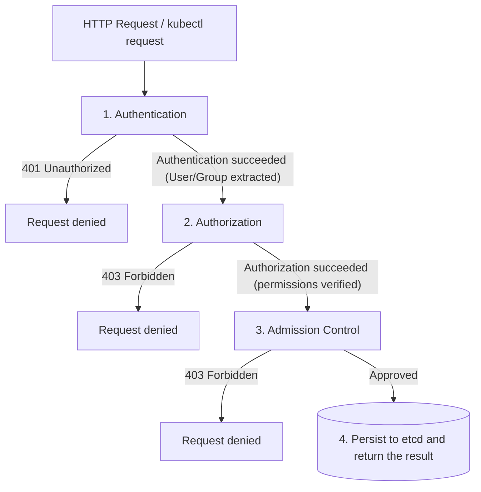

Learn about the three stages (authentication, authorization, and admission control) through which the Kubernetes API server processes requests.

---

## API Server Request Processing Pipeline

Every HTTP request that reaches the Kubernetes API server passes through the following security stages in order.

---

## Detailed Flow by Stage

### Stage 1: Authentication
This stage verifies "Who is the requester?" The API server runs the configured authentication plugins in order, and the requester is identified as soon as any one of them succeeds.

| Plugin Type | Description | Main Use |
|---------------|------|------------|
| **X.509 Client Certs** | Checks the CN and O fields of the client certificate | Administrators, kubelet communication |
| **Static Token File** | Checks tokens defined in a static file on the API server | Testing, legacy environments |
| **ServiceAccount** | Checks the JWT mounted in the Pod | Pod (application) authentication |
| **OIDC** | Validates tokens issued by an external identity provider (Google, Okta, etc.) | Enterprise integrated authentication |
| **Webhook** | Delegates authentication requests to an external service | Integration with custom authentication systems |
| **Anonymous** | Treated as `system:anonymous` if all other authenticators fail (when enabled) | Health checks (`/healthz`), etc. |

---

### Stage 2: Authorization
This stage checks "Does the authenticated user have permission to perform a specific action on that resource?"

| Authorization Mode | Description | Notes |
|-----------|------|------|
| **Node** | Restricts each kubelet to accessing only the resources related to its own Node | Special-purpose authorization |
| **RBAC** | Permission management through Roles and RoleBindings | **The most recommended approach** |
| **Webhook** | Asks an external service to decide (allow or deny) | Custom authorization systems |
| **ABAC** | File-based attribute-based access control | Not recommended because it is hard to manage |
| **AlwaysAllow** | Unconditionally allows every request | Security risk (testing only) |

---

### Stage 3: Admission Control
This is the final check of whether a request that has passed authentication and authorization "satisfies the cluster's policies."

1.  **Mutating admission:** Modifies the request or fills in default values. (e.g., sidecar injection)
2.  **Validating admission:** Validates the request and decides whether to reject it. (e.g., ResourceQuota check)

---

## Summary

| Stage | Main Role | Code Returned on Failure |
|------|-----------|-------------------|
| **Authentication** | Identity verification (who) | 401 Unauthorized |
| **Authorization** | Permission verification (what) | 403 Forbidden |
| **Admission** | Policy review (policy) | 403 Forbidden |

**Understanding the API server's request pipeline lets you accurately diagnose security misconfigurations in the cluster.**
