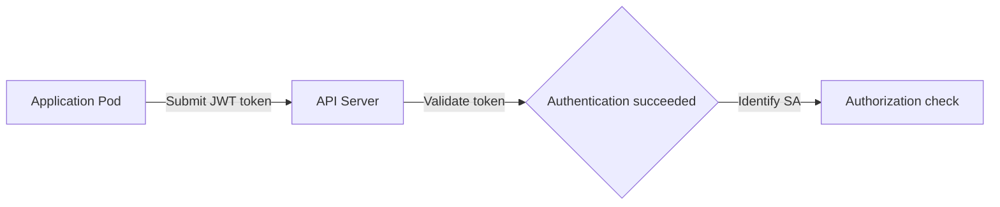

In Kubernetes, users are divided into Human Users (people) and Machine Users (machines/services).

---

## Core Concept Comparison

| Category | Human User (person) | Machine User (machine/service) |
|------|-------------------|--------------------------|
| **Subject** | Developers, administrators, operations teams, etc. | Applications, CI/CD, monitoring bots, etc. |
| **Authentication** | X.509 certificate, OIDC token | ServiceAccount token (JWT) |
| **Identifier** | CN (e.g., admin, john) | `system:serviceaccount:<ns>:<name>` |
| **Group** | O (e.g., developers, admins) | `system:serviceaccounts` |
| **Lifetime** | Long-lived (1 year+) or OIDC (1 hour) | Short-lived (auto-rotated), tied to the Pod lifetime |
| **Use cases** | kubectl commands, manual administrative tasks | API calls from inside a Pod, automation scripts |

---

## Characteristics by User Type

### 1. Human User

A human user is a real person who connects from outside the cluster through tools such as `kubectl`. Because Kubernetes does not manage a 'user' resource itself, users are identified through external proof of identity.

- **Certificate-based:** The Common Name (CN) field of the client certificate is recognized as the user name.
- **OIDC-based:** The email or ID in a token issued by an external identity provider such as Google or Okta is recognized as the user.

### 2. Machine User (ServiceAccount)

A machine user is an account that Pods inside the cluster or automation tools use when communicating with the API server. Because it is managed as a Kubernetes resource (`ServiceAccount`), it can be freely created and deleted.

- **Automatic creation:** A ServiceAccount named `default` is automatically created in every namespace.
- **Automatic mounting:** When you specify a particular ServiceAccount at Pod creation, the associated token is automatically mounted inside the Pod at `/var/run/secrets/kubernetes.io/serviceaccount/`.

---

## Security Considerations

| User type | Security threat | Mitigation |
|-------------|-----------|-----------|
| **Human User** | Leaked private key/token | Use MFA (multi-factor authentication); short-lived OIDC tokens recommended |
| **Machine User** | Privilege abuse if a Pod is compromised | Apply the principle of least privilege, disable unnecessary automatic mounting |

**Understanding the difference between the two user types and choosing the appropriate authentication method is the key to cluster security.**
