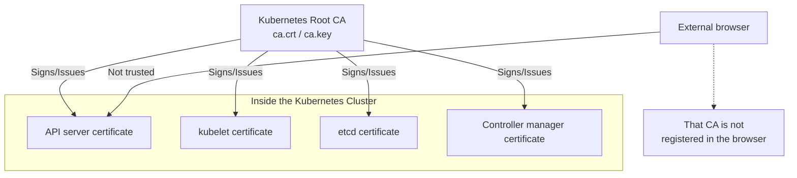

A Kubernetes cluster operates as its own Root CA, issuing and managing all certificates inside the cluster.

---

## Why Kubernetes Acts as a Root CA

The reason Kubernetes operates its own CA instead of using an external public CA (such as DigiCert) is the unique nature of intra-cluster communication.

| Category | Public CA (Let's Encrypt, etc.) | Kubernetes' Own CA |
|------|----------------------------|--------------------|
| **Purpose** | For services exposed to the internet | For communication between components inside the cluster |
| **Trust scope** | All browsers/devices worldwide | Inside that Kubernetes cluster only |
| **Cost/Time** | May cost money; issuance takes time | Free, issued instantly through automation |
| **Validity period** | Usually 90 days to 1 year | 1 year by default for component certificates (configurable) |
| **Analogy** | International passport | Company employee ID card |

---

## Trust Scope of the Kubernetes CA

The Kubernetes CA is a 'private certificate authority' trusted only within the boundary of the cluster.

---

## Kubernetes CA Structure and File Locations

### Key Certificate Files (kubeadm)

The core Kubernetes certificates are stored in the `/etc/kubernetes/pki/` directory on the control plane node.

| File Name | Role | Description |
|--------|------|------|
| **ca.crt** | Root CA certificate | The public certificate that all components use as the trust anchor |
| **ca.key** | Root CA private key | **Must never be leaked.** Used when signing new certificates |
| **apiserver.crt** | API server serving certificate | Used by clients to verify the API server's identity |
| **apiserver-kubelet-client.crt** | API server client certificate for the kubelet | Used when the API server connects to the kubelet |
| **front-proxy-ca.crt** | Front proxy CA certificate | A separate CA for communication with extension API servers |
| **sa.pub / sa.key** | ServiceAccount token signing key pair | Not a certificate; a key pair for signing and verifying JWT tokens |

---

## Flow of Certificate Usage in Kubernetes

1.  **Cluster initialization:** Running `kubeadm init` generates `ca.key` and `ca.crt`.
2.  **Component certificate issuance:** The generated CA key is used to automatically issue certificates for components such as `kube-apiserver` and `kube-scheduler`.
3.  **Mutual authentication (mTLS):** For example, when `kube-scheduler` connects to the API server, each side verifies that the other's certificate was signed by `ca.crt`, which establishes trust.

**The Kubernetes Root CA is the root of cluster security, and this CA is what lets all communication within the cluster be encrypted and trusted.**
