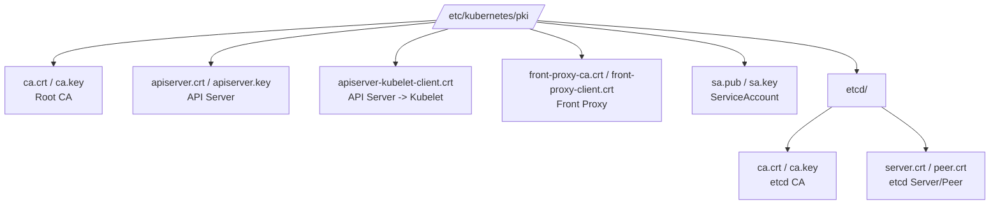

Learn where certificates are stored in a Kubernetes cluster and how to manage them.

---

## Certificate Storage Locations Overview

Kubernetes components store their certificates in different locations depending on their role.

| Location | Path | Description |
|------|------|------|
| **Control Plane** | `/etc/kubernetes/pki/` | Stores the core certificates of the master node |
| **Worker Node** | `/var/lib/kubelet/pki/` | Stores the client certificates for the kubelet |
| **etcd** | `/etc/kubernetes/pki/etcd/` | Dedicated certificates for securing the etcd database |
| **User** | `~/.kube/config` | File containing the credentials for kubectl access |
| **Pod** | `/var/run/secrets/kubernetes.io/serviceaccount/` | ServiceAccount token and CA certificate |

---

## 1. Master Node Certificates in Detail (`/etc/kubernetes/pki/`)

On the master node of a cluster created with kubeadm, the following certificate structure is formed.



### Purpose of the Key Files

| File name | Purpose | Importance |
|--------|------|--------|
| **ca.crt / ca.key** | Trust anchor of the entire cluster (Root CA) | **Highest (never leak)** |
| **apiserver.crt / .key** | Server certificate of the API server | High |
| **sa.pub / .key** | Key pair for signing ServiceAccount tokens | High |
| **etcd/ca.crt / .key** | Separate CA for securing the etcd cluster | High |

---

## 2. Per-Component kubeconfig Files (`/etc/kubernetes/`)

The configuration files (kubeconfig) that components use to connect to the API server are also stored on the master node. These files contain certificate information encoded in Base64.

- **admin.conf:** For the cluster administrator (for kubectl)
- **kubelet.conf:** Used when the kubelet connects to the API server
- **controller-manager.conf:** For the controller-manager
- **scheduler.conf:** For the scheduler

---

## 3. Worker Node Certificates (`/var/lib/kubelet/pki/`)

On worker nodes, the kubelet manages the following files so that it can communicate securely with the API server.

- **kubelet.crt / .key:** The certificate the kubelet uses to prove itself to the API server
- **ca.crt:** The Root CA public key used to verify the API server's certificate

---

## Tips for Inspecting Certificates

On a Linux system, use the `openssl` command to view the contents of a specific certificate file.

```bash
# Check the certificate's Subject and expiration date
openssl x509 -in /etc/kubernetes/pki/apiserver.crt -text -noout | grep -E "Subject:|Not After"
```

**Knowing exactly where certificates are stored lets you quickly resolve certificate expiration and permission issues when troubleshooting.**
