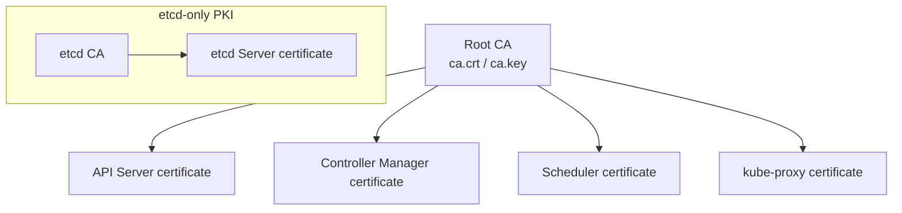

This document analyzes in detail the certificates generated when the `kubeadm init` command is run.

---

## Detailed Analysis of kubeadm init Options

Learn how the main options used when initializing a cluster affect certificate generation.

| Option | Description | Certificate impact |
|--------|------|-------------|
| `--kubernetes-version` | Specifies the Kubernetes version to install | Generates certificates matching that version's specification |
| `--apiserver-advertise-address` | IP address the API server advertises to other components | **Adds that IP to the certificate SAN field** |
| `--apiserver-cert-extra-sans` | Additional DNS names or IPs to include | **Adds custom addresses to the certificate SAN field** |
| `--cri-socket` | Specifies the container runtime socket path | (No direct certificate impact) |

---

## Step-by-Step Analysis of Certificate Generation

You can trace the certificate generation process through the log output when `kubeadm init` runs.

### 1. Create the CA (Certificate Authority)
First, the Root CA that serves as the cluster's trust anchor is created.

```text
[certs] Generating "ca" certificate and key
```

- **Generated files:** `/etc/kubernetes/pki/ca.crt`, `ca.key`
- **Validity period:** 10 years by default
- **Characteristics:** It is a self-signed certificate and becomes the parent of all certificates generated afterward.

### 2. Issue the API Server Certificate
The API server certificate is signed by the CA created above.

```text
[certs] Generating "apiserver" certificate and key
```

- **Generated files:** `/etc/kubernetes/pki/apiserver.crt`, `apiserver.key`
- **Validity period:** 1 year
- **Key point:** The values given with the `--apiserver-cert-extra-sans` option are included in this certificate's **Subject Alternative Name (SAN)** field.

### 3. Other Component Certificates
Certificates for the other control plane components and related services are then generated in turn.



---

## Hands-on: Checking Certificate Information

Use OpenSSL commands to verify that the generated certificates contain the expected information.

```bash
# Check the SAN entries of the API server certificate
openssl x509 -in /etc/kubernetes/pki/apiserver.crt -text -noout | grep -A 1 "Subject Alternative Name"

# Example output
# X509v3 Subject Alternative Name: 
#    DNS:kubernetes, DNS:kubernetes.default, IP Address:10.96.0.1, IP Address:172.31.1.10, DNS:jadeedu.com
```

**Understanding the relationships among the certificates generated during `kubeadm init` helps you avoid the network and authentication problems that can occur during initial cluster setup.**
