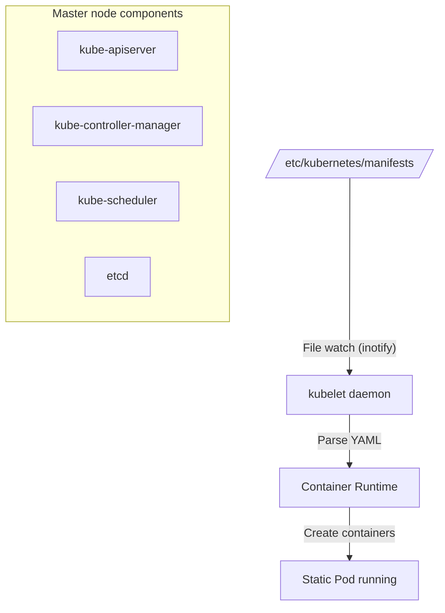

Learn about the concept of Static Pods, their relationship with the API Server, and how control plane components are started.

---

## What Is a Static Pod?

A Static Pod is a special Pod that is **managed directly by the kubelet** without any involvement of the API server. It is mainly used to run the cluster's core components (API Server, etcd, etc.).

### Static Pod vs Regular Pod

| Category | Static Pod | Regular Pod |
|------|------------|----------|
| **Managed by** | kubelet (local node daemon) | API Server (Control Plane) |
| **Storage location** | Local file system (`/etc/kubernetes/manifests/`) | etcd (cluster database) |
| **How to create** | Place a YAML file in a specific directory | `kubectl apply`, Deployment, etc. |
| **How to delete** | Delete the local YAML file | Run the `kubectl delete` command |
| **Main use** | Running control plane components | Regular application workloads |
| **Naming rule** | `<Pod name>-<node name>` | User-specified or assigned by a controller |

---

## How Static Pods Work

The kubelet watches a configured directory in real time and manages the Pod lifecycle.



1.  **Directory watch:** The kubelet watches the directory specified by `--pod-manifest-path`.
2.  **Automatic creation/update:** When a YAML file is added to that directory, the Pod is created immediately, and when the file is modified, the Pod is restarted to apply the changes.
3.  **Mirror Pod:** To report the status of a Static Pod to the API server, the kubelet creates a 'Mirror Pod' so that you can check its status with the `kubectl get pods` command. (However, it can only be deleted by deleting the local file.)

---

## Relationship with the API Server

The first component that must run in a Kubernetes cluster is the API Server. But this creates a 'chicken-and-egg' problem, since Pods can only be launched when an API Server exists.

- **Solution:** Configure the API Server itself as a **Static Pod**.
- **Boot order:** At system startup, the `kubelet` starts first -> reads `kube-apiserver.yaml` from the local directory -> and launches the API Server container.

---

## Lab: Checking the Static Pod Configuration

This is how to check which directory the kubelet is watching on a master node.

```bash
# Check staticPodPath in the kubelet configuration
grep staticPodPath /var/lib/kubelet/config.yaml

# Example output
# staticPodPath: /etc/kubernetes/manifests
```

**Static Pods are the key mechanism for waking up the control plane, the 'heart' of the cluster, and through them Kubernetes gains the ability to manage itself (Self-hosting).**
