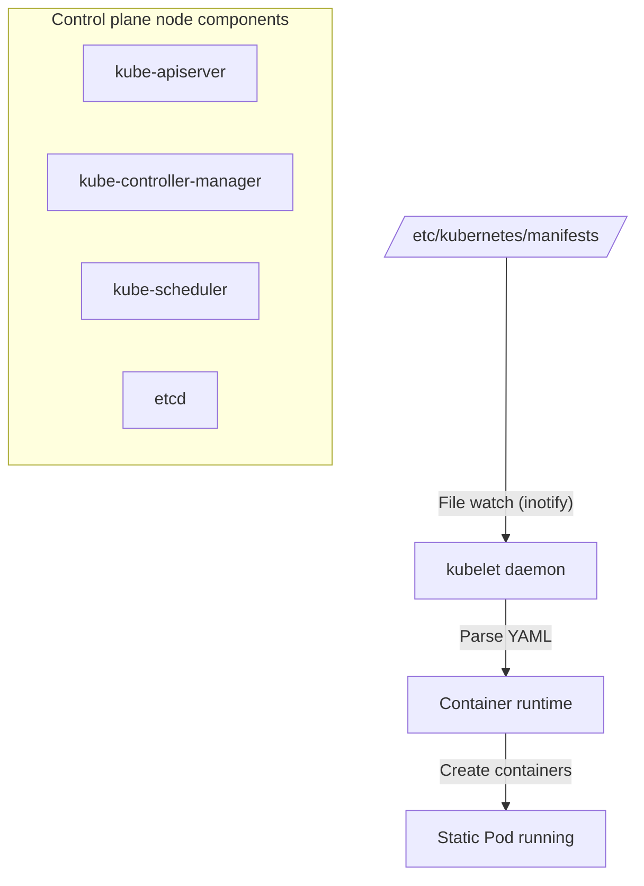

Learn what static Pods are, how they relate to the API server, and how control plane components are started.

---

## What Is a Static Pod?

A static Pod is a Pod that is **managed directly by the kubelet** on a specific node, without the API server's control. It is mainly used to run the cluster's core components (API server, etcd, etc.).

### Static Pod vs Regular Pod

| Category | Static Pod | Regular Pod |
|------|------------|----------|
| **Managed by** | kubelet (local node daemon) | API server and controllers (control plane) |
| **Definition stored in** | Local file system (`/etc/kubernetes/manifests/`) | etcd (cluster database) |
| **How to create** | Place a manifest file in a specific directory | `kubectl apply`, Deployment, etc. |
| **How to delete** | Delete the local YAML file | Run the `kubectl delete` command |
| **Main use** | Running control plane components | Application workloads |
| **Naming rule** | `<Pod name>-<node name>` (node name appended) | User-specified or assigned by a controller |

---

## How Static Pods Work

The kubelet watches a configured directory and manages the Pod lifecycle.



1.  **Directory watch:** The kubelet watches the directory set by `staticPodPath` (or the legacy `--pod-manifest-path` flag).
2.  **Automatic creation and update:** When a manifest file is added to that directory, the Pod is created; when the file is modified, the Pod is recreated to apply the change.
3.  **Mirror Pod:** So that the static Pod is visible through the API server, the kubelet creates a mirror Pod, and you can check its status with `kubectl get pods`. (However, deleting the mirror Pod does not remove the static Pod; you must delete the local file.)

---

## Relationship with the API Server

The first component that must run in a Kubernetes cluster is the API Server. This creates a chicken-and-egg problem, because normal Pods can only be scheduled and launched once an API server exists.

- **Solution:** Run the API server itself as a **static Pod**.
- **Boot order:** At system startup, the `kubelet` starts first, reads `kube-apiserver.yaml` from the local directory, and then launches the API server container.

---

## Lab: Checking the Static Pod Configuration

Check which directory the kubelet watches on a control plane node.

```bash
# Check staticPodPath in the kubelet configuration
grep staticPodPath /var/lib/kubelet/config.yaml

# Example output
# staticPodPath: /etc/kubernetes/manifests
```

**Static Pods are the key mechanism for bootstrapping the control plane, the 'heart' of the cluster, and they let Kubernetes manage itself (self-hosting).**
