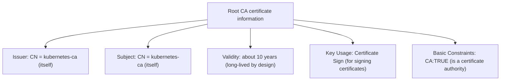

Inspect the certificate file information for the Kubernetes cluster's Root CA certificate and the certificate used by the API Server.

---

## Certificate Inspection Overview

While operating a cluster, it is very important to verify certificate validity and trust relationships.

| Target | File Path | Main Role |
|-----------|-----------|-----------|
| **Root CA** | `/etc/kubernetes/pki/ca.crt` | Anchor of cluster trust (parent of all certificates) |
| **API Server** | `/etc/kubernetes/pki/apiserver.crt` | Server certificate proving the API server's identity |

---

## 1. Inspecting the Root CA Certificate

The Root CA certificate has a **Self-Signed** structure that vouches for itself.

### Command to View Detailed Information
```bash
openssl x509 -in /etc/kubernetes/pki/ca.crt -text -noout
```

### Analysis of Key Fields



---

## 2. Inspecting the API Server Certificate

The API Server certificate is a **leaf (end-entity) certificate** signed by the Root CA.

### Command to View Detailed Information
```bash
openssl x509 -in /etc/kubernetes/pki/apiserver.crt -text -noout
```

### Analysis of Key Fields

| Field | Content | Description |
|--------|------|------|
| **Issuer** | `CN = kubernetes-ca` | Shows that it was issued by the Root CA |
| **Subject** | `CN = kube-apiserver` | Identifies the certificate owner as the API server |
| **Validity** | About 1 year | Shorter than the Root CA's validity, for security |
| **SAN** | `DNS:kubernetes, IP:10.96.0.1...` | Subject Alternative Names: the additional DNS names and IPs that clients can use to connect |

---

## 3. Verifying Trust Relationships Between Certificates

Use the following command to verify that the API server certificate was signed by the Root CA.

```bash
# Signature verification command
openssl verify -CAfile /etc/kubernetes/pki/ca.crt /etc/kubernetes/pki/apiserver.crt

# Output
# /etc/kubernetes/pki/apiserver.crt: OK
```

**Being able to inspect and verify certificates yourself is essential for assessing a cluster's security posture and troubleshooting authentication failures.**
