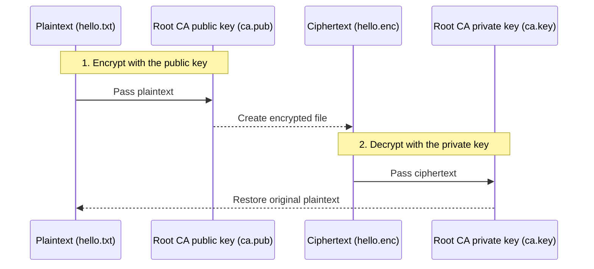

Hands-on practice verifying encryption using the public key of the Root CA certificate.

---

## Encryption Verification Overview

Using the Root CA certificate, you will verify the core principle of asymmetric-key cryptography: **'encrypt with the public key, decrypt with the private key'**.

| Step | Task | Tool |
|------|------|------|
| **1. Extract key** | Extract the public key from the Root CA certificate. | OpenSSL |
| **2. Encrypt** | Encrypt a text file with the extracted public key. | OpenSSL pkeyutl |
| **3. Verify** | Confirm that the encrypted file is unreadable. | cat / hexeditor |
| **4. Decrypt** | Confirm that it can be decrypted only with the CA's private key (`ca.key`). | OpenSSL pkeyutl |

---

## 1. Lab Flow Diagram



---

## 2. Key Commands Summary

### Extract the Public Key
Extract only the public key portion to be used for encryption from the certificate file (`.crt`).
```bash
openssl x509 -in /etc/kubernetes/pki/ca.crt -pubkey -noout > ca.pub
```

### Encrypt a File
Use the extracted public key to convert a plain text file into encrypted binary data.
```bash
openssl pkeyutl -encrypt -pubin -inkey ca.pub -in hello.txt -out hello.enc
```

### Decrypt a File
Restore the encrypted file back to readable text using only the matching private key.
```bash
openssl pkeyutl -decrypt -inkey /etc/kubernetes/pki/ca.key -in hello.enc -out hello.dec
```

---

## 3. Analyzing the Results

- **Encryption succeeded:** Running `cat hello.enc` prints garbled, unreadable characters.
- **Decryption succeeded:** Running `cat hello.dec` correctly prints the original "Hello World".
- **Conclusion:** We confirmed that although anyone can hold a public key, data encrypted with it can be read only by the **party that owns the private key**.

**This principle is the foundation of the communication security by which every Kubernetes component exchanges data safely with the API server.**
