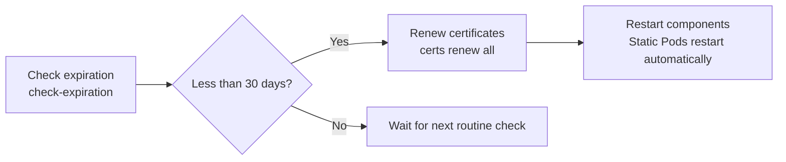

Check the certificate expiration dates of a Kubernetes cluster and learn about the `kubeadm-config` ConfigMap.

---

## Checking Certificate Expiration

One of the most important tasks in maintaining a Kubernetes cluster is managing certificate expiration dates.

### Command to Check Expiration
```bash
kubeadm certs check-expiration
```

### Output Fields in Detail

| Field | Description | Note |
|--------|------|------|
| **CERTIFICATE** | Name of the certificate being checked | About 10 core certificates are checked in total |
| **EXPIRES** | Exact date and time the certificate expires | In UTC |
| **RESOLUTIONS** | Days remaining until expiration (D-Day) | Needs attention if within 30 days |
| **AVAILABLE CA** | The authority that issued (signed) the certificate | kubernetes-ca, etcd-ca, etc. |

---

## Summary of Roles of Key Certificates

| Certificate name | Main role | Location |
|-------------|-----------|------|
| **admin.conf** | Credentials of the cluster administrator (kubectl) | `/etc/kubernetes/admin.conf` |
| **apiserver** | Proves the server identity of the API Server | `/etc/kubernetes/pki/apiserver.crt` |
| **etcd-server** | Authenticates the etcd database server | `/etc/kubernetes/pki/etcd/server.crt` |
| **scheduler.conf** | Used when the scheduler connects to the API server | `/etc/kubernetes/scheduler.conf` |

---

## Certificate Renewal (Renew)

Certificates that are about to expire can be renewed easily with the `kubeadm` command.



### Renewal Command Examples
```bash
# Renew all certificates at once
kubeadm certs renew all

# Renew only a specific certificate (e.g., apiserver)
kubeadm certs renew apiserver
```

---

## kubeadm-config ConfigMap

`kubeadm` stores the configuration used when initializing the cluster in a ConfigMap in the `kube-system` namespace. This information is referenced when renewing certificates.

```bash
# Command to view the configuration
kubectl -n kube-system get cm kubeadm-config -o yaml
```

**Certificate expiration can lead to a complete cluster outage, so regular checks with the `check-expiration` command are essential.**
