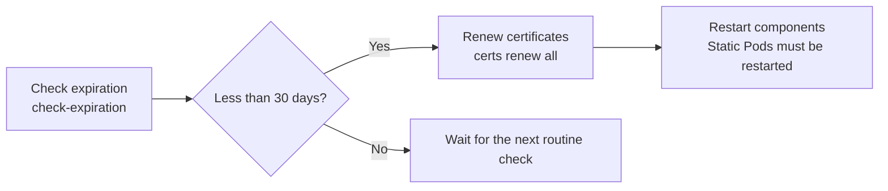

Check certificate expiration dates in a Kubernetes cluster and learn about the `kubeadm-config` ConfigMap.

---

## Checking Certificate Expiration

One of the most important tasks in maintaining a Kubernetes cluster is managing certificate expiration dates.

### Command to Check Expiration
```bash
kubeadm certs check-expiration
```

### Output Fields in Detail

| Field | Description | Note |
|--------|------|------|
| **CERTIFICATE** | Name of the certificate being checked | Roughly 10 core certificates are checked |
| **EXPIRES** | Exact date and time the certificate expires | In UTC |
| **RESIDUAL TIME** | Time remaining until expiration | Needs attention if within 30 days |
| **CERTIFICATE AUTHORITY** | The CA that issued (signed) the certificate | kubernetes-ca, etcd-ca, etc. |

---

## Summary of Roles of Key Certificates

| Certificate name | Main role | Location |
|-------------|-----------|------|
| **admin.conf** | Credentials of the cluster administrator (kubectl) | `/etc/kubernetes/admin.conf` |
| **apiserver** | Proves the identity of the API server | `/etc/kubernetes/pki/apiserver.crt` |
| **etcd-server** | Authenticates the etcd server | `/etc/kubernetes/pki/etcd/server.crt` |
| **scheduler.conf** | Used when kube-scheduler connects to the API server | `/etc/kubernetes/scheduler.conf` |

---

## Certificate Renewal

Certificates that are about to expire can be renewed with the `kubeadm` command.



> ⚠️ `kubeadm certs renew` only rewrites the certificate files. The control plane static Pods (kube-apiserver, kube-controller-manager, kube-scheduler, etcd) do **not** restart automatically, so restart them manually (for example, move the manifests out of `/etc/kubernetes/manifests/` and back, or restart the containers with `crictl`). The 30-day threshold above is an operational convention, not a kubeadm rule.

### Renewal Command Examples
```bash
# Renew all certificates at once
kubeadm certs renew all

# Renew only a specific certificate (e.g., apiserver)
kubeadm certs renew apiserver
```

---

## kubeadm-config ConfigMap

`kubeadm` stores the configuration used when initializing the cluster in a ConfigMap in the `kube-system` namespace. This information is referenced when renewing certificates.

```bash
# View the configuration
kubectl -n kube-system get cm kubeadm-config -o yaml
```

**Certificate expiration can lead to a complete cluster outage, so regular checks with the `check-expiration` command are essential.**
