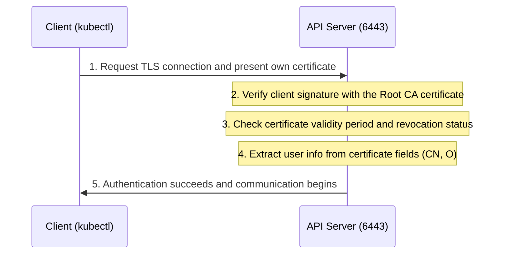

This document explains X.509 certificate-based authentication for securely connecting to the Kubernetes API Server.

---

## API Server Authentication Overview

Every request coming into the API server goes through the following three stages.

| Stage | Role | Notes |
|------|------|------|
| **1. Authentication** | "Who are you?" | Identity verification |
| **2. Authorization** | "What can you do?" | Granting permissions (RBAC, etc.) |
| **3. Admission Control** | "Is the request valid?" | Additional validation and mutation |

---

## Client Certificate Authentication (X.509 Client Certs)

Client certificate authentication is Kubernetes' default and one of its strongest authentication methods.

### How It Works (mTLS Flow)

### Key Certificate Fields and Their Roles

Kubernetes identifies a user based on specific fields in the certificate.

| Field | Meaning | Kubernetes Mapping | Example |
|--------|------|-----------------|------|
| **CN (Common Name)** | Common name | **User Name** | `admin`, `john-doe` |
| **O (Organization)** | Organization name | **Group** | `system:masters`, `developers` |

> **Note:** Kubernetes does not store 'User' resources internally. It simply trusts the **CN** value written in the certificate and recognizes it as the user.

---

## Key Certificate Components

- **ca.crt:** The Root CA public key held by the API server to verify that a client certificate is genuine
- **client.crt:** The user's own ID (public key + signature) submitted to the API server
- **client.key:** The private key that the user must keep safe to prove their identity

---

## Pros and Cons Summary

| Pros | Cons |
|------|------|
| - Very strong security (asymmetric key based) | - Revocation of an issued certificate is difficult |
| - Authentication works even offline (only the CA public key is needed) | - Manual renewal is required when it expires |
| - No separate user DB is needed | - MFA (multi-factor authentication) is not supported |

**Certificate-based authentication is the most widely used method for admin tools (kubectl) and component-to-component communication (kubelet-apiserver).**
