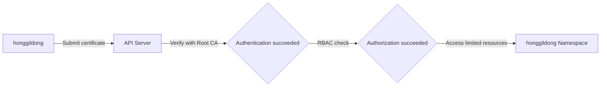

A lab on building a certificate-based environment so that a regular user (`honggildong`) can work only in their own namespace.

---

## Lab Overview

This lab covers the entire process, from issuing an X.509 client certificate to assigning RBAC permissions.

| Step | Task | Notes |
|------|------|-------|
| **1. Generate keys** | Generate a user-specific private key and CSR. | Uses `openssl` |
| **2. Issue certificate** | Sign the CSR using the Kubernetes Root CA. | Requires `ca.key` |
| **3. Configure environment** | Create a `kubeconfig` file to set the connection information. | `kubectl config` |
| **4. Grant permissions** | Grant namespace permissions through a Role and RoleBinding. | RBAC applied |

---

## Lab Architecture



---

## Step 1: Generate the User's Private Key and CSR

To create the certificate that will serve as the user's ID, first generate a private key and a signing request (CSR).

```bash
# Create the working directory
mkdir -p ~/users/honggildong && cd ~/users/honggildong

# 1. Generate the private key
openssl genrsa -out honggildong.key 2048

# 2. Generate the CSR (CN is recognized as the username, O as the group name)
openssl req -new -key honggildong.key \
  -out honggildong.csr \
  -subj "/CN=honggildong/O=developers"
```

---

## Step 2: Issue the Certificate (Sign)

Sign the user certificate using the Kubernetes Root CA key on the master node.

```bash
# Issue a certificate valid for 365 days using the Root CA's key
openssl x509 -req -in honggildong.csr \
  -CA /etc/kubernetes/pki/ca.crt \
  -CAkey /etc/kubernetes/pki/ca.key \
  -CAcreateserial \
  -out honggildong.crt \
  -days 365
```

---

## Step 3: Configure Kubeconfig

Configure the settings file so that you can use `kubectl` commands with the generated certificate.

```bash
# 1. Register the cluster information
kubectl config set-cluster kubernetes \
  --certificate-authority=/etc/kubernetes/pki/ca.crt \
  --embed-certs=true \
  --server=https://172.31.1.10:6443 \
  --kubeconfig=honggildong.conf

# 2. Register the user credentials
kubectl config set-credentials honggildong \
  --client-certificate=honggildong.crt \
  --client-key=honggildong.key \
  --embed-certs=true \
  --kubeconfig=honggildong.conf

# 3. Configure the context
kubectl config set-context honggildong-context \
  --cluster=kubernetes \
  --user=honggildong \
  --namespace=honggildong \
  --kubeconfig=honggildong.conf
```

---

## Step 4: Grant RBAC Permissions (Performed from the Admin Account)

The user is authenticated but has no permissions yet. Grant permissions so that the user can work only in their own namespace.

```yaml
# role-binding.yaml
apiVersion: rbac.authorization.k8s.io/v1
kind: RoleBinding
metadata:
  name: honggildong-admin
  namespace: honggildong
subjects:
- kind: User
  name: honggildong # Must match the CN of the certificate
  apiGroup: rbac.authorization.k8s.io
roleRef:
  kind: ClusterRole
  name: admin # Use the built-in admin permissions
  apiGroup: rbac.authorization.k8s.io
```

**Now a user holding the `honggildong.conf` file can safely perform work only within the designated namespace.**
