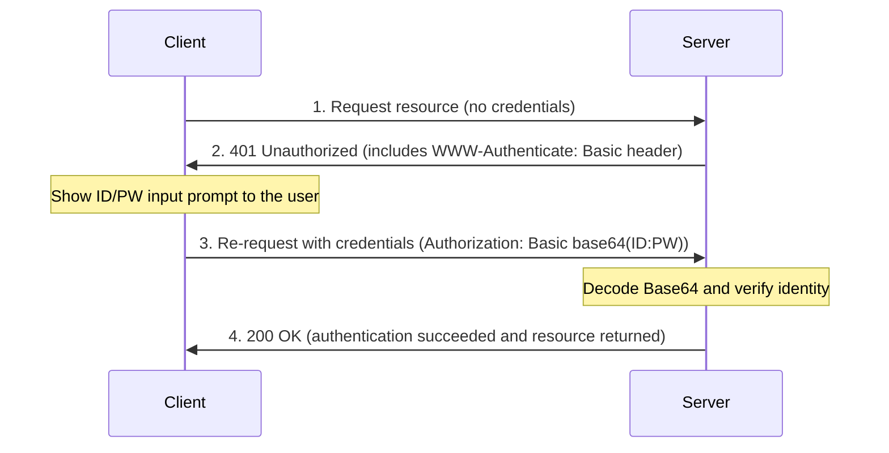

Learn about the concept and characteristics of HTTP Basic Authentication (Basic Auth).

---

## What Is HTTP Basic Authentication?

HTTP Basic Authentication is the simplest method by which a web browser or client authenticates itself by sending a username and password to a server.

### Key Characteristics

| Category | Details | Notes |
|------|------|------|
| **Components** | Username + Password | Joined with the `:` character |
| **Encoding** | Base64 encoding | A text transformation, not encryption |
| **Standard** | RFC 7617 | Standard HTTP protocol |
| **Status** | **Removed after Kubernetes v1.19** | Not recommended for security reasons |

---

## How Basic Auth Works

Authentication is performed using the Challenge-Response mechanism of the HTTP protocol.

---

## Security Vulnerabilities

1.  **No encryption:** Base64 encoding can be decoded easily by anyone, so it must be used together with **HTTPS (TLS)**. When used over plain HTTP, the password is exposed simply by capturing network packets.
2.  **Difficult to log out:** Because the browser keeps the credentials in memory, logging out is difficult until the browser is completely closed.
3.  **Difficult to manage:** User information has to be managed directly on the server side in files or a DB, which makes it unsuitable for large-scale environments.

---

## Alternatives in Kubernetes

Kubernetes no longer supports Basic Auth and recommends the following more secure methods.

- **X.509 Client Certificates:** Strong certificate-based authentication
- **Bearer Tokens:** Use ServiceAccount or static tokens
- **OIDC (OpenID Connect):** Integration with external IDPs such as Google and Okta
- **Webhook Token Authentication:** Delegates verification to an external authentication service

**Basic authentication is easy to understand because of its simple structure, but in production environments (especially Kubernetes), more modern authentication methods should be used for security reasons.**
