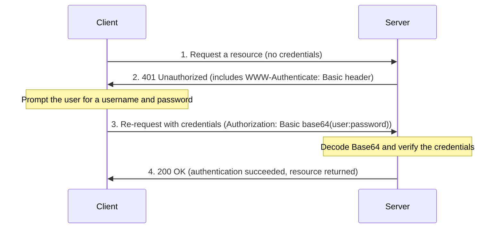

Learn the concept and characteristics of HTTP Basic authentication (Basic Auth).

---

## What Is HTTP Basic Authentication?

HTTP Basic Authentication is the simplest method for a browser or client to authenticate by sending a username and password to a server.

### Key Characteristics

| Category | Details | Notes |
|------|------|------|
| **Components** | Username + password | Joined with the `:` character |
| **Encoding** | Base64 encoding | A text transformation, not encryption |
| **Standard** | RFC 7617 | Standard HTTP authentication scheme |
| **Status** | **Removed in Kubernetes v1.19** | Not recommended for security reasons |

---

## How Basic Auth Works

Authentication uses the challenge-response mechanism of HTTP.

---

## Security Vulnerabilities

1.  **No encryption:** Base64 can be decoded by anyone, so Basic Auth must be used with **HTTPS (TLS)**. Over plain HTTP, the password is exposed by simply capturing network packets.
2.  **Hard to log out:** The browser keeps the credentials in memory, so you cannot log out until the browser is completely closed.
3.  **Hard to manage:** User information has to be managed on the server side in files or a database, which is unsuitable for large-scale environments.

---

## Alternatives in Kubernetes

Kubernetes no longer supports Basic Auth; use one of the following more secure methods instead.

- **X.509 Client Certificates:** Strong certificate-based authentication
- **Bearer tokens:** ServiceAccount tokens or static tokens
- **OIDC (OpenID Connect):** Integration with external identity providers such as Google and Okta
- **Webhook Token Authentication:** Delegates verification to an external authentication service

**Basic authentication is easy to understand because of its simple structure, but production environments (especially Kubernetes) should use more modern authentication methods for security reasons.**
